<p align="center"></p>

# G-Box

A universal game laboratory. One control plane on the **NVIDIA DGX Spark** indexes your game library, launches games on the GPU, streams them to any PC, and lets you inspect memory and graphics, edit RAM and paste assets into Blender. Every action is recorded in a tamper-evident audit log. A tool only gets credit for success when an independent validator confirms its artifacts.

## Using it

- **Desktop app** (Windows): Start Menu or Desktop → **G-Box**.
  - **Play & Library**: search all 63,728 games with box art, then click Play.
  - **Sessions**: watch and control running games, or reopen any past game.
  - **Inspect** (in a session): live game, hex RAM/ROM viewer and editor, memory search, tile/sprite viewer, copy to Blender.
  - **Controllers**: Xbox pads work automatically; assign players or remap here.
  - **Control**: Spark and Windows-node status, install/update, logs.
  - **Click the G-Box logo** to pull the latest code, rebuild the Spark, restart everything and relaunch.
  - Leaving a game turns it into a draggable, resizable picture-in-picture window. Double-click it to go back.
- **Blender**: the G-Box add-on is installed automatically. Copy anything in G-Box, then press **Ctrl+Shift+V** in the 3D view, or enable *Auto-paste* in the *G-Box* sidebar tab.
- **Browser**: open `http://10.89.1.246:8765` and paste the token from `gbox-data/api_token` on the Spark.

## Install

| Machine | Command |
|---|---|
| DGX Spark (control plane + GPU worker) | `bash scripts/bootstrap-linux.sh`. Installs everything: apt packages, NAS mounts, VirtualGL (GPU), RetroArch, cores, BIOS, Ghidra and the systemd service. |
| Windows PC (worker + desktop app) | `powershell -ExecutionPolicy Bypass -File scripts\bootstrap-windows.ps1`, then `clients\desktop\install.ps1` |
| Another PC (from GitHub) | Clone, then run the two Windows commands. The app finds the Spark at `http://10.89.1.246:8765`. It reads the token over the share or SSH, or you paste it once in Settings. |

Dependencies resolve themselves. A missing emulator core, BIOS file or core asset is downloaded the first time a game needs it. To check or repair everything, run `gbox setup` or use *Control → Verify deps*.

## Libraries (`gbox.toml`)

| id | what | Spark path | Windows path |
|---|---|---|---|
| `hyperspin` | HyperSpin Attraction (Attract-Mode): 398 emulator configs, 222 ROM folders | `/mnt/gbox/hyperspin/Arcade` | `\\10.89.1.125\HyperSpin Attraction\Arcade` |
| `gc-iso` | GameCube/Wii ISOs | `/mnt/gbox/quickswap2/Emulation/_emulation/GC ISO` | `\\10.89.1.125\QuickSwap2\...\GC ISO` |

Games with an ARM64 libretro core run on the Spark (rendered by the GB10 GPU through VirtualGL). Everything else (PC games, TeknoParrot, Xbox/PS3+, Switch/Wii U…) launches on a Windows node through the drive's own RocketLauncher.

## Check compatibility

```sh
python scripts/compat_sweep.py --per-platform 1   # launches real games per platform, checks they run and draw, records results
python -m pytest -q                               # 35 tests
```

See [ROADMAP.md](ROADMAP.md) for status and [ARCHITECTURE.md](ARCHITECTURE.md) for design.
