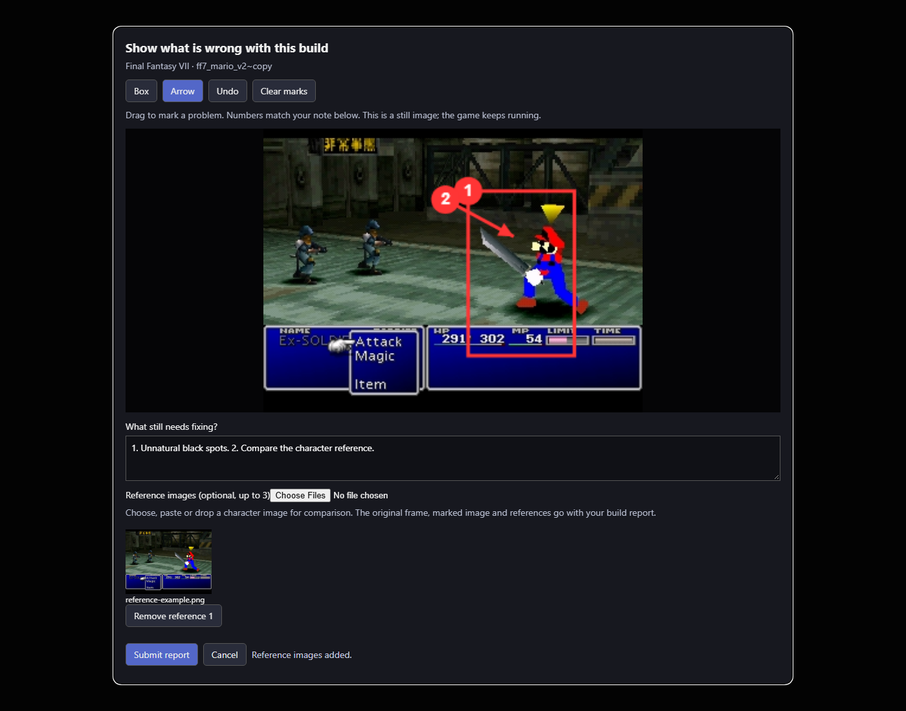

# Annotated reports from the active mod camera

Ctrl-click the camera on the active ROM mod card to capture the current game frame.
Drag boxes or arrows onto the still image; each mark is numbered for the note.
Undo and Clear marks allow corrections. Add up to three character reference images
using the file picker, paste or drag-and-drop. Submit sends the original capture,
annotated image, references and note through the existing build investigation queue,
with the collection build and exact running copy identified. Plain click continues
to save the mod thumbnail. Capture and cancellation do not save, pause, stop or
switch the game, or replace the thumbnail.

This is a real Chromium rendering of the implemented editor. The game image is
the existing real i9-NUC FF7 Mario battle capture from
`../ff7-mario-1819/battle-after.png`. The editor test uses a simulated capture API
and reuses that image as a sample reference attachment; this is UI evidence, not
a new gameplay run or a corrected character reference. The black spots reported
by the operator remain a separate visual defect to investigate.

Validation:

- Ten Python checks cover authenticated nonmutating capture, original/annotated
  image preservation, reference labels, invalid/oversized input, high-resolution
  capture reduction, exact running build identity, and queued ticket delivery.
- Existing build cleanup/report and session image checks passed (27 checks).
- Thirteen existing build-action Node checks passed.
- Three new Node checks passed, including real Chromium pointer drawing, reverse
  box direction, undo, arrows, reference input, retry after submission failure,
  preserved note/images, cancellation, and capture failure/retry. Coordinate
  conversion was checked at a scaled viewport.

PNG/JPEG screenshots are decoded and validated on the server. Client reference
uploads accept PNG, JPEG or WebP up to 4 MB, convert to PNG and reduce to a maximum
1600-pixel edge. Reports accept up to three references, 4 MB per image, and bounded
decoded pixel counts. Normalized high-resolution game captures are kept within
the same report attachment budget. The editor retains the captured moment rather
than taking a different frame when the user eventually submits.
