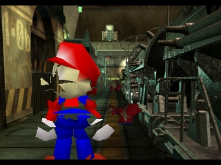
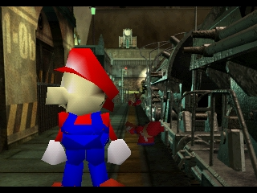
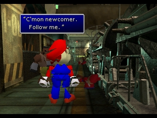
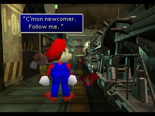
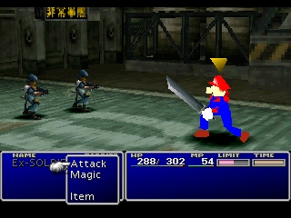
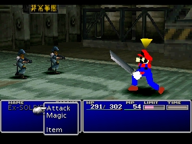
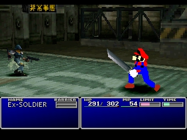
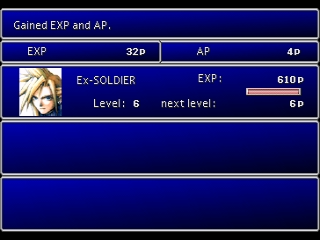

# FF7 Mario: field surfaces and battle textures

These are real emulator frames from agent-owned i9-NUC sessions. Only Mario replacing Cloud was
tested, in the US Disc 1 opening field and first battle. No operator session was used.

## Field comparison

The reported `ff7_mario` build combines arbitrary adjacent triangles into quads. Its field model has
196 quads: 165 have halves whose normals differ by more than 10 degrees, and 11 have oppositely
facing halves. Stock Cloud has 155 quads and no nondegenerate pair over 10 degrees.

The [public native field-renderer analysis](https://github.com/Akari1982/q-gears_reverse/blob/master/ffvii/DISC/FIELD/FIELD.BIN_model_render.cpp)
(`funcae23c`, shaded quad loop) shows that one clipping test on the first three vertices controls
the entire quad. The writer now pairs only exactly coplanar integer geometry with matching colours
on the shared edge. Folded surfaces remain independently culled triangles.

The same new-game route, dialogue, and walking directions were used. These are comparable views,
not identical animation frames. Movement was inspected in both directions. The field model is still
simplified and uses vertex colours: 359 triangles versus 438 in the reported build, to remain within
the native compressed-size and GPU-packet budgets without unsafe quad merging.

## Battle comparison

The previous battle model retained all 752 source triangles but reduced each texture to corner
colours. Interior features therefore disappeared. The new writer keeps textured faces as native
textured triangles, using the original TIM allocation and upload coordinates. It retains 752
triangles, including 50 textured triangles, with a shared 15-colour palette plus transparency.

The first encounter was reached from a fresh boot and completed; the experience result screen rendered.
The model remained visible while moving and attacking. Both captures are terminal and stopped their
own sessions. Other party characters, all later encounters, and the ten special-scene BSX files that
carry separate Cloud meshes were not changed or certified by this test.

## Validation and identity

- 55 focused tests passed: safe quad pairing, colour seams, full s16-coordinate arithmetic,
  native texture round trips, transparent/opaque black texels, allocation refusal, immutable
  rebuilds, local/remote output naming, and existing format regressions.
- Readback of the actual rebuilt disc changed only battle sections 0 (model) and 96 (TIM).
  All other 111 sections, including all 16 weapons, are byte-identical. The field skeleton and
  every parsed field animation equal stock.
- Field: 6,958 / 7,072 compressed bytes; 10,444 / 11,724 raw bytes;
  10,032 / 11,764 GPU-packet bytes.
- Battle: 60,301 / 66,694 compressed bytes; 94,204 / 98,364 raw bytes;
  21,236 / 25,744 GPU-packet bytes. Builds also enforce this packet limit.
- Baseline capture: `3ba1b46bb4344b69`, session `122471b0d35e4c28-3bb19a49b6ce4e64`.
- Candidate capture: `dafb115109a44a00`, session `122471b0d35e4c28-1d21898b7ace4a4a`.
- Tested diagnostic: `ff7_mario_texture_probe_1819`. The versioned `ff7_mario_v2` disc is
  byte-for-byte identical (747,435,024 bytes), SHA-256
  `dc665cfa1fcfa8b4b8c8dfc7ac03a423dcb8d575ea254c4f6f9d5cf8fe0d73de`.
- Rebuilt payload hashes: field `471fdc80ae7eca963b5c0ab1a18d57c8d386918a58d94f4f163944e84fe855df`;
  battle `4f40da116efe15c8a65a9c72226c48c58514364d83c9a195c9e972204cabb61b`.

Old builds and previews were preserved. Current-version builds use separate names; explicit
rebuilds create a new suffix. Donor textures that exceed the native TIM allocation are refused,
and textured weapons sharing that TIM require a preservation path before replacement.
