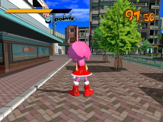
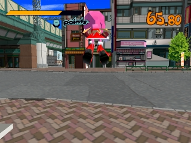
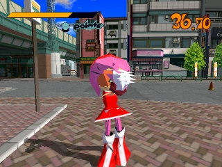
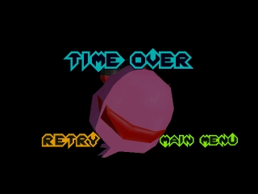
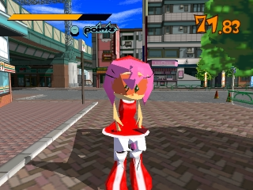
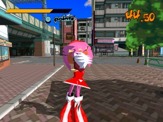
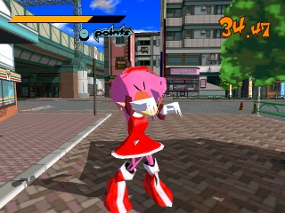

# JGR model relocation evidence

These are real emulator frames from an agent-owned i9-NUC session, not offline renders.
Only Amy replacing Beat was built and tested. No operator session was used.

- Build: `jgr_sa2_amy_rose_04_4dc0d83595b03488` (schema 7, 500 triangles, native ID 0/archive 04).
- Capture job: `b059e40e760c4e2b`; session: `122471b0d35e4c28-349d5a44220f4847`.
- New Game was selected from the observed menu. The game was paused between inspection steps.
- Analog-stick movement changed the player's position; Dreamcast A produced the captured jump.
- Player rendering continued from timer 91.50 to 36.70 (over 54 seconds of game time).
- After another 40 seconds the TIME OVER menu rendered. This frame alone does not establish a separate
  head or texture defect; its camera angle differs from the gameplay front view.

These frames prove the pointer fix reaches and sustains player rendering; they do not prove every visual issue is resolved or
that every alternate draw group was exercised. The reported build's earlier single black frame is not
accepted as proof of a sustained crash, and its stock comparison never reached the same gameplay point.

Ghidra analysis of the owned US executable identified PLAY loading at `0x8c0c75f0` and recursive
in-place pointer relocation at `0x8c0c7278`. An offline transcription of that routine, using an illustrative
RAM base, found 0 invalid list pointers in stock, 100 in the reported build, and 0 in this rebuilt archive.
This is not a live RAM capture. The new regression test failed on the previous writer with 78 invalid
pointers and passes after assigning a model record to each object. All 131 JGR tests passed on Spark,
including owned-disc checks; the portable Windows run passed 107 with 24 owned-disc skips.

Original frame artifacts (handoff, jump, sustained):

- `d9d3ac25287b3754fe6a20416084115c682f3a84a84dc98b616c52cc722a045a`
- `435da8f0474208b7a81253e7da6bdc71c85421940ce34ddcc70a6674654a1c5a`
- `5ddf7a355a9cd5e78cb685155a1eec1f4319858da32ff4e5a1f8b56148a0f5c0`
- TIME OVER: `f03273703be5f8a54f04e8cc0fa6b12e76bd09143aa23c0ab2e5d0fd6d2e0190`

## Follow-up: distinguish the idle glove pose from a face defect

A second capture of the same schema 7 build, without any face-hiding changes, reached New Game,
Gum's tutorial, and player control on idle i9-NUC. Capture `93d09960c2b649a9` succeeded and stopped
its own test session. These are inspected real emulator frames, not offline renders:

The early frame has a visible face. The white finger-shaped area in the later frames moves with the
glove during the idle pose. The prior claim that this area demonstrated corrupted facial geometry was
too strong. A diagnostic that hid the stock expression objects still showed the same white area after
idling; it did not establish a visual benefit. That experiment is not part of the shipped writer.

Native inspection also found that draw group 5 contains small eye/mouth expression meshes, not a
second complete head. The earlier claim that TIME OVER conclusively showed an incorrect separate
head is withdrawn pending a matched camera comparison. These observations do not certify full-game
visual quality, spray-can draw groups, or other character replacements.

Follow-up frame artifacts (early, idle, later):

- `37b2c6747c056406a63660d178619fc9e0d827e94824887e9d650c89bc9b4888`
- `2913c318b1bba4b579eb2938699c540469d4ac1fcd34884431a8577243a8da07`
- `e54305b36d8b1bd373aac1dcc40f5e65e0a8ed6b04c046eb9f01fc6a84884d54`
