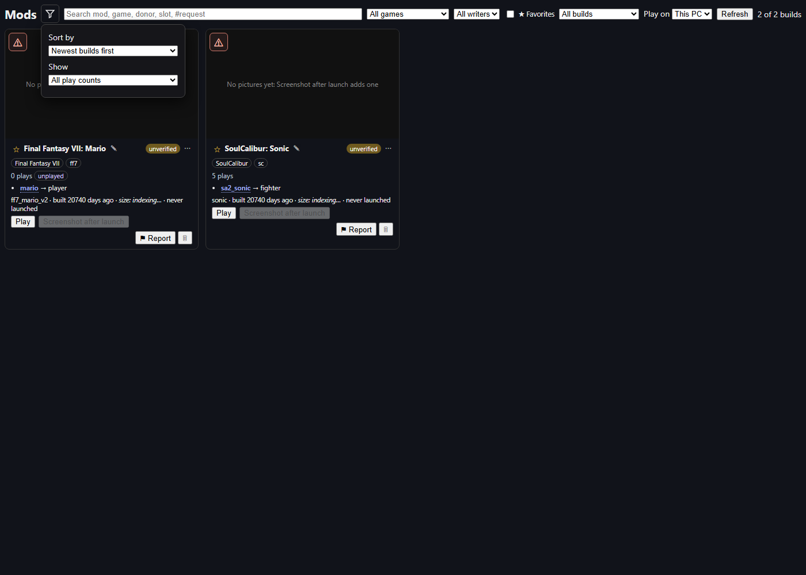
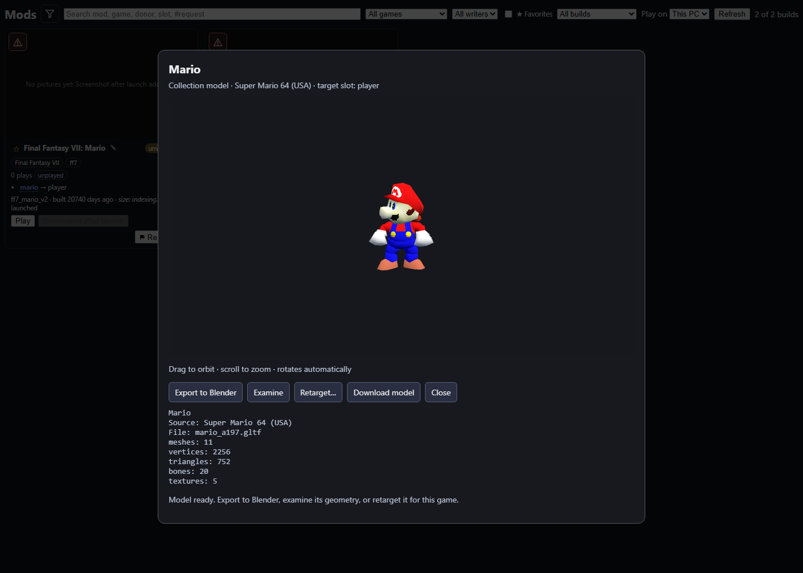
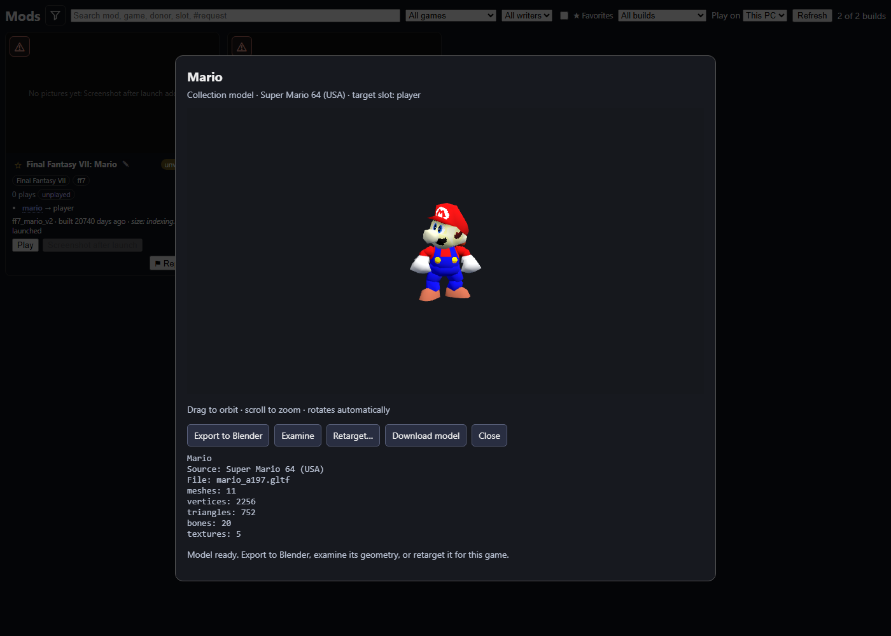

# Mods ordering, play history and character popup

The funnel icon beside **Mods** opens sorting and play-history filters. The default
is newest builds first, including when older builds are favorites. Other choices
are oldest, favorites, unplayed first, most played, recently played, and name.
The play-history filter can show all, unplayed only, or played only.

Cards show the recorded player launch count and mark zero-count builds **unplayed**.
Failed starts, stock sessions and automated agent test sessions are excluded.
Staged copies count toward their collection build, duplicate session IDs count once,
and a session explicitly claimed by the operator counts as a player session.
Historical counts reflect the session records retained by gBox. If the server has
not supplied a count, the UI says it is unavailable rather than labelling it unplayed.

The gallery screenshot uses two synthetic listing records to show the zero and
nonzero count states; those counts are not claims about the operator's library.

Clicking a donor name in a Mods card or a character name in the session library
opens the shared collection-model popup. It rotates automatically and supports
orbit/zoom, a geometry summary under Examine, downloading the model, copying it
to Blender through the existing clipboard action, and opening the existing
Retarget editor with the selected game's slot.

These two popup screenshots render the real `mario` collection model, fetched
read-only from Spark, with the production Three.js character viewer in Chromium.
I inspected both frames. They are collection-model renders, not in-game evidence.
No game or Blender instance was launched for this check. The surrounding gallery
records and usage counts are fixtures. Blender and retarget action arguments were
tested with callbacks; the existing tools perform those operations on user click.

Validation: 18 Python checks passed across the existing gallery suite and new
play-history cases. All 40 Node checks passed across Mods, shared build actions,
sort/filter labels and the real-browser popup flow. Tests cover staged copies,
duplicate IDs, agent exclusion, operator ownership, failed starts, newest-first
despite favorites, unplayed filtering, exact character/game/slot handoff, geometry
inspection and viewer disposal. Client CRLF and git whitespace checks passed.
