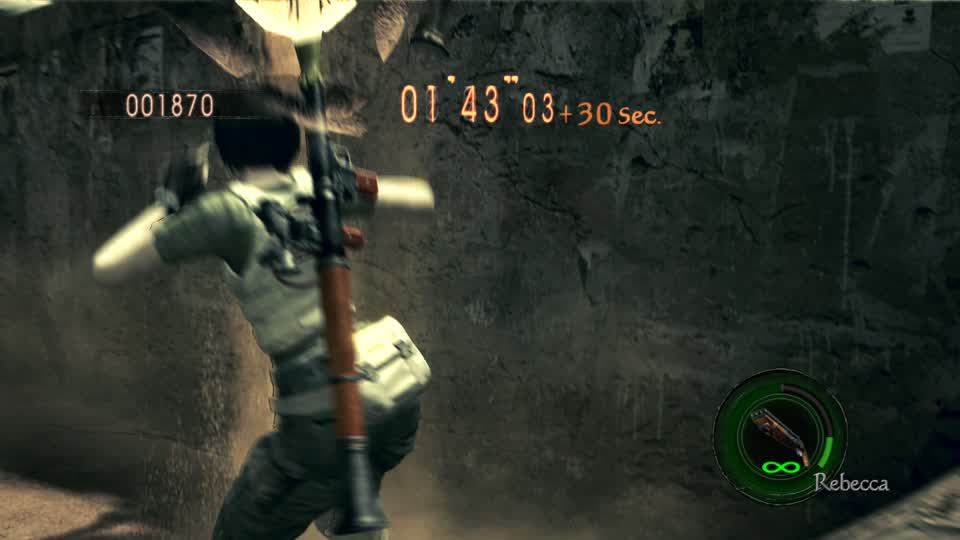
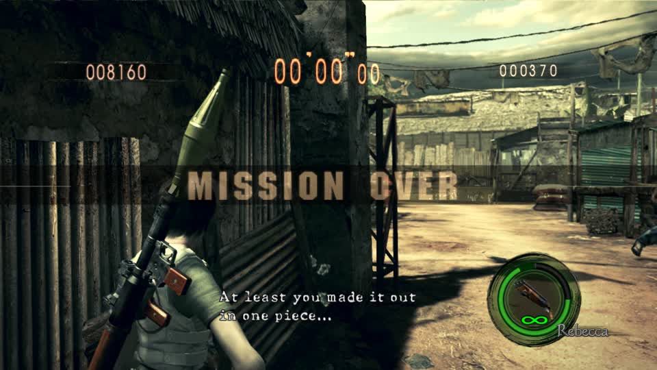

# RE5 live validation, October 21

These are unedited actual gameplay captures, not mockups. Session
`e488be8ecd2a445b-541d53c4bee54a34`, RPCS3 PID 3849229, BLUS30491 app 01.01.
The bounded fresh controller used deployed main `d2e452e9` and restored the cached autoplay controller afterward.

The game displays +30 seconds, green health and unlimited Hydra ammunition. Across the run, RAM evidence
recorded two time bonuses, 24 kills, 26 shot events and 23 associated hits. Sampled health stayed at 30,000.

This frame is the mission-over transition, not a completed score-results screen. Its score tally is still
animating. Last active bot telemetry reported 8,050; the last RAM sample reported 8,420. The round is below
the 60,000 solo S-rank threshold. No winning-round acceptance or 80 actual shots per second is claimed.

Detailed private telemetry and the bounded runner remain under
`~/gBox_alt/scratch/re5-validation-20261021/run3`. No game binaries or extracted game assets are published here.
