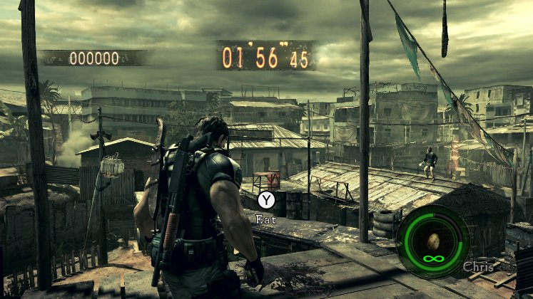
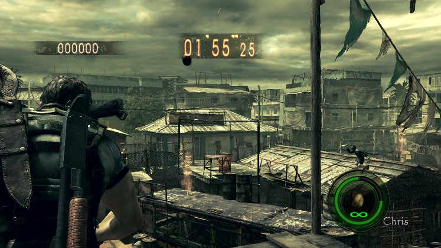

# RE5 Switch rotten eggs: live check, October 27

These are unedited frames from the real game, cropped to the game area. They are not mockups. They come from a
private Citron NEO session on the Spark (Xvfb :97, nice 15, the agent's own home; not MercMode's session), at 13:14
CST in RE5 v1.0.0 (010018100CD46000), The Mercenaries United, No Mercy, Chris (BSAA). The log is kept at
`~/gBox_alt/scratch/agent/switch/runs/egg_131433.log`.

Before the round, Chris (BSAA)'s template record 1 (bank 1, descriptor 14) was set to 0x136, the egg, and definition
0x36's no-ammo flag was set to 1. The round's inventory then held `0x136 x5 @ grid 1`.

Two taps of D-pad up brought it to hand. With the egg in hand, Y is "Eat" (eggs are recovery items too).

With ZL held, ZR tapped at 0.7 s throws it. The motions read 22 (raise) and 26 (aimed), then 29 at 0.76 s (the throw:
the arm back, the egg in the air), and 26 again at 2.06 s. The count stayed at 5 under the no-ammo flag. ZR alone does
nothing.
