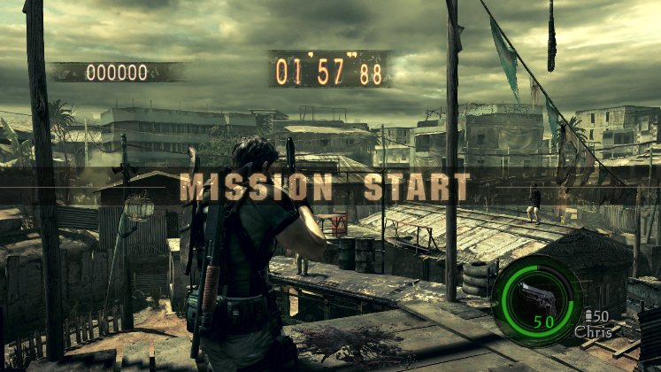
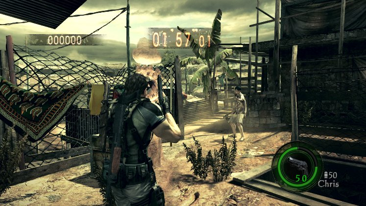
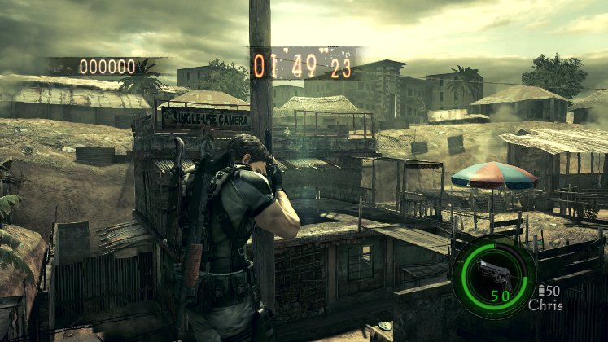

# RE5 Switch hourglasses: live check, October 27

These are unedited frames from the real game, cropped to the game area. They are not mockups. They come from four
private Citron NEO sessions on the Spark (Xvfb :97, nice 15, the agent's own home; not MercMode's session), between
14:23 and 15:01 CST, in RE5 v1.0.0 (010018100CD46000). The logs are kept at
`~/gBox_alt/scratch/agent/switch/runs/` as `hg_run_1423.log`, `hgb_run_1434.log`, `hgm_run.log` and `hgw_run.log`.

**The pickup frame has not been captured yet.** No probe managed to break a statue, so the game's own "+120 Sec."
has not been seen on screen. The scan and the scaling are verified by reading memory back (below).

## What was wrong

`time_bonus_multiplier` looked for vtable main+0x1BD71D8. That belongs to `uOmHourGlass`, the parent class, which no
stage places. The standing statues are `uOm0100` (vtable main+0x1BD6D58). The scan found none in the 13:14 round. With
the fix it finds all of them.

## The scan and x2, read back

This frame was taken at mission start (clock 1:57.88), right after the scan and x2 in that run (14:24):

| unit | class (vtable) | position (cm) | s16 before | s16 after x2 |
|---|---|---|---|---|
| 0x5d4a91d130 | uOm0100 (0x1bd6d58) | (-2087, 256, -1744) | 60 | 120 |
| 0x5d4a9400a0 | uOm0100 (0x1bd6d58) | (382, 460, -1030) | 90 | 90 * |
| 0x5d4a96d1a0 | uOm0100 (0x1bd6d58) | (717, 387, 1904) | 90 | 90 * |
| 0x5d4a9780a0 | uOm0100 (0x1bd6d58) | (876, 108, -3811) | 60 | 120 |
| 0x5d4a9729a0 | uOm0100 (0x1bd6d58) | (-1161, -204, -3620) | 60 | 120 |
| 0x5d4a9800a0 | uOm0100 (0x1bd6d58) | (35, 303, 29) | 60 | 120 |
| 0x5d4a95a8a0 | uOm0100 (0x1bd6d58) | (-1449, 230, -366) | 60 | 120 |
| 0x5d4a944e80 | uOm0100 (0x1bd6d58) | (-488, 0, -389) | 60 | 120 |

\* In that first run the value list had only 30 and 60. 90 was added after it. In the 14:35 run, all 8 scaled:
`{'hourglasses': 8, 'scaled': 8, 'hourglass_seconds': [120, 180], 'verified': True}`.

Every unit on sUnit line 13 was listed by class. The 8 statues are the only `uOm0100` units there, and no
`uOmHourGlass` units were found.

## What the three pickup tries did

1. **14:23, Chris's position written onto a statue.** The write doesn't hold. The character controller keeps his
   own position, and the clock showed no bonus.
2. **14:35, Chris's position written 1 m from a statue, then the knife (L + ZR) and the gun.** The write didn't
   hold again: he stayed 14.2 m away, and nothing broke.
3. **14:47, the statue's own position written 1 m in front of Chris.** The value held, but neither the model nor
   its hitbox moved: the frame shows nothing in front of him, and the knife and the gun hit nothing.

   

4. **14:59, Chris walked to the nearest statue with the sticks.** He spawned on a rooftop, 14.2 m from it and 1.6 m
   above it, and never moved. The walk gave up after 4 s.

   

The "+NN Sec." frame should come from a MercMode RE5 turn where the bot breaks a statue with the multiplier on, or
from a private round that spawns on the ground.
