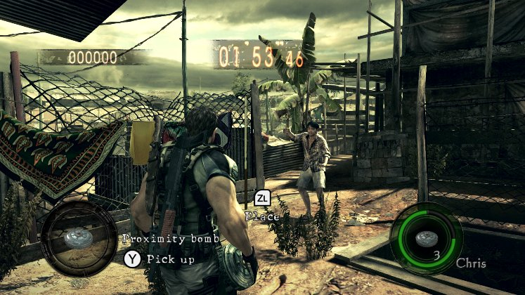
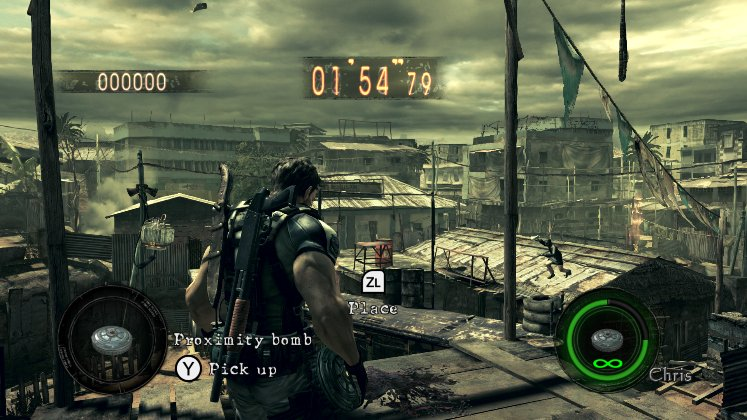
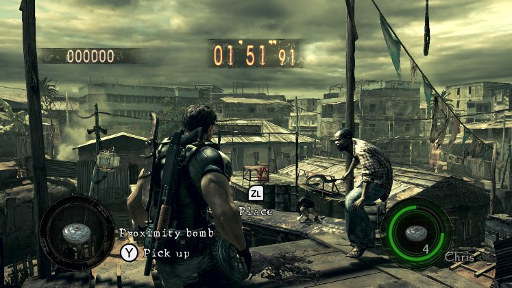
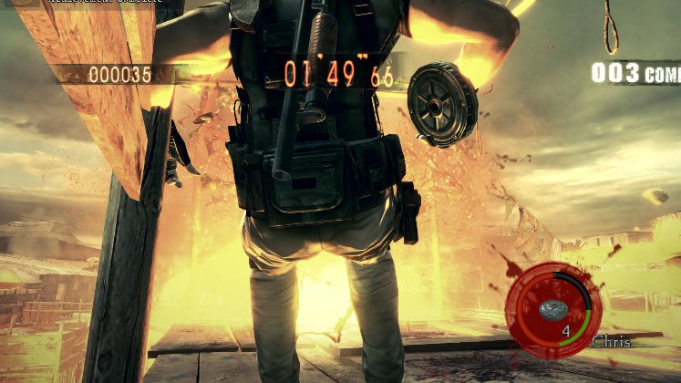

# RE5 Switch proximity bombs, live check, October 27

These are unedited frames from the real game, cropped to the game area. They are not mockups. Two private Citron NEO
sessions ran on the Spark (Xvfb :97, nice 15, the agent's own home; not MercMode's session):
`mine_probe2.py` at 08:46 and `mine_probe3.py` at 08:55 CST, both in RE5 v1.0.0 (010018100CD46000), The Mercenaries
United, No Mercy, Public Assembly, Chris (BSAA). The full logs are kept under
`~/gBox_alt/scratch/agent/switch/runs/mine2_084603.log` and `mine3_085456.log`.

Before the round, each run edited Chris (BSAA)'s loadout template (`re5_switch_mods.mine_loadout`: record 1, id 0x106
-> 0x10A, in both banks). The round's inventory then held `0x10a x5 @ grid 1`.

Run 1 held ZL alone for 1.5 s with the bomb in hand. The count went 5 -> 3, and two new `uWp0a` units appeared on
sUnit line 11, both about 57 cm ahead of his feet. The motion byte read 29 at 0.05 s, 0 at 1.27 s, 29 again at 1.30 s
(the second placement, ZL still held) and 0 at 2.54 s. "Proximity bomb / Y Pick up" shows beside the bombs.
ZL+ZR (ZR pressed for 0.25 s at 0.6 s) did exactly the same: two more bombs, count 3 -> 1, nothing thrown.

Run 2, A: the bomb definition's +0x1C no-ammo flag was set to 1, as MercMode's `infinite_ammo` sets it, and ZL was
tapped for 0.25 s. The motion read 29 at 0.17 s, a new `uWp0a` was on the ground 57 cm ahead at 0.69 s, and the
motion read 0 at 1.41 s. The count stayed at 5, and the HUD shows infinity.

Run 2, B: the same tap with the flag off. The motion read 29 at 0.02 s. At 0.57 s the count fell to 4 and the bomb
was on the ground 57 cm ahead. The motion read 0 at 1.27 s. One tap places one bomb.

Run 2, C: Chris walked back for 1 s. At 1.47 s Majini came within about 1 m of the two bombs, and both went off.
Kills went 0 -> 3 and the score 0 -> 900. Chris's health fell 1000 -> 300 at 3.8 m from the blast (motion 4). The
bombs' units left line 11 at 1.59 s. His own bombs hurt him: `re5_switch_mines` never stacks two, never places one
with a Majini within 8 m, runs him 8 m out of the blast after the placing motion, and runs him off a bomb a Majini
reaches.

Not shown by these frames: a MercMode round with the controller placing bombs by itself. That needs a deploy and a
live turn.
