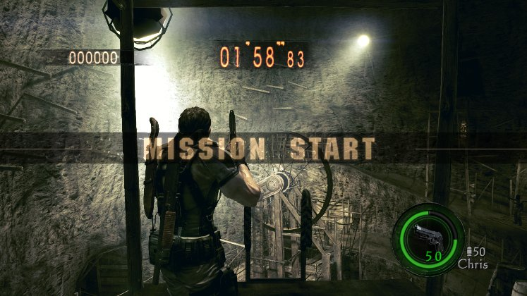
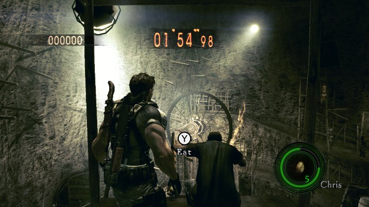

# RE5 Switch parity, step 2: live finds, October 27

These are unedited frames from the real game, cropped to the game area. They are not mockups. They come from a
private Citron NEO session on the Spark (Xvfb :97, nice 15, the agent's own home; not MercMode's session), at 10:42
CST in RE5 v1.0.0 (010018100CD46000), The Mercenaries United, No Mercy, Chris (BSAA). The ops ran through the step-2
code (`re5_switch_mods.tool_run`) on an adapter over that emulator's memory. The log is kept at
`~/gBox_alt/scratch/agent/switch/runs/step2_104221.log`. MercMode's stream pacing p95 stayed 26-60 ms, with no stall.

`mercs_select` (stage 1, Chris (BSAA)) moved the stage-select target. The menus walked the cursor 0 -> 1 there and
0 on the character select, and the round opened in The Mines ("MISSION START" in the shaft). The default is
Public Assembly, stage 0.

Definition 0x36 is `WP36 EGG_X` on Switch too. With Chris (BSAA)'s template record 1 set to 0x136, the round's
inventory held the egg x5 at grid 1 (the HUD's egg, 5). A ZL tap raised it (motions 22, 24) without a throw, and the
count stayed at 5. So the egg throws with ZL + ZR, as a gun fires; that, and the egg mode itself, come next.

The same run read, in the round:
- the upgrade table (sParameter::WEAPON_LEVEL_STRUCT, 0x210 a weapon): the M92F's firepower 150 / 170 / 190 / 210 /
  230 / 250 at +0x18 (the PS3's 150 at level 0), groups 0x40 apart, firing speed 26 at +0x58;
- sParameter (its pointer at main+0x1CF1C30): the walk / run turn 110.0 at +0x34, the stick range 0.2 / 1.2 at
  +0x70 / +0x74, the aim pitch / yaw 57.9 at +0x2D0 / +0x2D4.
`bullet_damage` and `turn_speed` are built on these (read back in their tests); their live effect check is next.
