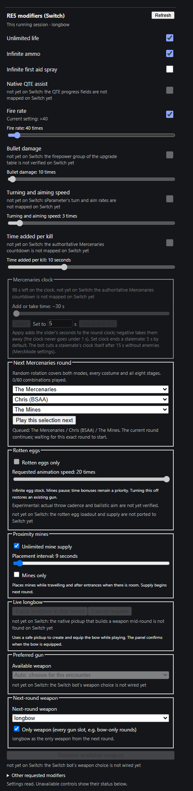

# RE5 modifiers panel on a Switch session (parity step 3)

This is NOT a live app frame. It is the panel's own code (`clients/web/viz/re5-modifiers.js`, `html()`), rendered by
headless Edge with the panel's CSS. The status it was given mirrors what the Switch worker answers after parity
step 1: the bow-only override, fire rate x40 and unlimited health on, and the capabilities of the live check of
2026-10-27 10:03. A live frame of the desktop app follows once the deploy and the app update are in.

On a Switch session (game 52d15709be0fda1a, adapter citron or eden):
- the heading reads "RE5 modifiers (Switch)";
- the Team and training block is left out (Player 2 control is PS3 / RE6 only);
- every control the Switch worker can do is live: the toggles, fire rate, the next Mercenaries round (No Mercy's
  roster), mines and the next-round weapon;
- every control it cannot do yet is disabled and shows the worker's "not yet on Switch: why".

The next-round weapon now has its own fieldset. Before, it sat inside the "Preferred gun" fieldset, which is disabled
when the live gun choice is unavailable, as it still is on Switch.
