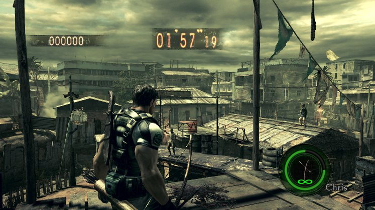
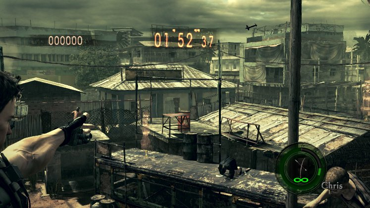
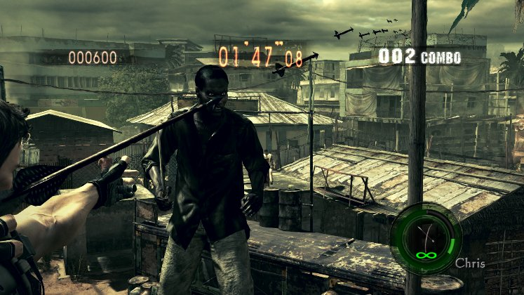

# RE5 Switch parity, step 1: live check, October 27

These are unedited frames from the real game, cropped to the game area. They are not mockups. They come from a
private Citron NEO session on the Spark (Xvfb :97, nice 15, the agent's own home; not MercMode's session), at 10:03
CST in RE5 v1.0.0 (010018100CD46000), The Mercenaries United, No Mercy, Public Assembly, Chris (BSAA). The ops ran
through the step-1 code (`re5_switch_mods.tool_run`) on an adapter over that emulator's memory. The log is kept at
`~/gBox_alt/scratch/agent/switch/runs/parity_100247.log`. The run stopped itself if MercMode's stream degraded; the
pacing p95 stayed 34-71 ms and no new stall appeared.

Before the round: the descriptor table found all 54 Mercenaries loadout blocks. `loadout` drew powerful guns into
52 of them (block 15 became AK-74 / Gatling / Lightning Hawk / S&W M500), then `weapon_override` with the longbow
only wrote 111 records in 52 blocks, each read back.

The round's inventory read `0x10f` at grid 3 (in hand) and grid 5; the grenades, spray and knife stayed. The HUD
shows the longbow with infinity (`infinite_ammo`). Block 24's grid 5 had been set to the S&W M500 by hand, but grid 5
held the bow: No Mercy builds Chris (BSAA) from descriptor 14 (bank 1). `unlimited_health` raised his health from
1000/1000 to 30000/30000 on the first snapshot, and it stayed 30000 through the fire.

ZL + ZR held for 4 s at x1.

The same 4 s at `fire_rate` x40 (the player's time scale while his shot motion plays). Arrows stream across the sky,
one is hitting a Majini, and the score reads 600 with a 2 combo. With the bow held, the shot motion (29) stays on for
the whole hold, so the speed-up covers the draw as well.

Then `revert_all` put every block back.
