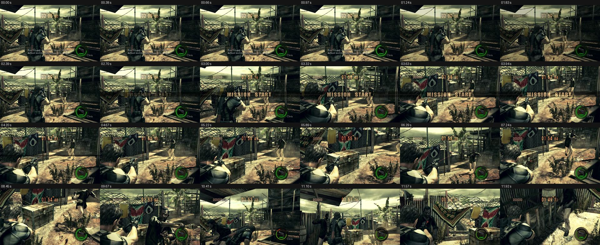
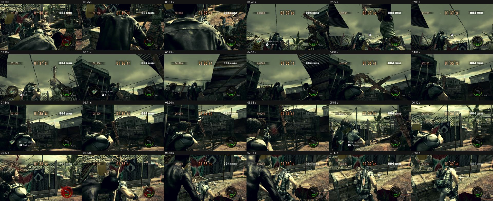

# RE5 Switch aim smoothness: live frames, October 27

These are contact sheets of real frames from MercMode's own RE5 Switch stream, read-only through the session's
`frame.jpg`, taken every 0.25 s for 12 s by `frames_now.py` with the agent actor. The game was not touched.

11:44:12, the round's start with #1322: long aim at a far Majini, then close quarters.

12:06:04, with #1323 and #1325: from 2.5 s to 4.6 s the camera points at the sky. The aim is pitched up at a Majini on
a roof (inside the 3 m level window) while ground Majini close in, and at 6.4 s he is grabbed (red health ring). This
is what the level-aware target cost and the pitch-swing limit address.
