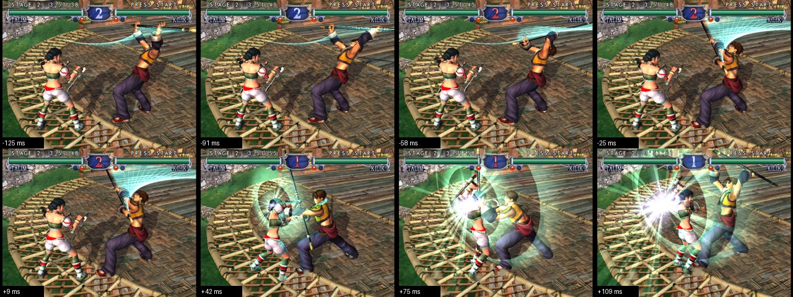
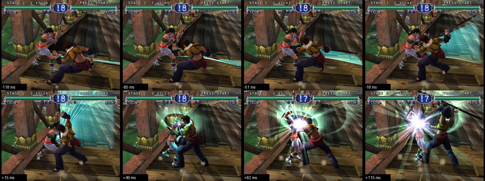
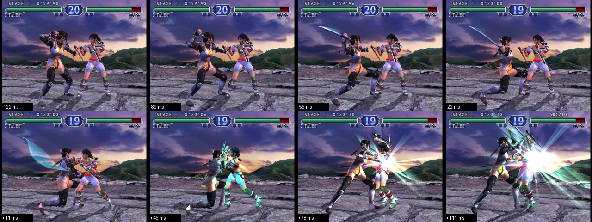
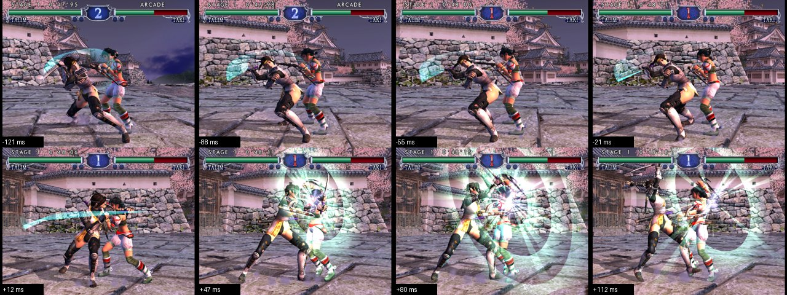
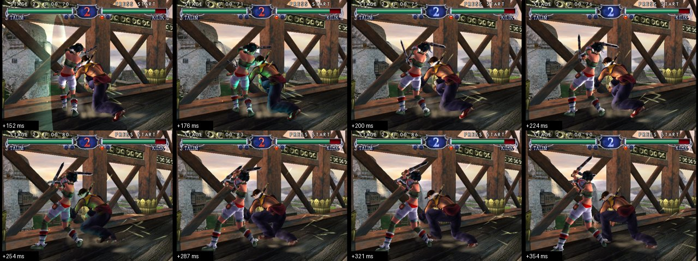
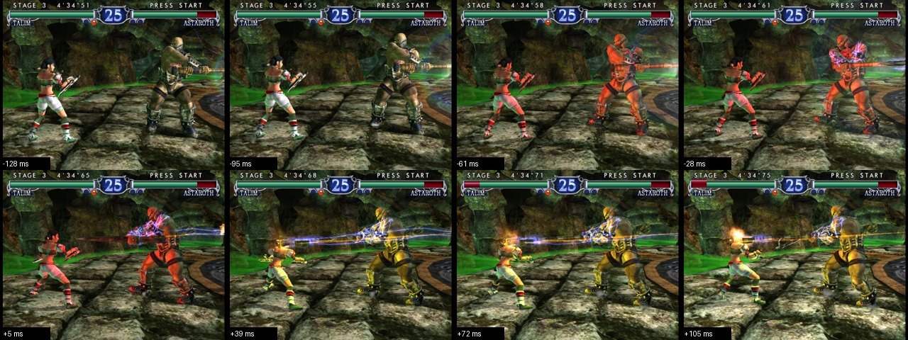
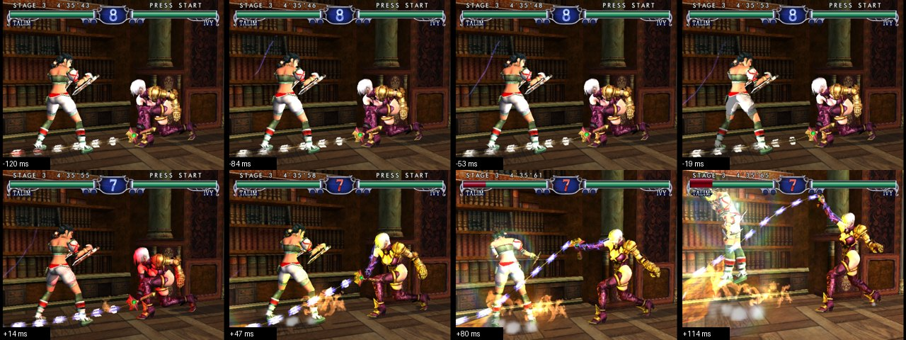

# Soul Calibur II: perfect defence from RAM (`gbox/sc2_bot.py`)

Operator, 2026-10-20: "for soul caliber. The autoplayer for player 1 should know how to parry / soul block every attack
and never be able to get hit as a result."

Every image here is a **real game frame**: Dolphin's picture grabbed from its X display (XGetImage, 60 a second) while
the playbook played. The frames around each event were saved by the RAM event itself (P1's hit result turning to 11 =
"this fighter Guard Impacted the attack", or to 4-7 = hit), not picked by eye; the label under each frame is its time
from that RAM event. Nothing is rendered or edited; the sheets are 8 of those frames side by side.

Setup: Soul Calibur II (USA, GRSEAF, the HyperSpin GCZ), Dolphin 2609a (flatpak) on the Spark, started by hand (a
private display, `nice`), because gBox's lilspark worker was running another agent's RE4 sessions and the i9-NUC went
to the DOA3 work. P1 Talim (gBox keys: G = `b`, B = `y`), P2 the CPU. Keys went through xdotool exactly as gBox's
Linux `send_input` sends them (`run_bot_send.py`), RAM through `/proc/<pid>/mem` read-only (as `ram_dump.ShmRam`).

## Guard Impacts (the GI flash)

| | |
|---|---|
|  | **Repel (6G) vs Kilik's overhead staff (high 0x49, active frames 17-19)**, Arcade stage 2. RAM showed the record at the move's first frame; 6G was sent so it reached the game 5 frames before frame 17. The green ring and the white burst from +42 ms are the game's GI effect; Kilik is thrown back into the 40-frame stagger, and the punish B followed. |
|  | **Repel vs a Kilik mid (0x4B)**, Arcade stage 2: the burst at +15..+65 ms. |
|  | **Repel vs Taki's special mid (0x1B)**, Arcade stage 1 (final code). |
|  | **Repel vs Taki's high**, Arcade stage 1 (final code): the trail of her blade meets the ring at +47 ms. |
|  | **Parry (4G) vs Kilik's low (0x37)**: the frames start 150 ms after the GI (the grabber was saving the previous event); Talim has turned Kilik, who staggers past her. |

## What still gets through

| | |
|---|---|
|  | **Astaroth's unblockable thrust (0x41, active 29-34)**, Arcade stage 3, final code: the red glow is the game's unblockable warning. The bot sidestepped (held up) 14 frames before; the thrust still caught her. 0x41 does not hit a crouching fighter (no 0x02 bit), so crouching is the fix to make next. |
|  | **Ivy's whip string, earlier code**: 0x168 hits 2 frames into its own move and 0x169 (unblockable) 3 frames into its own, too late to react to. This is why the bot now reads the **queued** next move (action layer +0x52, taking over at frame +0x60) before it starts; against Ivy at Ultra Hard that took the hits from 27 in 8 minutes down to 4 in 6 minutes. |

## Measured (RAM counters, the playbook's own stats)

| run | input | time | attacks | GIs landed | guards | hits taken | damage | rounds won / lost |
|---|---|---|---|---|---|---|---|---|
| Practice VS CPU, Raphael, Ultra Hard (book v1) | XTEST | 10 min | 395 | 251 | 18 | 4 | 130 | (practice) |
| Practice VS CPU, Raphael, Ultra Hard | xdotool | 10 min | 413 | 253 | 59 | 2 | 25.7 | (practice) |
| Arcade, Normal (stages 1-9, permissive book) | xdotool | 21 min | 502 | 322 | 35 | 8 | 251 | 17 / 0 (+1 lost after the bot was stopped) |
| Arcade, Normal (cautious book, no look-ahead) | xdotool | 20 min | 626 | 99 | 368 | 12 | 518 | 12 / 4 (all 4 to Ivy) |
| Practice VS CPU, Ivy, Ultra Hard (look-ahead) | xdotool | 8 min | 446 | 117 | 120 | 27 | 386 | (practice) |
| Practice VS CPU, Ivy, Ultra Hard (+ distance book, held-G rule) | xdotool | 6 min | 290 | 84 | 65 | 4 | 49 | (practice) |
| **Arcade, Normal, final code** | xdotool | 15 min | **465** | **146** | 190 | **14** | 186 | **13 / 0** (Taki, Raphael, Astaroth, Cassandra, Ivy, Mitsurugi 2-0; Yunsung 1-0 when the run ended) |

GIs landed = P1's hit result 11; hits taken = P1's hit result 4-7; damage = the drop of P1's health (f32 +0x155C).
In the final Arcade run 451 of 465 attacks did P1 no damage (97 %), 145 punishes after a GI landed 135 hits, and no
round was lost, but P1 was still hit 14 times, so the operator's "never hit" is **not** reached yet. (The runs met
different opponents, so their hit counts are not a strict before / after: the 21-minute Arcade run with the early,
permissive book took 8 hits from another cast.) What the 14 were
(their attack records): lows with long active windows (0x37 active 19-25, 25-31), an Astaroth unblockable (0x41, above),
a Raphael throw (0xC1) the crouch did not beat, and mids (0x4B) that came while P1 was in its own move (after a GI
that met nothing, or a punish the CPU impacted). Rounds were won on time with P1 ahead, 5 of 13 with P1 untouched.
