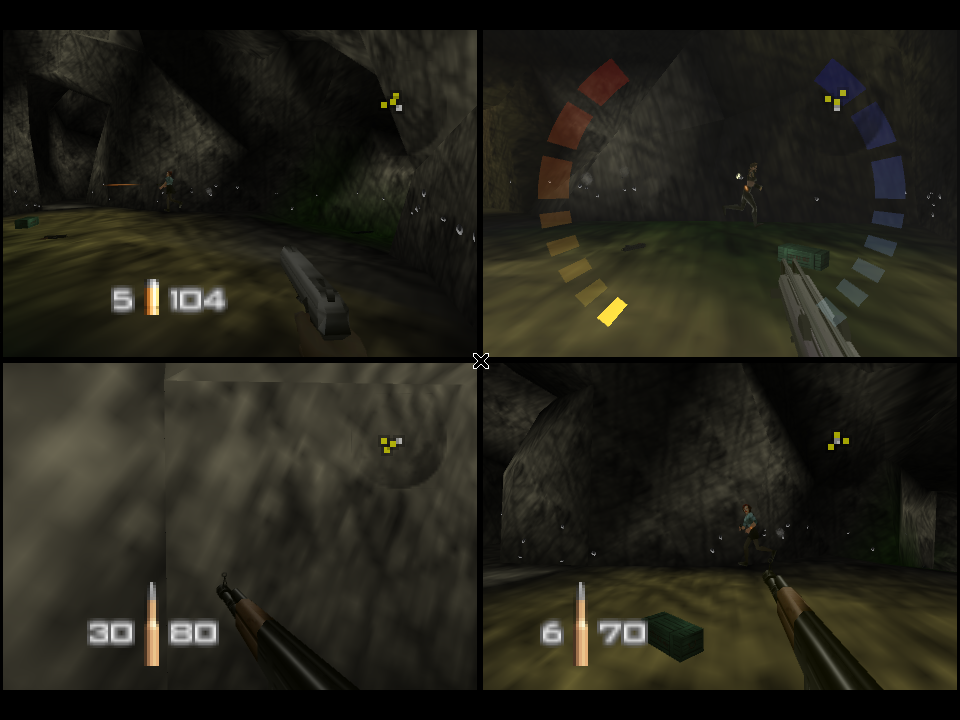
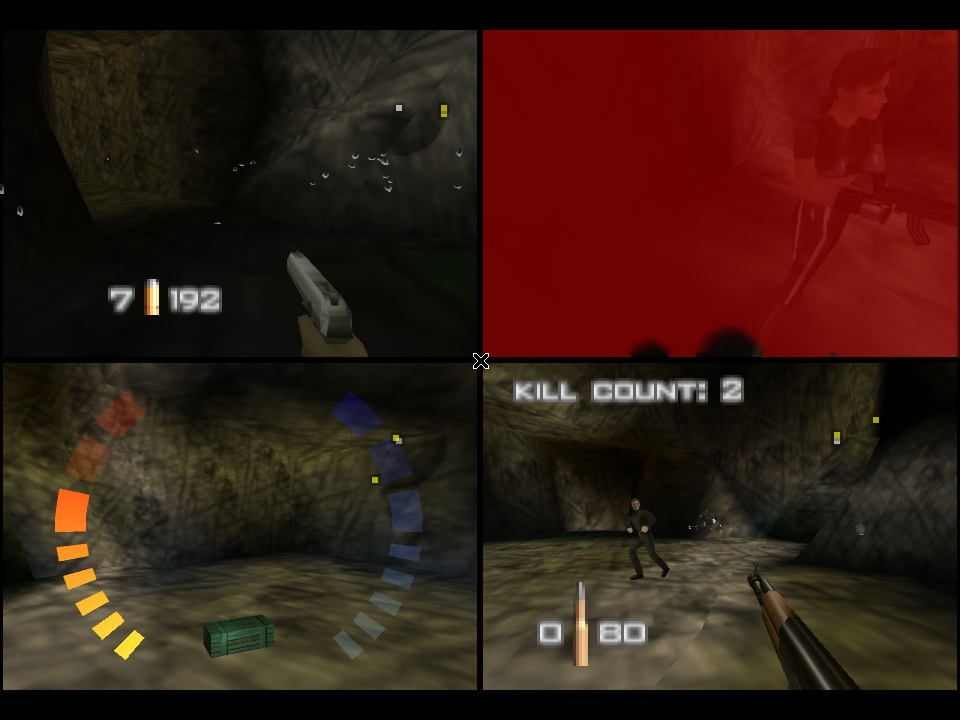
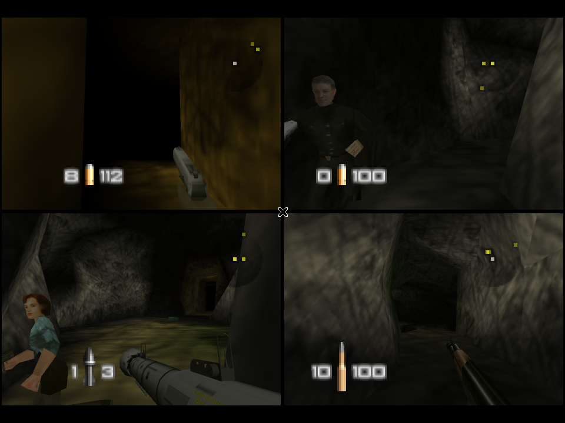

# GoldenEye 007 PC port with gBox bots

Inbox ticket #2865: play the GoldenEye 007 PC port (github.com/jkdansereau/goldeneye-pc-port) in gBox with bots, and
turn the logic behind them into a gBox bot system for automated play.

- **The port** is the n64decomp/007 decompilation compiled for the PC. It ships no bots: its multiplayer is
  human-only, as on the N64.
- **The bots** are therefore gBox's own:
  - a small bridge compiled into a local build of the port (`adapters/ge007_port/gbox_bridge.c`);
  - a game-agnostic brain (`gbox/bot_brain.py`);
  - a GoldenEye driver that plays seats 2-4 (`gbox/ge007_bots.py`).
- **Where they come from.** The algorithms are GoldenEye's own guard AI, read from the decomp and cited below.

Source citations are `file:line` in the upstream tree at the pinned tag **v0.6.0 (commit 5b86a9bb)**. The decomp files
under `src/` are the n64decomp project's, so the upstream repository is the reference: gBox copies none of them.

## 1. The port

| | |
|---|---|
| What | A decompilation-based native port, not an emulator or a recompiler. The game's own reconstructed C (`src/`, unmodified except `#ifdef PORT` pointer-width and timing fixes) runs on PC shims (`port/`): a software RSP that emits OpenGL (`port/fast3d`, from the Perfect Dark port lineage), libultra over host threads, and SDL2 video, audio and input. |
| License | MIT for the port layer, build system, `tools_pc/` and docs (`LICENSE`). `NOTICE`: the inherited decomp files (`src/`, `include/`, `assets/`, `tools/`...) carry no explicit license; `port/fast3d` keeps its own MIT notice. |
| Platforms | Windows 10/11 x64 (MSYS2 MinGW64 is the primary build), Linux x86_64 (CI on Ubuntu 24.04), Steam Deck. v0.6.0 adds an experimental arm64 macOS build. ARM Linux is "not yet". |
| Build deps | CMake 3.16+, GCC (Clang rejects the decomp's `inherits struct` idiom), SDL2, zlib, OpenGL, Python 3. MIPS binutils are only needed to regenerate the committed asset data; a clone already has what the PC build compiles (`docs/building.md`). |
| ROM | The operator's own US ROM, `ge007.ntsc-final.z64`, SHA-1 `abe01e4aeb033b6c0836819f549c791b26cfde83`; PAL/JP are source-only. `data/` holds it, and three pure-stdlib converters turn it into the PC "sidecars" the port loads (`tools_pc/d43_emit.py`, `d69_emit.py`, `d88_emit.py` → `data/pcmodels-*`, `data/pccg-*`). Release bundles run a frozen copy of these on first start. The library's `GoldenEye 007 (USA).zip` (quickswap-n64, game 8922dc0685f267ee) is exactly this ROM. |
| Test harness | `GE_STARTMP="<players>,<mp stage>[,<scenario>]"` starts a multiplayer match from boot (`src/game/lv.c:400`; it starts again after each match). `GE_MPVIRT=<n>` reports n idle virtual controllers (`port/src/input.c:1300`). `GE_INPUTSCRIPT_P1..P3` are open-loop timed button scripts per seat (`input.c:1335`). `GE_PCDUMP`/`GE_QUITFRAME` dump frames and quit. |

**Bots upstream: none.** The roadmap lists "MP bots" as post-1.0, issue #111, noting "GoldenEye's MP is human-only;
Simulants are Perfect Dark" (`docs/ROADMAP.md`). The "bot runs" in `docs/dev/findings.md` (D445) are harness seats
driven by `GE_INPUTSCRIPT_Pn`, not AI. A third party's ROM patcher, linked from issue #111
(IIIIIIIllllllllIIIII/N64-GoldenEye-Multiplayer-Bots-Patcher-v1), adds bots to the N64 ROM for emulators. It
publishes no license or source and patches MIPS code that the port never runs, so gBox does not use it.

**Building on the Spark (aarch64)** needs two fixes. `gbox/native_ports.py` applies both, for aarch64 only:

1. `assets/animationtable_data.h:200` widens the D34 `ANIM_DATA_*` lvalue guard for arm64 macOS only. Linux needs
   it too, or the link fails on undefined `ANIM_DATA_*`.
2. `src/game/bg.c` `sub_GAME_7F0B37EC` walks `specialportalarray` up to `&g_BgCurrentRoom`. That relies on N64 linker
   adjacency. aarch64 GCC places `levelentry_index` between the two, so the walk reads it as a portal record. On
   Temple it spins forever in `load_bg_file`; gdb found it at bg.c:369. The fix bounds the walk by
   `sizeof(specialportalarray)`, and is a candidate to send upstream.

A full build takes 30 s at `-j4` with ccache warm, under `nice 19` and idle I/O. The binary runs on the Spark's GPU
through VirtualGL.

## 2. How gBox runs it

| Piece | Role |
|---|---|
| `gbox/native_ports.py` | Port registry (repo, pinned commit, accepted ROM SHA-1, converters, hooks, per-CPU fixes, ini pins). Tool `native_port` op=status/build/prepare. `PortAdapter` (the session). Catalog entries. |
| `adapters/ge007_port/gbox_bridge.c` | gBox's own C, copied into `port/src/` of the worker's build plus two one-line hooks: `gboxBridgeTick()` once per frame on the game thread (`src/boss.c`, after `joyConsumeSamplesWrapper()`) and `gboxBridgeSeat()` where `inputComputePadSlot` produces each controller's buttons and stick (`port/src/input.c`). With `GE_GBOX_BRIDGE` unset the build plays exactly like upstream. |
| `gbox/ge007_bridge.py` | The shared-memory block, Python side (layout v1, asserted against the C file by the tests). |
| `gbox/bot_brain.py` | The generic brain (section 5). |
| `gbox/ge007_bots.py` | GoldenEye driver: one brain per seat, control-style measurement, weapon picker, N64 pad output. Also the autoplay playbook for player 1 (`PLAYBOOKS` in `gbox/tools.py`). |

**Flow:**

1. `scan_library` adds **GoldenEye 007 (PC port + bots)** to the catalog. It does this for the owned US ROM
   (`native_ports.catalog_entries`; `launch.kind = "native_port"`), using the ROM's library and rel_path.
2. A Play is routed to the Linux worker (`server.py`, `require_os`).
3. `_launch_game` resolves and unpacks the ROM as for the emulator entry, then calls `PortAdapter.launch_game`. The
   adapter:
   1. builds on first use;
   2. copies the ROM in with its SHA-1 checked;
   3. runs the converters once;
   4. pins `Input.NaturalPitch = 0` (1.1 Honey for pads and bots), no mouse, a 960x720 window and no vsync;
   5. starts the port on a private Xvfb display through VirtualGL with `GE_MPVIRT=3` and a per-session
      `GE_GBOX_BRIDGE`;
   6. maps the block and starts the bots on seats 2-4.
4. The session then runs:
   - **Display:** the MJPEG stream and `get_frame` work as for other Linux sessions.
   - **Player 1:** the streamed pad reaches player 1 through the bridge. `send_input` maps gBox pad names to N64
     buttons in `padmap.py`'s N64 layout: A = `b`, B = `y`, Z = `l2`, stick = `l*`, C = `r*`. No window focus is
     needed. The seat goes back to the port's own input 2 s after the last key is released.
   - **Plain Play:** boots to the title. Pick Multiplayer with 2-4 players and the bots fill the other seats.
   - **Autoplay or screensaver launch (jump):** starts a 4-player match on a random arena (`GE_STARTMP=4,1..7`), and
     the `ge007_bots` playbook plays player 1.

**Commands**, as the agent on the Spark:

- Build: `POST /api/jobs {"tool": "native_port", "input": {"op": "build"}, "require_worker": "lilspark"}`.
- Prepare: the same with `{"op": "prepare", "rom_path": "/mnt/gbox/quickswap2/Emulation/n64/GoldenEye 007 (USA).zip"}`.
- A launch does both when needed.
- Bot difficulty: `GBOX_GE007_BOTS=agent|secret|00|007` in the worker's environment (default `00`).

### The bridge block (`GE_GBOX_BRIDGE`, layout v1, 92,608 bytes)

| Offset | Content | Written by |
|---|---|---|
| 0 | header: magic "GBX1", version, size, frame, stage, nplayers, in_match, nav_serial, counts, pid | port, every frame |
| 64 | `players[4]`: position, yaw (`vv_theta`), pitch (`vv_verta`), health, armour, dead, weapon, ammo/magazine, room, nearest walkable node, line-of-sight bits to the other players, kills/deaths/points | port, every frame |
| 384 | `seats[4]`: seq, enabled, N64 buttons, stick x/y, live | gBox (the port writes `live`) |
| 448 | `items[64]`: weapons lying in the level (`PROP_TYPE_WEAPON` props on the active list) | port, every 10 frames |
| 1472 | `chrs[32]`: guards in solo levels (position, alive, health, who sees them) | port, every 4 frames |
| 2496 | `nodes[1024]` + `edges[16384]`: the stage's navigation graph | port, once per stage (`nav_serial` bumps) |

- **Stale seats.** A seat whose `seq` stops moving for 120 frames is released: a crashed bot never walks into a wall
  forever.
- **Line of sight** is the guards' own test, `stanTestLineUnobstructed` over the floor tiles, ending on the target's
  tile (`chrCanSeeBond`). It uses OBJS|DOORS|PATHBLOCKER|AIOPAQUE at eye height 130.
- **Walkability** uses the same test with OBJS|PATHBLOCKER at knee height 40.

### Evidence (real frames, agent-launched on the Spark)

The frames come from `PortAdapter.get_frame` (x11grab of the session display) in an agent session started from this
branch's code. The control plane was not involved, because the branch is not deployed.

- **Setup:** a quick match (`demo`), bots on seats 2-4 (`00`), and the `ge007_bots` playbook on player 1.
- **The arena** was picked at random: Caves.
- **Over 120 s:** 7 kills across the four bots. Kills/deaths: player 1 3/0, player 2 1/3, player 3 0/3,
  player 4 3/1.
- **Earlier harness runs on Temple:** 150 s, 7 kills, all four seats.





A plain Play was also driven through `send_input`: Start ×3 and N64 A ×2 reached the Dam difficulty page
(`evidence/goldeneye-bots/front-end-input.png`).

### Limits and next steps

- **Split screen.** The bots' views share the screen with player 1, as 2-4 player split screen always does. A
  "humans only" view needs the per-player render loop in `lvlRender` to keep ticking bot players while drawing only
  player 1 full screen. Players' logic runs inside that loop (`lv.c`), so this means editing decomp rendering code;
  it is not done.
- **Windows.** Building is not automated (MSYS2 MinGW64; `build-pc.sh` runs an unbounded `-j`). The adapter can
  launch a build that is already in `<runtime>/ports/ge007/src/build-pc/`, as a local window driven through the
  bridge, but this is untested.
- **Doors and gadgets.** Doors open through the stuck handler pressing B. Bots do not throw mines or grenades on
  purpose (they score as weak weapons). Teams (2v2 and 3v1 scenarios) are treated as free-for-all.
- **Line of sight is 2D,** as the guards' is. A target on a balcony directly above is "not visible" until the line
  test reaches its floor tile.

## 3. GoldenEye's guard AI, extracted

Units: 1 world unit ≈ 1 cm. Guard timers are in 60 Hz ticks (`CHRLV_*`, `src/game/chraction.h:28-41`, 50 Hz values
at :11-24). Bearings are `atan2(dx, dz)`. A player's yaw is `360 - vv_theta`: the port moved along bearing 306.5 with
`vv_theta` 53.46.

### 3.1 Navigation: pads, waypoints and sets

**Data**

- Pads: `PadRecord`, `src/bondtypes.h:1761`. Each has a position, up and look vectors, a tile name, and its floor
  tile (`stan`), resolved at load (`prop.c` `init_pathtable_something`).
- The graph has two levels:
  - `waypoint` (`bondtypes.h:1808`): pad, neighbour list, group.
  - `waygroup` ("set"/"hall", `bondtypes.h:1821`): groups of waypoints with group-level neighbours.
  - The stage's `g_CurrentSetup` holds the tables (`stagesetup`, `bondtypes.h:4162`).
- **Multiplayer setups ship empty waypoint tables.** gdb on Temple shows `pathwaypoints[0].padID == -1`, and the
  `Ump_setup*Z` files agree. The guard pathfinder cannot run in multiplayer.

**Route** (`waypointFindRoute`, `src/game/padhalllv.c:419`)

1. A breadth-first flood over groups: `waygroupsMarkRoute` :179 and `waygroupsFloodDist` :157.
2. For each pair of consecutive groups, the first linking waypoint pair.
3. A BFS inside each group: `do_BFS_withinPathSet` :297, `waypointFindRouteInGroup` :346 and `waypointMarkRoute`
   :324.

The result is capped at the guard's 5-waypoint buffer. Hop counts are unweighted, and ties go to list order, so the
route is not the shortest one.

**Nearest waypoint**

- `chrlvStanPathRelated` (`chraction.c:2926`): a BFS over up to about 350 floor tiles (`stanFillSearch`,
  `stan.c:2716`) to the first tile holding a waypoint's pad.
- `waypointFindNearestToPos` (`padhalllv.c:11`) is a linear scan (unused).

**Following** (ACT_GOPOS)

- `plot_course_for_actor` (`chraction.c:3725`) plans.
- `chrlvTickGoPos` (`chraction.c:9273`) runs every tick:
  - It re-plans when the last good move (`lastmoveok60`) is more than 60 ticks old, or when a timer of 2×ETA + 300
    ticks runs out (`chrlvPlotCourseRelated` :3172).
  - A waypoint counts as reached when this tick's motion passes within 30 units (`chrlvIsArrivingLaterallyAtPos`
    :8107).
  - Every 10 ticks it tries a shortcut to the next-but-one or next waypoint with a straight two-rail test.
  - Off-screen, guards "magic"-slide along the route without collision.

**Local avoidance** (`chrlvTravelTick`, `chraction.c:8885`)

- Two parallel probes at ±0.95 × width.
- When one is blocked, it detours around the blocking edge's corner, at most 6 tries.
- Doors within 200 units are opened every 10th tick.
- Turning (`chrlvApplySpeed` :7831) uses capped rates: sprint 0.299 rad/tick; run and walk 0.02-0.2 depending on how
  far the guard still has to turn.

**Floor tiles ("stan")** carry everything:

- `stanTestLineUnobstructed` (`stan.c:1604`) walks a 2D segment across linked tiles and checks prop polygons by
  cdtype and height.
- Tiles chain in memory: `stan_prefix->ptr_firstroom`, stepped by `list_of_tilesizes`, the way the nearest-tile
  search `sub_GAME_7F0AFB78` walks them (`stan.c:785`).
- `getTileMidPoint` (`stan.c:715`) gives a tile's centre.

### 3.2 Perception and target selection

- **Who is the target.** Guards only ever target "Bond", i.e. `g_CurrentPlayer`'s prop. Nothing chooses between
  players.
- **`chrCanSeeBond`** (`chraction.c:4013`) is pure line of sight:
  - a tile line from the guard to Bond at eye height (chrheight - 20);
  - cdtypes OBJS|DOORS|CHRS|PATHBLOCKER|AIOPAQUE;
  - the line must end on Bond's tile.
- **`chrCheckTargetInSight`** (`chraction.c:4326`, AI command `IFISeeBond`) adds noticing:
  - If Bond was seen within 600 ticks, it goes straight to line of sight.
  - Otherwise Bond must be within 110° of the guard's facing and inside the vision range.
  - Then a roll passes 1 in `n`, where `n` grows with distance (`dist·30/16000`) and with the angle beyond 45°.
    The guard's speed rating × reaction scales `n` down (`chrlvGetGuard007SpeedRatingInt` :470).
  - Idle guards roll about 4 times a second; moving guards roll every tick.
- **Memory.** `lastseetarget60`, the last known position and tile (`chrlvSetTargetToPlayer` :4259), and "seen
  recently" = 600 ticks (`chrSawTargetRecently` :9641).
- **Hearing.** `chrCheckGuardsHeardSound` (`chr.c:3898`): distance < hearing scale × gun noise × 100. Walls are
  ignored.

### 3.3 Aim and firing

- **Body turn.** `chrlvSetSubroty` (`chraction.c:5822`): 0.0628 rad/tick × lerp(1, 1.6, rating).
- **Aim solve.** `chrlvUpdateAimendsideback` (:5919):
  - yaw to the target plus a 60-tick sinusoidal sway, clamped to the firing animation's limits;
  - pitch = atan2(dy, horizontal distance) to the torso;
  - `chrUpdateAimProperties` (`chr.c:1964`) eases the aim over about 10 ticks.
- **Hits are not dice.** `chrlvUpdateShotbondsum` (:6470) fills an accumulator while the gun points inside a cone
  (`chrlvGetAimLimitAngle` :6435):

  | Distance | Cone half-angle |
  |---|---|
  | > 16 m | 1.07° |
  | > 8 m | 2.16° |
  | > 4 m | 4.29° |
  | > 2 m | 8.57° |
  | closer | 14.4° |

  - The fill rate is `0.16·dt·min(1, 300/dist)` × accuracy × the difficulty accuracy modifier (× 2 for single-shot,
    × 2 for shotguns).
  - At 1 it deals damage and resets.
  - Vertical aim plays no part in hitting.
- **Fire timing.** `chrlvFireWeaponRelated` (:6656):
  - single shots once per animation cycle;
  - automatics every `AutomaticFiringRate` calls;
  - only at Bond seen within 120 ticks;
  - launchers only with more than 400 units clear.
- **Attack choice.** It is a weighted random menu in the global AI list (`chraidata.c` ATTACK_BOND): point, roll, hop,
  sidestep 10%, side-run 20%, walk-fire 25%, run-fire, kneel.

### 3.4 Weapon choice

- **Guards have none.** They hold their setup weapons, have unlimited ammo, and the weapon only picks animations,
  fire mode and damage.
- **Multiplayer arms players.** There are 14 weapon sets × 8 slots (`src/game/mp_weapon.c`). Setup weapons numbered
  `0xF0+slot` become the set's item.
- **Players pick up** by walking over a weapon (`chrprop.c` `propsTickPlayer` → `objTickPlayer`). Respawned players
  have fists only.
- **Ammo** is the reserve of the weapon's ammo type plus the magazines (`gunfire.c` `currentPlayerGetAmmoCount`).

### 3.5 Difficulty

`lvlSetMultipliersForDifficulty` (`lv.c:954`) runs every frame. The defaults are in `lv.h:6-24`.

| | Accuracy | Damage | Guard health | Reaction |
|---|---|---|---|---|
| Agent | 0.6 | 0.5 (ramps with the player's health) | ×2 | 0.2 |
| Secret Agent | 0.75 | 0.75 | ×1 | 0.5 |
| 00 Agent | 1 | 1 | ×1 | 1 |
| 007 | sliders | sliders | sliders | sliders |

- The 007 sliders (`front.c`): reaction = x; health, damage and accuracy = 10x².
- Reaction speeds up noticing, turning and animation.

### 3.6 Script interpreter and tick

- **Interpreter.** Guards run byte-coded AI lists (`ai()`, `chrai.c:907`, commands in `src/aicommands.def`).
  Conditions jump to labels and `Yield` saves the position.
- **Per-guard tick.** `chrlvActionTick` (`chraction.c:9501`): `sleep` counts down, then `ai()` runs, then the
  current action's tick.

### 3.7 Multiplayer facts the bots use

- **Spawning** rotates through the intro spawn pads and prefers one with nobody within 10 m
  (`bondviewGetRandomSpawnPadIndex`, `bondview.c:1251`).
- **Respawn** waits for A, Z or Start (mask `0xB000`) after the death fade (`bondview2.c:9490`).
- **Points** are kills minus suicides plus scenario bonuses (`get_points_for_mp_player`, `mpmenu.c:836`).

## 4. Mapping onto gBox's autoplay and playbooks

**Playbooks are modules** with `matches(ad, g)`, `setup(ad)` and `play(ad, send, stopped, stats=...)`.

- `gbox/tools.py` tries the modules in `PLAYBOOKS` in order (`_playbook`).
- `_start_playbook` runs one on a thread. Around it sit the operator-takeover watch (`_takeover`), the
  black-screen watch (`_black_watch`) and relaunch on a bad end (`_bad_end`).
- `gbox/screensaver.py` starts autoplay on idle PCs, and on a launch from the Spark's autoplay button
  (`autoplay_on_launch`).
- `ge007_bots` is now in `PLAYBOOKS`. A screensaver or autoplay launch of the port starts a quick match, and the
  playbook drives seat 0 through the bridge.

| GoldenEye guard AI | gBox bot brain (`bot_brain.py`) | RE4 Mercenaries playbook (`re4_merc_bot.py`, `re4_navmap.py`) |
|---|---|---|
| Waypoints + sets, BFS (`waypointFindRoute`) | `NavGraph.path`: A* over the bridge's pad + floor-tile graph (MP has no waypoints) | `LearnedMap.path` A* over walked cells; `re4_navmap.path` over the disc's collision grid |
| `chrlvStanPathRelated` nearest waypoint by tile BFS | `Body.node`: nearest node reachable straight, from the bridge | `NavGrid.node_at` |
| `lastmoveok60` → re-plan; `chrlvTravelTick` detours | `_check_stuck`: no progress for 1 s → step aside, press use, penalise the edge ×4, re-plan | `Bot._go`: vault, detour, then a teleport hop |
| `chrCanSeeBond` tile line | `Contact.visible` from the bridge's line-of-sight bits | `Bot._sight` over the navmap's walls |
| `chrCheckTargetInSight` roll (distance, angle) | `_notice_s`: reaction delay grows with distance and angle | none (engages within `ENGAGE`) |
| `lastseetarget60` memory, 10 s | `last_seen` → goal "chase", `memory_s` 10 | none |
| `chrlvSetSubroty` capped turn | `_turn`: P-control of the stick, `turn_rate` cap | `Bot._turn` stick steps |
| `chrlvGetAimLimitAngle` cone + shotbondsum | `aim_cone_deg` × `cone_scale` gates the trigger; aim jitter per difficulty | `FIRE_TOL` + `_score` / `_pitch` from Ganado HP |
| Difficulty multipliers | `Difficulty` presets agent / secret / 00 / 007 | none |
| Setup weapons, MP sets | Driver's `WEAPON_SCORE` + `WeaponPicker` (A cycles), ammo from the bridge | `re_mods` loadout package |

**How the two playbooks differ.**

- RE4 reads Dolphin's RAM at fixed addresses. GoldenEye's bridge is a typed block the port writes itself, which is
  sturdier across builds and costs one compiled-in file.
- RE4's navigation data comes from the disc. GoldenEye's comes from the running stage: pads plus one floor-tile
  midpoint per 3 m cell, linked by the game's own walk test.
  - On Temple, the 47 pads alone formed 7 islands.
  - With tile nodes: 220 nodes and 1,782 links, one component of 218.

## 5. The generic bot brain

`gbox/bot_brain.py` is game-agnostic and stdlib only. A game supplies perception and actuation; the brain decides.

```text
World(now, me: Body(pos, heading, alive, node, weapon_score),
      contacts: [Contact(id, pos, alive, visible, hostile, node)],
      items: [(pos, value)], nav: NavGraph(nodes, adj))
        |
Brain.tick(world) -> Intent(forward, strafe, turn, fire, use, cycle_weapon, respawn, target, goal)
```

**Per tick:**

1. **Dead.** Pulse respawn every 0.6 s.
2. **Remember.** First-seen and last-seen per hostile contact; forget after `memory_s`.
3. **Target.** Among visible hostiles, score by distance × (1 + angle/90), with hysteresis. An unarmed bot (score
   below 0.15) arms first unless the enemy is within 4 m.
4. **Fight.**
   - Turn toward the target plus aim jitter.
   - Fire after the noticing delay, while the true error is inside the GoldenEye cone.
   - Bursts and rests per difficulty.
   - Close in beyond 14 m, back off inside 3 m, strafe-dodge (secret and up).
   - Melee when unarmed and close.
5. **Otherwise pick a goal:** a pickup when poorly armed, then the remembered target, then the nearest enemy, then a
   random node. Route with A*, re-plan every 2 s or when the goal changes, and advance within 90 units.
6. **Stuck handling** as in the table above.

**A game driver provides:**

- **Perception.** Positions, heading in the atan2(dx, dz) convention, alive flags, line of sight, and a nav graph:
  bridge, RAM reads or a disc map.
- **Actuation.** Intent → pad (`ge007_bots.Seat.pad`), or Intent → held keys for `send` (the RE4 style).
- **Calibration.** `ge007_bots.Seat.calibrate` measures the turn sign and the control style (Honey walks on stick Y;
  Solitare looks with it) on the first life.
- **Weapon rating** and the cycle button.

**Adding a game:**

1. Write `gbox/<game>_bots.py` that fills `World` 20-60 times a second.
2. Map `Intent` to the game's controls.
3. Add `matches` / `setup` / `play`.
4. List it in `PLAYBOOKS`.

Natural next users:

- RE4 Mercenaries: swap `Bot._fight`/`_go` for the brain over `re4_navmap`.
- Other decomp ports with the same bridge shape, such as Perfect Dark's port, whose simulants could be read the same
  way.
- GoldenEye solo levels: the bridge already exports guards.

## 6. Recommendation

- **Keep the split** between the port, the bridge and gBox:
  - The port stays upstream and is rebuilt per worker.
  - The bridge stays a single file of gBox's own plus two hook lines.
  - All behaviour lives in gBox Python, where it is testable and shared across games.
- **Next for GoldenEye:**
  - a "humans only" view (the biggest play-quality gap);
  - team scenarios;
  - door-aware edges;
  - a Windows build job for the i9-NUC (MSYS2).
- **Next for the bot system:**
  - port the RE4 playbook onto `Brain`, so both games share targeting, routing and difficulty;
  - score runs by RAM signals (kills, deaths, time alive);
  - tune `Difficulty` per game from those scores.
