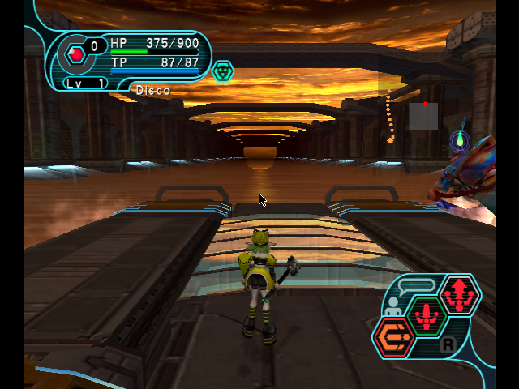

# PSO enemy drops, collision bypass and boss travel

The session sidebar and desktop Items window offer these controls for **offline GameCube Plus US,
GPOE8P disc 0 revision 2 (3OE2)**. They apply to the running game without rebuilding the disc.
Enemy-drop and collision preferences are shared across supported current and future custom builds.
Other executable revisions and online sessions are refused; this addition does not port these controls to Dreamcast.

## Using the panel

1. Check up to twenty items in the disc's item database, then enable **Enemies drop selected items**.
   Native enemy drop events produce one item at a time, cycling through that exact selection. Changing the checked
   items or **Maximum weapon grind** updates the enabled policy after a short debounce. Clearing the last selected
   item disables it and restores normal enemy loot. Boxes, shops and existing floor items are unchanged.
2. Category, class and rarity filters help choose the items; the checked item codes form the pool. Count, Spread
   and Highest rarity tier control manual scattering, not enemy loot. The weapon grind option uses each selected
   weapon's own catalog maximum. It does not bypass equipment requirements; Equip any is a separate setting.
3. Enable **Walk through doors, obstacles and laser barriers** to bypass the guarded collision routines. Disable it
   to restore all six original instructions. This is collision bypass, not invulnerability or a scripted-hazard bypass.
   Moving outside the walkable map can leave the player outside the intended environment.
4. Choose a boss in the current episode and press **Teleport straight to boss**. The list initially selects the boss
   associated with the current area. This starts the game's area loader; the panel confirms arrival only after the
   target floor is active and loading has finished. Inventory and difficulty are retained. Dead players and overlapping
   area transitions are refused. Boss travel is never automatic, persisted as a default, or automatically retried.

The controls use the existing immediate session RPC, an eight-second admission deadline and the session lock.
A queued build does not delay the button behind the build queue. A stale worker must refresh safely before accepting
the new commands. Unknown native outcomes are not retried. Preferences are saved separately from live acknowledgments;
an offline worker can apply a saved policy when the supported game is next available.

## Native implementation

The executable's independently inspected SHA-256 is
`1f80fb82b41c05b26b6d0545b1ba9c0aa60b52e6589cf32fbb2ffe644692a61a`.
`pso_gc_adventure.py` checks the existing 3OE2 player/phase/native fingerprints and additional generator, caller,
episode and area-loader fingerprints before writing. It refuses foreign hooks and occupied scratch memory.

The enemy item generator at `0x8010663C` receives the native output ItemData pointer in r6. A bounded PowerPC leaf
hook copies one twenty-byte selected record into that output. The game then allocates its normal floor-item ID and
creates the item through its existing enemy-death path. This does not poll enemy health or inject synthetic floor
items after a kill. It falls back to the original generator outside offline free play. Count and unsigned index checks
bound the pool to twenty records. The generated-event counter counts generator calls, not necessarily unique kills.

The code, pool and ownership header occupy otherwise-unused `0x80006000..0x800067FF`, separate from the existing
dispatcher. Updating an active pool first restores and flushes the stock entry, then installs the new pool and hook.
Guest `dcbst/sync/icbi/isync` handles already compiled code. Disabling restores the exact original generator instruction.

Collision changes preflight all six original/patched sites before any write and restore those exact bytes. Unknown or
partially applied code is reported rather than silently treated as a normal off state. The explicit toggle can restore
a partially applied set of recognized instructions.

Boss travel reads the guarded zero-based episode field, then batches the native destination setter `0x80228540`,
area-load trigger `0x8000F998` and player destination notification `0x801BAB1C` on the game thread. Sending the
notification alone does not load an area. Arrival requires the requested floor and a cleared native loading flag.
After forty-five seconds an unconfirmed transition is reported without another warp.

Agent tooling exposes `capabilities`, `enemy_drops`, `walk_through`, `bosses`, `boss_warp` and `adventure_status`.
The enemy pool is validated against this disc's catalog before any mutation. Permissions, immutable worker-source
hashes and session serialization use the existing PSO command contract.

## Verification and limits

An isolated Dolphin test used its own display, user directory, copied state and memory-card paths. The copied state
is **Episode II VR Temple Alpha**. Operator sessions and original saves were not modified.

- Four native generator calls alternated selected armor `010122` and Saber `000100`, with the Saber's maximum grind
  byte `35`. High and corrupted unsigned pool indices safely selected the first record after the final bounds fix.
- Actual controller-driven combat defeated an enemy and created selected armor `010122` with a game-allocated ID
  `100732084`. No gBox floor-spawn command was used for that drop.
- Normal collision blocked forward movement at a path boundary; enabling the bypass allowed movement through it.
  All six instructions and the enemy generator were restored afterward. Every door, obstacle and hazard script has
  not been individually tested.
- Native travel loaded Barba Ray's raft and rendered the boss. The full inventory snapshot was identical before and
  after travel. Other listed boss areas have not all been exercised in the emulator.
- Python tests cover revision/online/foreign-hook refusal, scratch ownership, restoration, partial collision state,
  catalog and admission checks, episode choices, overlapping transitions and loading-versus-arrival acknowledgment.
  Managed Chromium tests exercise pool selection, coalesced changes, saved defaults, the explicit warp and restoration.

No game binaries, save states, personal assets or upstream source are bundled with this implementation.

## Reverse-engineering references

The published Plus collision recipe is credited to **soulja224466**, ported by **Gcentrex**, in the original
[Plus Action Replay compilation](https://fuzziqersoftware.com/files/pso1212.html). Its decrypted instruction locations
and original bytes were independently matched to the owned executable. Native protocol and item facts were checked
against [newserv command formats](https://github.com/fuzziqersoftware/newserv/blob/9b075e4d125edac2a8740dc90b013e6e41322e1f/src/CommandFormats.hh)
and the [newserv project](https://github.com/fuzziqersoftware/newserv). The hook and loader integration are independent
implementations; the public recipe is not evidence that every obstacle type has been tested here.
