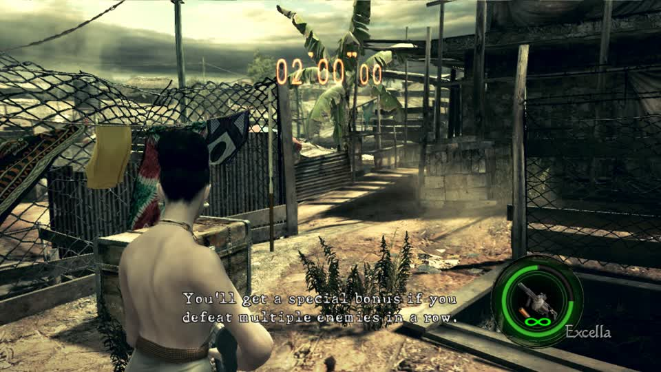

# RE5 round metrics: live failure and regression coverage

The 2026-10-21 resume audit found that the existing counters could not establish either successful hourglass
collection or a 100% hit rate. This change makes round boundaries explicit and separates damage observations
from the combat layer's scored shots. It does not claim an S-rank run or solve the remaining pickup/navigation work.

## Live observations before the fix

Read-only observation of agent session `e488be8ecd2a445b-541d53c4bee54a34` on `lilspark`, RE5 Gold BLUS30491,
on October 21, 2026, 09:53:18–09:56:41 America/Chicago (14:53:18–14:56:41 UTC):

- Two death/restart cycles increased `deaths_continued` from 70 to 85; `rounds` remained 2.
- The second restart increased `bonus_s` from 673.3 to 751.2 and `clock_jumps` from 16 to 17.
- All nine bonus object IDs remained present in every sampled tactical frame. No pickup was verified.
- Shared counters briefly reported 18 hits / 17 shots and later 19 hits / 18 shots while `accuracy` stayed 1.0.
- Telemetry, tactical JSON and screenshots were fetched sequentially, not atomically; they can describe adjacent frames.

The following are real frames from the existing bot, before this change, obtained from the session frame endpoint.

**09:55:49 CDT: death animation.** The adjacent tactical sample recorded zero health and 39.02 seconds remaining.

**09:56:09 CDT: restarted round at 02:00.** The bonus objects were unchanged; this reset was incorrectly counted as
bonus time. The earlier 09:55:59 frame was black during the transition and is not used as visible restart evidence.

## Corrected accounting

- Observe round transitions before prompt handling, including ticks where the engine handles input itself.
- Count deaths and successful restarts separately from repeated Continue button presses.
- Clear timer, bonus-presence and enemy-health baselines across interruptions.
- An ordinary clock increase is time gained within a round, not a new round.
- Keep damage-event counts separate from scored shots; public telemetry does not serve as the scorer's internal cursor.
- Resolve pending shots before a new spawn can reuse enemy identities.

Focused regression coverage is in `tests/test_re5_mercs.py`, `tests/test_re5_combat.py`, `tests/test_mercs_engine.py`
and `tests/test_mercs_bot.py`. The running worker was not restarted or hot-patched for this audit. Post-deployment
gameplay verification remains necessary; historical counters must not be treated as corrected evidence.
