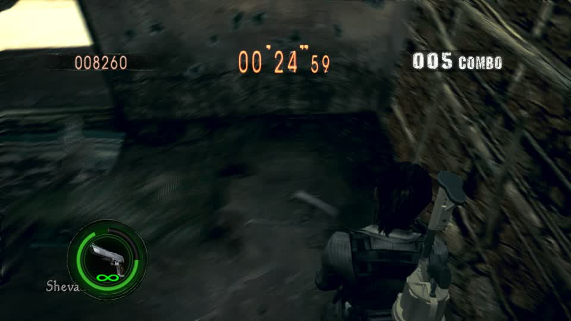

# RE5 Reunion scoreboard

The running per-round scoreboard of the RE5 Mercenaries bot, measured from RAM by a read-only sampler on the Spark
(`~/gBox_alt/scratch/re5-bot/score/r5score.py`; live copy `scoreboard.md` and one JSON line per round in
`rounds.jsonl` beside it). It follows the RE5 RPCS3 across relaunches and reads, at 5 Hz:

| column | source (BLUS30491) |
|---|---|
| stage | navmesh signature (`re5_nav` learning_sig) + hourglasses standing at the start (`1638-2187-…/9hg` = Public Assembly) |
| char | autoplay telemetry `character` (the Roster pick) |
| score, kills, combo | cGameSys `[[0x0191CEE4]+0x182D4]` +0x418, +0x3F4, +0x3FC (max over the round) |
| rank | score against the Reunion solo table (S 60,000; SS 90,000); only for rounds that reach the results |
| hits / grabs | entries of the player action byte (+0x845) into 5 (hit reaction) / 4 (grabbed) |
| contacts | episodes with a living Majini within 120 cm on the player's level (proxy: Muteki hit immunity, enabled by the `unlimited_health` package, hides real hits: HP never drops and the action byte rarely shows 5) |
| +time s | clock increases of more than 2 s inside a round (time bonuses, melee kills) |
| idle s | seconds moved < 40 cm in 2 s with no enemy damaged in 2 s and no prompt |
| wall s | idle seconds with the laser dot < 3 m from the muzzle and on no Majini (standing facing a wall) |
| landed | `round_hits / round_shots` from the combat layer's telemetry |

## Baseline: in-worker Autoplay, main `c7c71a04`, 2026-10-21 16:25-16:46 CDT

Agent session `637be1da03e448bb-b1a940071bf14713` on lilspark. Every round was Public Assembly (the menus take the
last-played stage; nothing rotates stages yet). The first row started mid-round.

| start | char | score | rank | kills | combo | grabs | contacts | +time s | idle s | wall s | longest idle s | landed |
|---|---|---|---|---|---|---|---|---|---|---|---|---|
| 16:25:14 | Rebecca | 8,280 | D | 22 | 6 | 0 | - | 0 | 60.2 | 57.0 | 10.8 | 0.09 |
| 16:28:02 | Sheva (Business) | 9,250 | D | 25 | 7 | 1 | 4 | 59.8 | 78.0 | 65.8 | 10.2 | 0.095 |
| 16:30:48 | Sheva (Business) | 9,150 | D | 24 | 8 | 0 | 7 | 0 | 59.0 | 51.2 | 10.2 | 0.105 |
| 16:33:23 | Excella | 7,610 | D | 19 | 7 | 0 | 6 | 0 | 58.2 | 51.8 | 8.8 | 0.123 |
| 16:36:03 | Sheva (Fairy Tale) | 11,010 | C | 24 | 10 | 0 | 5 | 0 | 47.8 | 40.0 | 10.0 | 0.179 |
| 16:38:44 | Rebecca | 18,590 | C | 43 | 11 | 3 | 6 | 119.4 | 102.2 | 80.2 | 12.6 | 0.131 |
| 16:43:24 | Chris (Heavy Metal) | 21,990 | B | 45 | 13 | 3 | 10 | 118.4 | 96.4 | 67.8 | 9.2 | 0.139 |

Summary: no S rank (best 21,990 = B), 35-45% of every round idle and most of that facing a wall (40-80 s), one shot
in ten lands, time bonuses taken in 3 of 7 rounds. No deaths (health maintenance + hit immunity are on).

The idle seconds' causes (autoplay telemetry at the time, seconds per round): `fight | front candidate; visibility
unconfirmed` 8-24 s, `gather_time/break_for_time | front candidate; visibility unconfirmed` 8-23 s, `clear_nearby |
acquiring clear shot` 5-9 s, `reacquire: near-origin ray` ~6 s. The bot aimed (and held fire) at Majini it could not see,
and flipped between a time-bonus route and those fights, from the same spot.

Real frame (session frame endpoint, 16:3x CDT): Sheva at 0:24 left, gun up against a wall, combo 5.

