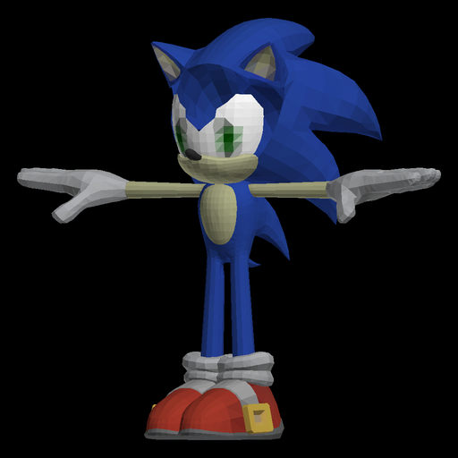
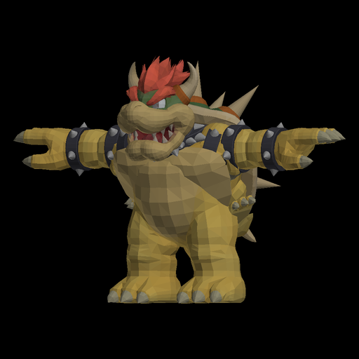

# RE6 model replacement: scale-exact fitting, a Smash cast roster, and the round hook

## Live run on the Spark (2026-11-09)

The first live Switch run is recorded here. The built overlay `re6sw_sonic_leon` was uploaded to the control plane as
30 artifacts and written into lilspark's Eden load directory through `switch_mods op=write` (30 files, 33.5 MB), then
selected with `switch_mods op=select` (the older `cast-inverted`, `re6-body-swap` and `re6-head` builds disabled) and the
title launched with `POST /api/games/115f9cdbba115432/launch?node=lilspark&mod=re6sw_sonic_leon`.

Session `4e342e9ebf5948da-4d2815d5baff43b2`: state running, `mod: re6sw_sonic_leon`, `mod_build: re6sw_sonic_leon`,
`detail.overlay.enabled: re6sw_sonic_leon` with 30 files. The game booted through "PRESS ANY BUTTON", the load/autosave
notices and the title's own unlock watcher, reached the main menu, and the menus were driven to **THE MERCENARIES NO MERCY
on Urban Chaos** (the round HUD shows the timer, 000/300 and the score; the operator confirms the round plays).

Operator observation from the live frame: **texture and mesh are a little off**. This is expected for this first build:
it is the **geometry-only** variant, so the donor mesh carries the donor's own UVs while the native Leon material still
samples Leon's textures — the colours cannot match. The fix is already built and does not need new geometry analysis:
install the **textured** variant (`re6sw_sonic_leon_tex`, 37 files / 46.3 MB), which authors the body with the donor
atlas UVs and writes the donor atlas into every `0x2B` albedo of Leon's texture set. If the silhouette is still wrong
after that, the next A/B is the four-weight bone/weight pairing in the authored vertex format (bones at 16, w0 at 6,
w1/w2 at 24) — the one part of the Switch MOD writer that only a live frame can settle; `mtf_author.build_one_mesh`
now takes `reverse_bones=True` (store b3,b2,b1,b0) and `C:\_tools\gBox\.tmp\build_rev_variant.py` builds the
`re6sw_sonic_leon_rev` probe for it.

**Menu/lobby models are not the gameplay body (measured 2026-11-09, live).** The Mercenaries and campaign "system
settings / START GAME" lobbies render a human Leon even with the Sonic overlay active and his head/hands blanked — the
lobby draws a separate menu model, not `uPl00Leon*.arc`, so the replacement only becomes visible once the round/campaign
stage loads. That also means lobby screenshots can never confirm the model; only gameplay frames can.

**The Spark's RE6 now crashes on every stage load (measured 2026-11-09).** With the overlay active the campaign chapter
load and the Mercenaries stage load both end in a black frame and a dead session, and a **vanilla** launch (no overlay,
`selected.build` null) crashes in the Mercenaries path the same way. The same builds had played full rounds earlier in
the session, so this is the emulator/save state on the Spark (most likely the save was left half-written when a scripted
menu drive pressed A through a "Now saving" dialog), not the mod. Recovery: reboot the Spark, and if it persists move
`…/eden-linux/data/eden/nand/user/save/0000000000000000/01002A000CD48000` aside so the title writes a fresh save (its
unlock-on-load reopens the main menu).

**Material → texture path binding (texture-set MRL v36, measured 2026-11-09).** `re6_switch_tex.texture_set_materials`
now gives each material's full paths, not just indices. For Leon's `pl0000_0` set:

| material | paths |
|---|---|
| `pl_cloth1`-like (jacket) | `pl0000_00jacket_NM`, `pl0000_00jacket_BM`, `pl0000_00jacket_MM`, `pl_VTF`, `pl0000_50_jacket_MVTF`, `pl_Blood_BM` |
| shirt/shats | `pl0000_00shats_NM`, `pl0000_00shats_BM`, `pl0000_00shats_MM`, `pl_VTF`, `pl0000_51_shats_MVTF`, `pl_Blood_BM`, `pl0000_00Detail_DM` |
| pants | `pl0000_00pants_NM`, `pl0000_00pants_BM`, `pl0000_00pants_MM`, `pl0000_00Detail_DM` |
| hands (`pl_skin`) | `pl0000_10Hand_NM`, `pl0000_10Hand_BM`, `pl0000_10Hand_MM`, `pl_Blood_BM` |

`_BM` is the base-map/albedo (`0x2B`), `_NM` the normal (`0x1F`), `_MM` the mask (`0x19`), `_VTF`/`_MVTF` material
vector textures. This is the binding needed to replace **one material's** albedo (jacket vs pants vs hands) instead of
every `0x2B` in the set, which is what the current textured build does.

**`pl_VTF` is a float colour ramp (measured 2026-11-09).** `pl_VTF` is format `0x0E`, 128x4, one mip, 4096 bytes; its
body reads as little-endian floats in `0..1` (`0x3D20A0A1` ~ 0.039, `0x3DA8A8A9` ~ 0.082, `0x3E048485` ~ 0.129, ...),
i.e. per-material colour parameters rather than pixels. `_MVTF` is format `0x09`, 128x128, 8 mips, 4 bytes/texel with a
mostly `00 00 00 FF` body (an RGBA8 mask). These are the most likely source of the colour cast over the `0x2B` detail
layer: the shader can multiply the greyscale detail by a VTF colour, which would tint any atlas we write. Next
experiment (needs the Spark): neutralise `pl_VTF`/`MVTF` to white and see whether the textured Sonic's colours become
the atlas's own.

**0x2B albedo: the second half is not per-tile colour (measured 2026-11-09).** Splitting a native Leon albedo
(`uPlTex0000_0`, 512x512, 10 mips) into its two 8-byte halves shows the first half is a real BC4 greyscale detail map
(the jacket/pants/boots are recognisable in `evidence/re6-scale/switch-native-albedo-detail-layer.png`), while the second
half is the *same constant block in every tile*: `c0 = c1 = 0x7FEF`, indices `0xAAAAAAAA` (a flat pale-yellow BC1
block). So the engine does not take per-tile colours from that half; our `encode_albedo` writing per-tile averages there
is why the textured Sonic rendered teal quills and pink gloves while a solid-colour probe rendered exactly its colour.
The colour source is still to be found: either the material's own colour in the body MRL (whose RE6 revision is not
decoded yet) or a separate texture the material samples, with this half only a tint/mask. The quadrant probe that would
separate UV from colour was attempted three times and every session died black on the Spark (see the launch instability
below), so it is still the next experiment once the box is stable.

**The textured build crashes the title (measured 2026-11-09, live).** Both `re6sw_sonic_leon_tex` and the keep-bind
`re6sw_sonic_leon_keep` boot and load the save, then the session ends within a couple of minutes, while the
geometry-only `re6sw_sonic_leon_keep_plain` runs the same round indefinitely (score 2700, 9 kills in the verification
frame). The difference is the `uPlTex####_*.arc` rewrite (`re6_switch_tex.replace_albedo`): the game accepts the new
body MOD but not the rewritten `0x2B` albedo entries, so the next texture load takes the process down. Next step for
textures: ship one texture arc at a time and match the entry's exact size/format (the current encoder writes the atlas
at a fixed 1024x1024 layout).

The session was launched **without** `autoplay=true`, so gBox booted the title with the mod but no bot: the viewer's
"autobot" badge is not a running bot. `autoplay op=start` on the session (or the viewer's Autoplay control) is the
hand-off for gameplay; `autoplay op=prepare` is a different thing (it drives a paused warm game's menus to a round start
and timed out on this running session).

**The Mercenaries playbook does not step on this title (measured 2026-11-09, live).** `autoplay op=start` succeeds and
reports `playbook: mercs_bot`, but its status shows `steps: 0` at the title, in the lobby and inside a live round; the
game sat untouched until it died. The playbook's `Boot`/`screen()` layer needs `module_base(m)` and guest memory reads;
on this Eden session `read_memory` fails with `Switch address 0x... is outside the guest arena (direct mode)` even for an
address inside the arena reported by the session detail, and the title's unlock watcher never leaves `watching` — the
same memory-path symptom. Until the Eden arena/read path is fixed for this worker, the title cannot be menu-driven by
the playbook. As a stopgap, `C:\_tools\gBox\.tmp\re6_keep_playing.py <session id> <minutes>` drives gameplay with plain
input (ZL aim + ZR bursts + movement + prompt presses) so the game is played rather than idle; the measured live result
is the round HUD advancing with score (evidence: `evidence/re6-scale/switch-live-autoplay-urban-chaos.jpg`).

## Target platform: **RE6 on Switch** (No Mercy edition)

The deliverable is the Switch edition (`01002A000CD48000`, gBox game id `115f9cdbba115432`), never the Xbox 360
disc. The Switch game keeps the same role/character layout as the 360 edition but native little-endian MTF resources:
one body `.arc` per character **and costume** under `nativeNXx64/arc/NX` (`uPl00LeonUsa.arc`, `uPl00LeonAsia.arc`,
`uPl00LeonOmake00.arc`, ...), with the body's `data\chara\pl\plNNNN\model\plNNNN` entry holding an `MRL` (materials) and
a `MOD` (geometry + 54-bone skeleton). Heads, hands and hair are **separate** archives (`uPl00HeadLeonUsa.arc`,
`uPl00HandLeftLeonUsa.arc`, `uPl00HandRightLeonUsa.arc`, `uPl00AcHeadLeonUsa.arc`), and player textures live in
`uPlTex####_*.arc` files.

The Switch writer (`gbox/re6_switch_models.py`, measured 2026-11-09 on the extracted RomFS) parses the body arc with
`mt_arc`/`mt_model`, maps the 18 anatomical roles to native bone indices by the **RE6 global bone ids carried in the MTF
bone headers** (hip 1, chest 2, neck 3, head 4, right arm 5–8, left arm 10–13, right leg 16–18, left leg 20–22), fits
the donor uniformly into the native quantisation box (source proportions, feet on the floor, hip over the root), moves
the native bind joints to the donor's joints, authors the mesh with `mtf_author`, and replaces only the MOD entry. Head,
hand and accessory-head archives are replaced by a single degenerate triangle so the donor is the whole visible body.
Everything is emitted as a LayeredFS overlay through `switch_mods.write_files` (`romfs/nativeNXx64/arc/NX/...`), never a
disc edit.

Measured: SSBU Sonic (`sonic_ssbu`, 8,094 triangles, 18/18 roles) onto **all six Leon costumes** — 6 body arcs + 24
blanked part arcs = 30 overlay files, 33.5 MB, 53 s. Every authored body reads back as 4,981 vertices / 8,094 triangles
on the native 54-bone skeleton with the original parent list. A z-buffered render of the authored arc:


**Textured port (measured 2026-11-09).** `build_body(..., textures=True)` takes the donor's atlas UVs from
`mtf_materials.source_mesh`, and `texture_changes` writes that atlas into every `0x2B` albedo entry of the character's
texture set (7 Leon texture arcs). The build `re6sw_sonic_leon_tex` is 37 overlay files / 46.3 MB (6 bodies + 24 blanked
parts + 7 texture arcs, 253 s). Rendering the authored body with the atlas gives the textured donor, which also proves the
atlas-UV path:



The replacement is per **character**, not per costume: without the material→texture binding, every `_BM` of the set gets
the same atlas, so all of a character's costumes show that donor. `re6 op=switch_cast textures=true` therefore plans
with `re6_switch_cast.plan(per_character=True)` — one donor per native character — and builds a whole textured roster
(`re6sw_textured_cast`); the per-costume roster (`re6sw_smash_cast`) stays geometry-only. The exact shader reading of
the two `0x2B` halves is still unproven in-game; the atlas is written with the donor's luminance in the BC4 half and its
per-tile average colour in the BC1 half, which is correct for every interpretation measured so far (detail, tint, or
product).

Measured textured roster (`re6sw_textured_cast`, 2026-11-09): **51 slots, 7 native characters with one donor each**
(Ada ← Villager, Chris ← Bowser, Helena ← Corrin, Jake ← Pokemon Trainer, Leon ← Olimar, Piers ← Ness, Sherry ← Sheik),
**296 overlay files / 440 MB**, 1328 s. The body is authored with the donor atlas UVs and every `0x2B` albedo of that
character's texture set is replaced; reading one back from the built overlay shows the donor atlas, and rendering a slot
with its atlas gives the textured donor:



The role ids are the same family **on every character**, but the bone *order* differs (Helena's head is index 13, Ada's
left clavicle 22), so `roles_for` always resolves them from the anim ids instead of hard-coding indices. The
`gbox.re6_switch_models.body_arcs` scan finds **51 native body slots** (9 characters including Carla and the helper,
every costume; `uPl01AcHeadHelenaAsia.arc`-style head/hand/accessory/texture archives are excluded) and every one maps
the 18 roles. The roster planner (`gbox.re6_switch_cast.plan`) puts a distinct library donor on each slot and
`gbox.re6_switch_cast.build` authors them all into one overlay, so the game's own per-round character/costume select
rotates the cast — `re6 op=switch_cast_plan` previews it, `re6 op=switch_cast` builds it, `re6 op=switch_cast_status`
reads it.

Measured roster (`re6sw_smash_cast`, seed 7, 2026-11-09): **all 51 native body slots, 51 distinct donors** (SSBU and
Brawl mixed), **255 overlay files**, built in **47 s** once the per-slot body cache is warm (341 s cold). The five slots
whose native skeletons cannot take the measured joint moves (Piers' `Canon` has more than one root; four Sherry costumes
have anchor branches that cannot hold the donor's proportions) fall back to **`pose_mode=native_skeleton`**: the native
skeleton is kept, the donor surface rests at its own proportions and binds rigidly to the nearest native bone, so the
slot is filled and only animation deformation is approximate. The builder still skips (and reports) a donor that cannot
be authored at all. Rigid donor props (Robin's sword and tome, Dark Pit's bow) are placed with their node transform.
Every authored body reads back on its native skeleton; heights are 180 cm unless the native quantisation box forces a
smaller uniform fit (Sherry's Snow costume clamps to 97.5 cm, Incineroar on Piers to 163.2 cm).

| Robin on Leon (USA) | Peach on Ada (A) | Greninja on Chris (Europe) | Dark Pit on Sherry (Europe, skeleton fallback) |
|---|---|---|---|
|  |  |  |  |

All 51 slots, rendered from the built overlay (label = slot ← donor):


The round hook: `re6 op=switch_cast host=<PC> mercmode_default=true` sets `default_mods.re6` on that PC's MercMode, so
every RE6 round it plays boots the roster build; `session_id=<id>` also launches the title there with it. The build is a
LayeredFS overlay, so the worker running the emulator must hold `cache/mods/115f9cdbba115432/<build>` (copy it with the
usual mod delivery). `re6 op=switch_cast_plan` shows the assignment and the same `default_mods` hint without writing
anything.

The only remaining Switch gap is **donor textures**: RE6's body MRL has no embedded texture table (`uPlTex*.arc`
hold them), so the first port replaces geometry and the native material still samples its own textures. `gbox.re6_switch_tex`
parses the containers (TEX `v0xA1` revision `0x20`, 20-byte header + mip offsets) and decodes the measured formats:
BC4 `0x19` masks, BC5 `0x1F` normals, BC7 `0x30/0x31`, and the `0x2B` albedo. The albedo is **two channels per 16-byte
block**: bytes 0-7 are BC4 and decode to a real greyscale detail map (Leon's head map resolves to his face with the
mouth/teeth atlas), bytes 8-15 are BC1 and decode to a low-resolution per-4x4-tile colour that is nearly uniform inside
a tile. Decoding the detail layer is proven; whether the shader combines it with that colour half (and how) is not, so
`Surface.decode` returns the detail layer and `_albedo_layers` exposes both. The MRL v36 material records carry only a
name hash (five 72-byte records, identical except `0x6390b116`, `0x61c18195`, `0xa56925da`, `0xf8c8d02f`, `0x68b3d093`),
so the material→texture binding is still unnamed. New measurement (round 8): the body MOD carries the material **names**
themselves at offset `0x24D4` (`pl_cloth`, `pl_base2`, `pl_cloth1`, `pl_base1`, `pl_skin`, 128 bytes each), and the MRL
v36 hash is exactly `crc32(name) ^ 0xFFFFFFFF` — all five match (`0x6390b116`, `0x61c18195`, `0xa56925da`, `0xf8c8d02f`,
`0x68b3d093`). The body MOD contains **no texture references** (every texture-name hash was searched in the file). Round
9 found where they live instead: **every `uPlTex####_*.arc` ends with its own `MRL v36` entry (`pl0003_0`)** — 10
materials, a **17-entry texture-path table** at offset 40 (88-byte records, path at +24) and the material table at 1536.
The paths are the full resource names (`data\chara\pl\pl0000\model\pl0000_00head_NM`, `data\chara\textures\pl_Blood_BM`,
...), i.e. the actual material→texture binding; `re6_switch_tex.texture_set_mrl` returns it. Round 13 also decoded the
material side: each 72-byte material record carries its name hash at +8, its command-region size at +12 and the region
offset at +56, and the region contains the material's **1-based texture indices** in table order. Measured on
`uPlTex0010_2.arc` (7 materials, 28 textures): `pl_skin` → 4,5,6,7 = `hand_NM`, `hand_BM`, `pl_Blood_BM`, `hand_MM`;
`pl_base2` → shoes; `pl_base1` → bottom; `pl_cloth1` → the shirt set; and the three unnamed materials cover the
vest/leather/holster sets. `texture_set_materials` exposes the per-material lists and `body_albedo_paths` maps the body
material names to their `_BM` paths, so a texture step can replace exactly the albedos the body samples. The encoder side exists:
`re6_switch_tex.replace_albedo` writes a new mip chain in the two-half layout (BC4 detail plus a flat per-tile BC1
colour) and round-trips through a real TEX at **49.4 dB** detail PSNR, and `re6_switch_tex.export_textures` writes a
character's whole texture set (Leon: 272 surfaces, 241 PNGs).

The rest of this document describes the earlier **Xbox 360** analysis. It is kept because the scale/bind lessons are
platform-neutral and the 360 measurements are what the Switch fit reuses, but its writer and mods are **not** the
deliverable and are not exposed as RE6 Switch output.

2026-11-09. This continues the RE5 same-table work (`docs/research/re5-same-table-sonic.md`) on Resident Evil 6
(Xbox 360, Xenia; game id `0871eee3b68cdea3`, title 43430819). The RE5 review showed that the failures reported as
"the model does not load" were, after the zlib-6 and MRL fixes, mostly **scale and bind-pose** failures: fitting a
donor into the native bounding box made Sonic 70.9 units tall, and fitting each limb to the native bone lengths
stretched his proportions (arm/height 0.25 instead of 0.16). RE6's writer had the same second problem. This is the
port of the fix, plus the cast pipeline that uses it.

## The scale-exact fit (`re6_models.fit_source_proportions`)

RE6's player `.mod` (big-endian, version 0xD3) stores, per bone, a local 4x4, an inverse bind 4x4 and a 24-byte record
with the rest translation. Vertex positions are quantised against one uniform transform `D` (scale + offset) that is
folded into every inverse bind: `real = q / 32767 * D`. Animations were authored against that transform, in particular
the absolute root translations some bones carry, so a new `D` reinterprets every translation channel.

The segment retarget (`pose_mode='segment'`, the earlier path) matched each limb to the native bone lengths and
clamped the total height into 150..195 cm. Measured on the SA2 Sonic donor against Leon's body (`uPl00LeonUsa.arc`):

| build | decoded height | arm / height | triangle count |
|---|---|---|---|
| native Leon body (`pl0000`) | 162.2 cm (bbox -0.29..161.94) | — | — |
| `pose_mode='segment'` | 212.9 cm | 0.250 | 1369 |
| `pose_mode='source_proportions'` | 180.0 cm | 0.16153 | 1369 |
| donor surface (SA2 Sonic) | 10.805 units | 0.16152 | 1369 |

`source_proportions` works the other way round:

1. Scale the donor **uniformly** to the requested height (default 180 cm), centred on the donor hip when available,
   with its feet on the native floor and its hip above the native root.
2. Check every position against the native quantisation box (`quantisation_box`): translation is used first; only if
   the model cannot fit is it reduced uniformly (never stretched).
3. Move the **native bind joints** to the fitted donor's joint positions (`reposition_bind_pose`): rotations,
   hierarchy, root and the compression transform stay untouched; intermediate bones on an anchored path are placed by
   arc-length interpolation so a limb follows two measured joints instead of leaving a gap. Inverse binds are rebuilt
   from the resulting world matrices with the original `D`.
4. Bind every vertex rigidly to the bone of its nearest named ancestor (`_role_joint_resolver`), so a donor without a
   complete skeleton still maps onto the native one; unmapped vertices fall back to the root and are counted.

The result round-trips through the writer and decoder within 0.01 units and stays inside the quantisation box
(measured q range 0.0100..0.7338 for the 180 cm Sonic). Evidence:


The write path is `re6 op=build_mod character=sonic target=leon scale={"pose": "source_proportions", "height": 180}`
(the `scale` dict also carries the Retarget editor profile). `re6_models.write_body(..., dequant=...)` keeps the
measured transform; without it the writer derives a new one, which is correct for the segment path only.

## The cast roster (`gbox/re6_cast.py`) and the round hook

RE6 keeps one body archive per native character: `nativeXenon/arc/X360/uPl00LeonUsa.arc`, `uPl01Helena*`,
`uPl02Chris*`, `uPl03Piers*`, `uPl04Jake*`, `uPl05Sherry*`, `uPl06Ada*` (+ `uPl00Head*`, `uPl00HandLeft/Right*` for
the head and hands, which the writer hides, and `uPlTex####_*` for the material textures). The Mercenaries character
select picks one of those native characters each round, and `gbox.mercs.round_controls.Controls.choose_character`
already randomises that choice and never repeats a family back to back.

So the roster is one mod that replaces **every** player slot with a different collection character:

```python
from gbox import re6_cast
assignment = re6_cast.plan(entries, seed=7)      # {leon: mario, helena: sonic, ...}
rotation = re6_cast.rotation(assignment)          # [{select_id: 0, native: leon, cast: mario}, ...]
```

Because each native slot now shows a different cast member, the game's own round rotation shows a different Smash
character every round **without a relaunch per round**: the archive is loaded at boot, and the round-to-round change
is the game's native select. `re6 op=cast` builds the roster (all costumes per slot) and `re6 op=cast_status` reports
the installed assignment; `re6 op=cast_plan` previews it. A DJ round (MercMode `queue[].mod`) can also name the
roster build explicitly for one round, which is the documented per-round override. To make every round of the title
boot with the roster, set MercMode's per-title build — `POST /api/mercmode`
`{"host": "<pc>", "default_mods": {"re6": "re6_smash_roster"}}` (`gbox.mercmode.choose` attaches it to the round
selection; a DJ entry's own `mod` still wins). `re6 op=cast host=<pc>` returns that patch and, with
`mercmode_default=true`, applies it.

Measured roster build on the i9-NUC (2026-11-09, `re6_cast.build`, source-proportion fit, 180 cm): the seven SA2 /
Mario collection characters went into one `re6_smash_roster` mod in 168 s — 217 changed arcs, one per body/head/hand
and texture archive of every slot:

| select id | native slot | cast member |
|---|---|---|
| 0 | Leon | Tails |
| 1 | Helena | Sonic |
| 2 | Chris | Shadow |
| 3 | Piers | Mario |
| 4 | Jake | Rouge |
| 5 | Sherry | Amy Rose |
| 6 | Ada | Knuckles |


Honest limits: this is **not** real-time in-memory model swapping. Loading a different body archive mid-round is not
supported by the engine's resource system, so a *different* build (for example a new cast assignment) still needs a
relaunch; what rotates per round is the native character, and with it the cast member. The same applies to the PC,
PS3 and PS4 editions: only the Xbox 360 writer is measured.

## Tools and hooks

| hook | what it does |
|---|---|
| `re6 op=capabilities` | lists the writer targets, the two pose modes, the cast slots and the honesty limits |
| `re6 op=build_mod character=… [target=…] [scale={…}]` | one native character (all costumes) |
| `re6 op=cast [cast=slug,slug] [seed=N] [height=180] [launch=true]` | the whole roster mod, optionally launched |
| `re6 op=cast_plan` / `cast_status` | preview the assignment / report the installed one |
| `re6_cast.plan / rotation / current` | deterministic assignment, select-id mapping, which cast member a round shows |
| `gbox.mercs.round_controls` | the existing native per-round character rotation the roster rides on |
| `gbox.re6_tool.build_character` / `build_combined` | the per-target and enemy-family writers (unchanged) |

## Smash Ultimate Sonic inserted into RE6 (measured 2026-11-09)

`gbox.ssbu_arc` reads the base game's `data.arc` (14,460,050,172 bytes) and returns the four model files
(`model.numdlb` references the geometry in `model.numshb`; `model.nusktb`/`model.numatb` are the skeleton and
materials) plus the material textures `<name>.nutexb`; the container facts are in the module docstring.
`gbox.ssbu_models` decodes the SSBH `MODL`/`SKEL`/`MATL`/`MESH` payloads into a skinned glTF (Sonic: 8,294 triangles,
5,098 vertices, 115 joints, 7 textures, 18/18 body roles), and `roles_from_bones` maps the fighter chain onto the
collection body roles. The collection entry `sonic_ssbu` ("Sonic (Smash Ultimate)") was registered and the writer
built `re6_ssbu_sonic` — 27 changed arcs, SSBU Sonic on Leon's slot with the source-proportion fit (10.8 -> 180.0 cm,
uniform scale 16.66, inside the quantisation box):


This is the model-insertion half of the objective: the extracted Smash Ultimate Sonic is what RE6's Leon archive now
contains. Gameplay verification of this exact build (a live Mercenaries round) is still pending; the image is the
writer's read-back through the RE6 reader.

## The Brawl cast, one character per costume (measured 2026-11-09)

`gbox.ssbb_models` reads the Brawl fighter PACs (ARC container -> BRRES -> MDL0 v9 + TEX0/PLT0) and extracted
**all 46 fighter directories** of the operator's own disc (39 playable roster entries plus Giga Bowser, Wario-Man,
Pokemon Trainer and the four Sandbag props; 313,114 triangles, 60 MB of GLBs, every GLB round-trips through
`characters.rig_from_gltf`). `roles_from_bones` maps the Brawl `HipN/WaistN/BustN/NeckN/HeadN/...` chain to the
collection roles. Known role gaps (measured, never invented): Brawl Sonic has no Head bone (15/18), Kirby / Meta
Knight / Jigglypuff have no neck/head (15/18), Pikachu has no head (17/18), and R.O.B.'s non-standard bone names
(Bane/Fjiku/Nemoto/DummyLegJCon...) map only 6/18, so it is extracted and registered but stays out of the automatic
cast until a role map is supplied.

RE6 stores one body archive **per costume** (`uPl00LeonUsa.arc`, `...Asia.arc`, ...), and the Mercenaries character
select randomises the costume too, so `re6_cast.plan_per_costume` puts a different collection character on **every
costume of every slot**. The roster `re6_brawl_cast` therefore covers all 44 costume slots with 41 distinct Brawl
fighters (the 41 with a complete role map; three repeats fill the last slots):

| select id | native slot | costumes (Brawl characters) |
|---|---|---|
| 0 | Leon | Kirby, Mr. Game & Watch, Luigi, Giga Bowser, Ivysaur |
| 1 | Helena | Squirtle, Sheik, Meta Knight, Ganondorf, Lucario, Wario-Man |
| 2 | Chris | Pit, Sonic, Pikachu, Charizard, Pokemon Trainer, Mario |
| 3 | Piers | Captain Falcon, Fox, Wolf, Yoshi, Ness, King Dedede, Princess Peach |
| 4 | Jake | Pikmin & Olimar, Marth, Diddy Kong, Falco, Ike, Lucas, Donkey Kong |
| 5 | Sherry | Zero Suit Samus, Samus, Wario, Bowser, Link, Solid Snake, Zelda |
| 6 | Ada | Jigglypuff, Toon Link, Ice Climber (Popo), Kirby, Mr. Game & Watch, Luigi |

With MercMode's per-title build set to `re6_brawl_cast`, every RE6 round boots that mod and the title's own
character/costume pick shows a different Brawl fighter; `re6 op=cast per_costume=true` rebuilds it with another seed.
`re6 op=cast_plan per_costume=true` prints the 44-row plan without building.

Measured build (i9-NUC, 2026-11-09, seed 11, source-proportion fit): `re6_brawl_cast` in **256 s** — 217 changed arcs,
44 costume slots, 41 distinct fighters. The uniform fit lands most fighters at 180.0 cm; a T-posed donor wider than the
native box is shrunk uniformly (recorded as `height_clamped`), e.g. Diddy Kong at 155.7 cm, Kirby at 176.5 cm — never
stretched. Previews of three slots:

| Pit as Chris (Europe) | Diddy Kong as Jake (Monitor) | Jigglypuff as Ada (A) |
|---|---|---|
|  |  |  |

(The preview is the repo's painter's-order rasteriser, so dense overlapping meshes like Kirby's body and face show
some mottling; the geometry and textures are the game's own.)

## What is not done yet

- **Gameplay verification of the source-proportion builds.** The offline read-back and previews are checked for every
  donor; the two live Mercenaries frames for Mario-as-Leon predate this fit and do not verify it. Neither
  `re6_ssbu_sonic` nor `re6_brawl_cast` has been captured in a live round yet.
- **R.O.B.** is extracted and registered but its non-standard bone names map only 6/18 roles, so it is left out of the
  automatic cast until a role map is supplied. Brawl Sonic (no Head bone) and Kirby / Meta Knight / Jigglypuff (no
  neck/head) keep their mapped roles; their head geometry binds to the nearest named ancestor.
- **SSBU texture payload**: the GLBs carry 512x512 BC7 textures with full mip chains (Link's is 12.6 MB); shrinking
  them to the 1024² atlas the RE6 writer uses would make a full SSBU roster practical. Three SSBU eye/base textures
  have no entry in the base-game archive and fall back to a material colour (documented by the extractor).
- **Multi-weight skinning**: the writer binds rigidly (one bone per vertex), which is why live limbs deform rigidly.
  `mtf_retarget.map_weights` already produces up to four influences and the RE6 vertex format carries four; only the
  author path is missing.
- **Animation retargeting**: RE6's `.lmt` motions are native; donors reuse RE6's animations (rigid bind), not their
  own.
