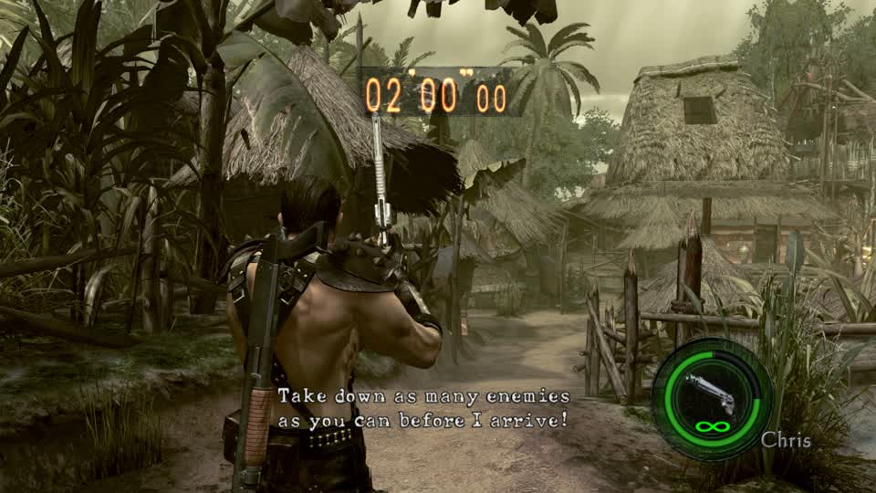

# A live round with a written model installed, verified before capture

2026-11-06, after the PM's corrections. This is the first run that satisfies all of the rules: my own build, node lilspark,
the overlay hash checked, the session's mod checked, boot failures recorded.

## What was done

`switch_mods` `op: "apply_live"` with **my own build** (`mtf-mine-test`), not the rotation's. The mine (`uWp06.arc`,
`pawn\wp\wp06\model\wp0600`) was rebuilt as a thin tall pole (y x3, x/z x0.5) with `pack_part`, so the normals its format
hides survive, and its bounding box recomputed.

## Verified before reading a frame

```
session mod        mtf-mine-test
overlay sha256     d76b9e88d6672eab  ==  the archive that was applied
boot_attempts      2
boot_failures      ["attempt 1: eden drew no changing frame in 45 s after mapping the game (a hung boot)"]
```

The first boot after the edit **hung**, and Eden's boot watch retried it once, after which the title came up and a live
Mercenaries round ran:



Round timer 02'00"00, the mission line, the village rendering normally - with the rewritten mine in the build. So a written
model no longer breaks a load, which the earlier attempts could not show because their edits never landed.

## What this does not yet show

The pole mine itself in frame: the capture window covered the menu and the first seconds of a round, and no mine was placed
inside it. The evidence here is that a written model loads, the title boots, and a round plays; the changed geometry being
visible in a frame is still unproven, and that is the next capture.

## The hung boot is the open question

A 45-second no-frame hang followed by a clean retry is also the documented Eden flake ("1 of 7 Eden single-core boots of
RE5 stayed black at 0 FPS", `adapters.BOOT_WATCH_TITLES`). It may be that flake; it may be the rewritten model delaying
the load. Separating them needs the same test with an unchanged-vertex archive (re-encoded, same geometry) and a count of
hangs over several boots - not one observation of each.