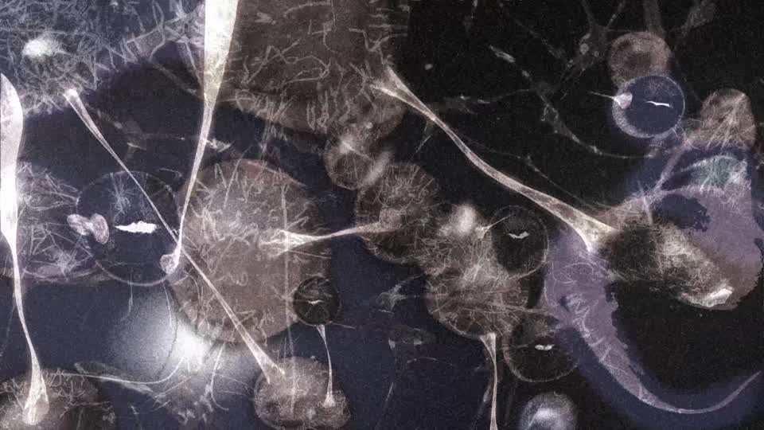
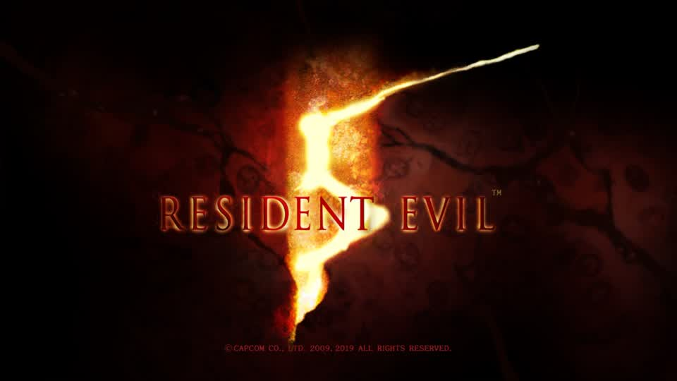
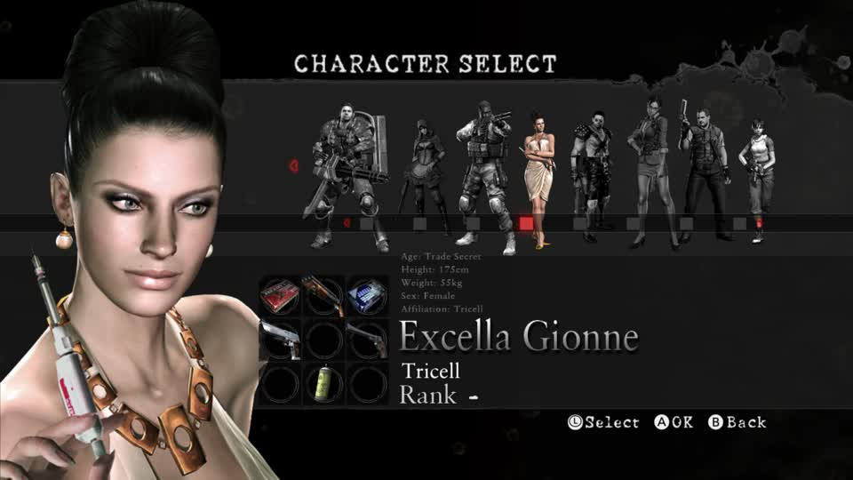

# The writer bisect: run, and what each variant showed

2026-11-06. The staged bisect finally ran, using the mechanism that does not cost the round: `switch_mods` `op: "write"`
stages an edit into the running round's own build, and it lands when the title next starts on its own. Two variants, each
captured from a live round of RE5 No Mercy on Eden.

## Variant 1: the 3x mine (`pawn\wp\wp06\model\wp0600`)

Built from 15 of 15 parts, valid, part 0 width 4.6 -> 13.9 cm, bounding box recomputed and written into the header.
Staged into the round's own build and captured from the next round:

Surfaces stretching across the whole frame. This is what a camera *inside* a three-times-larger mine looks like - and it is
also what corrupt geometry would look like. On its own the frame cannot tell those apart, which is why the second variant
matters.

## Variant 2: the same model re-encoded with no geometry change

Every part decoded and packed again at 1.0 scale, same bounding box. The title booted and ran:

and reached character select with the whole cast rendering correctly, textures included:

## What this establishes

The archive that carries a model **rebuilt by `gbox.mt_model`** loads and plays: the title boots, the menus draw, and the
eight cast models render with their textures. So the writer does not corrupt a model it rewrites - variant 1's frame is the
mine being genuinely larger, with the camera inside it, not a broken mesh.

## What it does not establish

That a *deliberately different* mesh renders correctly at a sane size. The 3x test was too aggressive to tell "bigger" from
"broken" by eye alone, and a fair test needs the changed geometry to stay in front of the camera - a smaller scale, or a
model the camera never enters. The next variant should therefore be a modest change (about 1.5x, or a shape substitution on
the same bounds) captured in a round whose frames show the mine from outside.

## Cleanup, verified

The staged edit was reverted; `uWp06.arc` is no longer in the `cast-inverted` overlay, so the round uses the game's own file
again (`sha256 dbd996d2...`), and the only residue is a pending "removed" marker for a file that is already absent. MercMode
is enabled with RE5 pinned to the Switch No Mercy edition.
