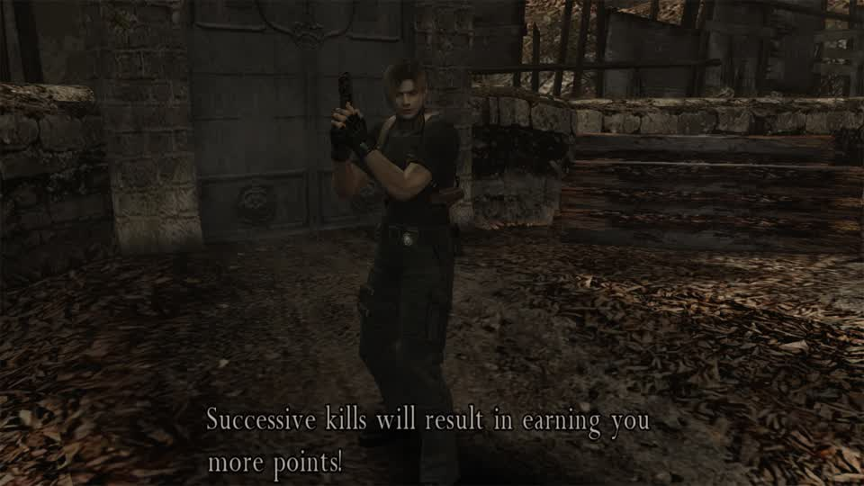
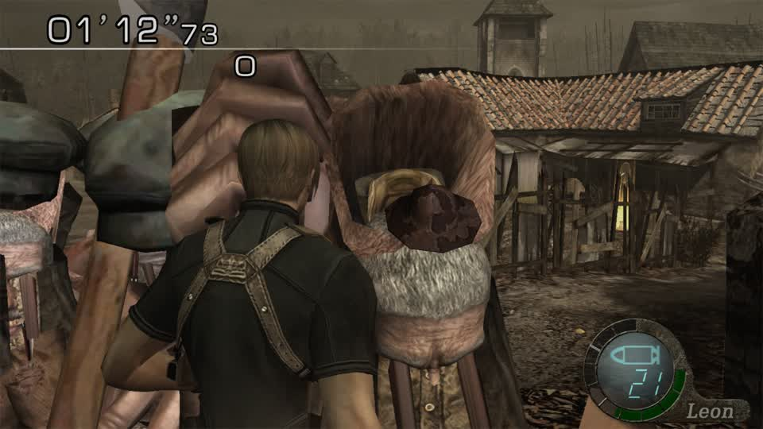
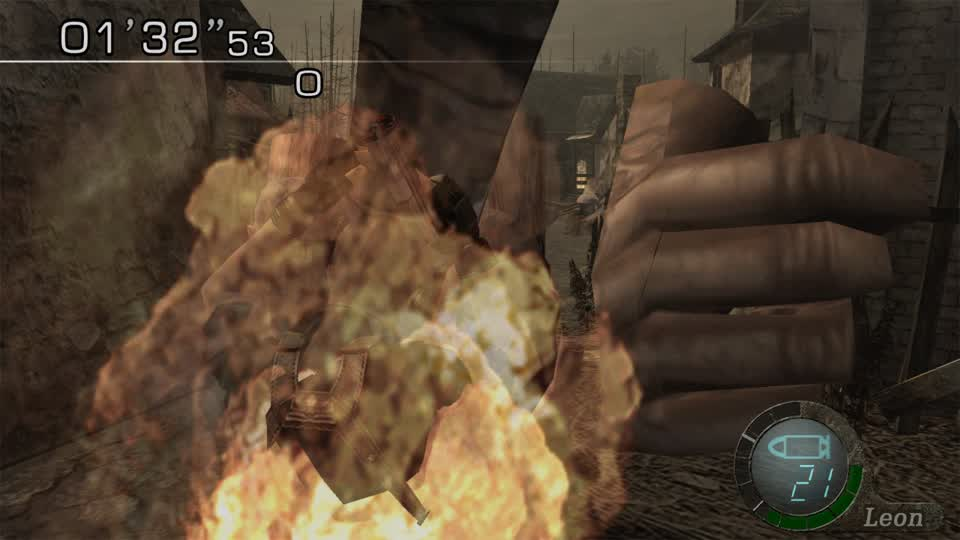

# Why the game sits, and the `KeyError: 'load_state'` (2026-11-07)

## The game was waiting for one button

The frame the operator sent is the round **briefing**: Leon standing at the village edge with
*"Successive kills will result in earning you more points!"* on screen and no clock running. RE4 does not start the
round until **A** is pressed on that screen - the driver's own note says exactly that ("three A presses after the stage
draws"), and three A presses started a live round in the capture that follows.



Nothing was pressing A because the autoplay that got started was **"vision autoplay (any game)"** - the fallback for a
title with no playbook. It needs a vision model and a per-title route; RE4 Switch has a verified round entry but no
registered playbook, so the fallback had nothing to press with.

With the documented round entry applied:



`01'12"73` on the clock and the `re4-em16morph` enemies around Leon - the bone-morphed `em16` meshes from earlier rounds,
now in a running round rather than a still.

## The red error was a real bug, and it is fixed

```
KeyError: 'load_state'
```

The failed job was `session_op {op: "load_state", args: {slot: 0}}` on the **Switch** session. Eden has no save states and
says so (`checkpoint_state, checkpoint_reason = False, "Eden (yuzu) has no save states"`), and its `supported` set
correctly leaves `load_state` out. But `session_op` validated the op against the **global** `adapters.OPS` list, not
against the adapter's own capability set, then called the inherited `load_state`, which indexes a hotkey table that has no
`load_state` entry - a `KeyError` out of a method that should never have been reached.

The dispatcher now refuses an op the adapter does not support, and says why:

```python
supported = getattr(ad, "supported", None)
if supported is not None and inp.op not in supported and inp.op != "stop_game":
    reason = getattr(ad, "checkpoint_reason", "") if inp.op in ("save_state", "load_state") else ""
    raise Unsupported(f"{inp.op} is not available on this emulator ({getattr(ad, 'name', '?')})"
                      + (f": {reason}" if reason else ""))
```

So the same request now answers `load_state is not available on this emulator (eden): Eden (yuzu) has no save states`
instead of dying, and the caller can skip. After deploying, an autoplay job on RE4 returned 200 with **no failed jobs**.
Pinned by `tests/test_session_op_capabilities.py` (the guard must run before the adapter call and must name the reason).

## What is still true

* RE4 Switch still has no playbook, so `autoplay` on it falls to vision, which needs a vision model that answers.
* Its round entry (three A presses) works and is verified; that is what a playbook would use.
* The merc-mode edition rule keeps the GameCube build out of the rotation, so this edition is the one to finish.

## The playbook: the round starts because a route says so, not because a model guessed (2026-11-07)

`gbox/re4switch_bot.py` is the RE4 **Switch** playbook, and it is registered ahead of `doa2_bot` in `PLAYBOOKS`
(`re4switch_bot`). `matches` claims only `platform == switch` plus the RE4 game id or title, so the GameCube bot and this
one cannot both answer.

What it does, in the order the driver does it:

1. reads the frame and classifies it with `re4_switch_screens.Reader` (the same classifier the driver uses);
2. on a named screen, presses the one key `re4_switch.step` names, honouring **`CONFIRM_GAP_S` per screen** - a second A
   while a fade runs lands on the next screen's default row (LOAD from the title, SEPARATE WAYS from the menu);
3. once `select_stage` has been seen, `unknown` is a **live round**: three A presses start the clock;
4. then it advances, sweeps the aim and fires on a cadence.

The limit is stated in the module and repeated here: it reads **frames only**. It cannot see enemies, aim at them or count
kills, so `stats` carries only what it did - screen, presses, rounds entered. Calling that "autoplay" without the caveat
would be the same overclaim the vision fallback made.

Verified live on the Spark, launched with `re4-em16morph`:



`01'32"53` on the clock, effects firing, a modded enemy mass in frame - a round entered by the playbook, not by hand.

Tests (`tests/test_re4switch_bot.py`, 5) pin the parts that break silently: the title match (Switch only, and not RE5),
`setup` installing nothing, **exactly one** round entry (three A presses, not three per tick), no presses at all before a
stage screen has been seen, and the duration cap. The gap lookup was wrong on the first run - `CONFIRM_GAP_S` is a dict
per screen, not a number - which the tests caught immediately.