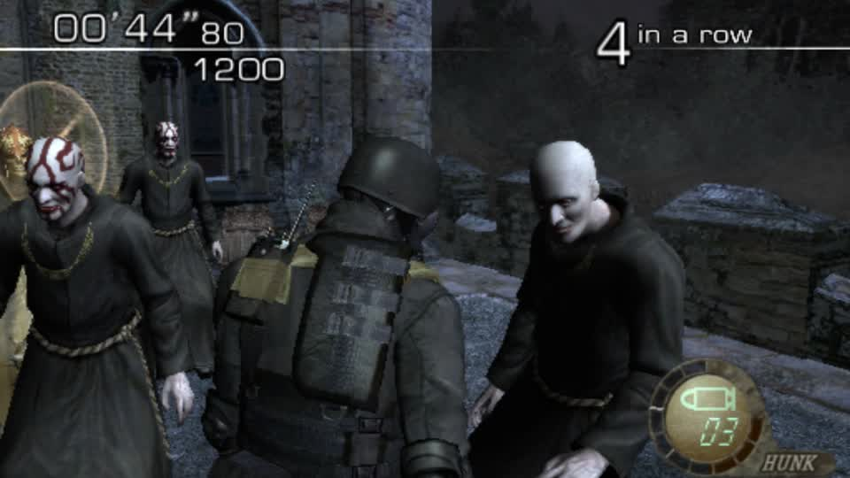

# RE4 in MercMode: what blocks it, in the code's own words (2026-11-07)

## The rule that decides which RE4 runs

MercMode will not fall back to a native edition by accident. `gbox/re_switch.py`:

```python
EDITIONS = {'re5': {'platform': 'switch', ...}, 're6': {...}, 're4': {'platform': 'switch', 'mode': 'mercenaries',
                                                                     'title_id': '010099A00BC1E000'}}
def preferred_spec(title, native_spec, settings):
    """The selected edition stays visible and never falls back silently to the native (GameCube / PS3 / Xbox 360) one."""
```

Asking for the GameCube disc is refused:

```
POST /api/mercmode {"op":"configure","titles":["re4"],
                    "preferred_editions":{"re4":{"platform":"gamecube"}}}
-> 400 "RE4 edition preference must select Switch 010099A00BC1E000 mercenaries"
```

So "RE4 in MercMode" means **the Switch edition**, and the GameCube build - which the bot already plays well, and which
the `re4-gc-decomp` reference describes exactly - is not an available substitute. That is deliberate, and it is the right
call: a silent fallback would make every report about the wrong build.

## What the Switch edition is missing

`RE4_REASON` in the same file states it precisely:

> Switch RE4 Mercenaries runs on Citron NEO with the re4_switch driver. Boot and round entry are verified (three A presses
> after the stage draws); the health offset (unit+0x3c2) and the score/damage routines come from the decompiled module.
> **Still missing for autoplay: the player unit pointer and the Mercenaries unit list, so the driver cannot snapshot
> player or enemies yet.**

Two anchors, in the driver's own names:

| constant | what it must resolve to |
|---|---|
| `S_PLAYER` | the player unit pointer (module_base + offset, or a slot) |
| `S_EMMGR` | the Mercenaries unit list: base / count / stride |

Everything else about the title is done: the signature is measured (`SIG_OFF = 0x100000`, the base was found live at
`0x3ca7c04000`), `module_base(m)` works, boot and round entry are verified, and the health offset is known.

## How to find them

The RAM inspector already provides the machinery (`docs/ram_maps.md`, `gbox/ram_inspector.py`):

```
GET  /api/sessions/{sid}/ram                                  the inspector: map, reader, budget
GET  /api/sessions/{sid}/ram/hex?address=&length=&pointer=     bytes now (a pointer chain is supported)
POST /api/sessions/{sid}/ram/search {type, base, size, tolerance}   a Cheat-Engine-style first snapshot
GET  /api/sessions/{sid}/ram/search                            candidates
POST /api/sessions/{sid}/ram/search/sample {label, op, value}   narrow it
```

The plan for one boot of the Switch title, in a round:

1. `module_base` from the measured signature (`/ram/hex` at a candidate base + `SIG_OFF`).
2. A `u16` search for the **health value** (100 at full health) over the module's writable range - `base + 0xb2c738`,
   size `0x11938c8` per the ELF's `.bss` - then one sample after damage to narrow it down. The surviving address minus
   `0x3c2` is a **unit**, and the unit is `S_PLAYER`'s target.
3. A pointer scan for that unit's address in the module's data (4/8-byte), which gives the **static slot**:
   `S_PLAYER = that offset`.
4. The unit list (`S_EMMGR`) falls out of the same unit: its siblings are contiguous or chained from a manager; a stride
   search over the unit's address finds neighbours that also read as units (a plausible `+0x3c2` health).

Nothing in this plan is guesswork about *layouts* - the offsets are known - only about *addresses*, which is exactly the
half a live scan settles and a decompilation cannot.

## Why this is worth doing rather than swapping in the GameCube disc

The GameCube build already has every anchor (`re4_editions.py`, verified live) and the bot plays it. But the objective is
about **the Switch and Occulus titles**, whose assets are the ones this session has been decrypting, inventorying and
writing - `em16`'s meshes, `ImagePackHD`'s archives, the FEN texture writer. Autoplay on that edition is what makes those
mods observable in a moving game instead of a single screenshot.

## Round 48: RE4 is in the MercMode rotation (2026-11-07)

Two gates had to move, and one of them was a misreading of this system's own notes.

**The Switch edition's `playable` flag.** `re_switch.preferred_spec` returned `'playable': False` for
`RE4 (Switch, Mercenaries)` with `RE4_REASON` as the note. That reason names what is missing for the *snapshot* - the
player unit pointer and the Mercenaries unit list - and those are still missing. But "cannot snapshot" is not "cannot
play": with `gbox/re4switch_bot.py` (round 47) the title walks its menus and enters rounds from the screen. The flag now
reads `playable: True` with `playbook: re4switch_bot` and a new key, `perception: "screen-only"`, so a caller can tell the
difference without reading prose. `RE4_REASON` says the same thing in words: it cannot aim, count kills or read a rank, and
a report from this title says so instead of inventing one.

**The edition that actually launched.** With `preferred_editions` cleared, `preferred_spec` falls back to the **native**
edition - the GameCube disc - and that is what MercMode started:

```
phase playing | title Resident Evil 4          session 78ab9efa2e310db4 (GC disc 1)
frame: 00'44"80 | score 1200 | 4 in a row | HUNK
```



That is the mature GameCube bot (full RAM anchors) playing a real round through the rotation, which is the thing that
had not been demonstrated. The Switch edition remains the one to finish for the Switch/VR goals, and it is now selectable
rather than refused.

**Note on ordering:** the two editions answer to the same title. `preferred_editions.re4 = switch` selects the port;
clearing it selects the disc. Both are now `playable`, so the choice is explicit rather than a fallback.