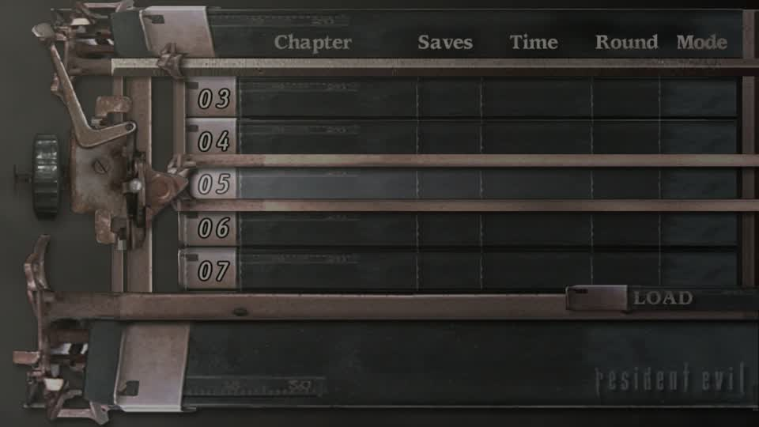
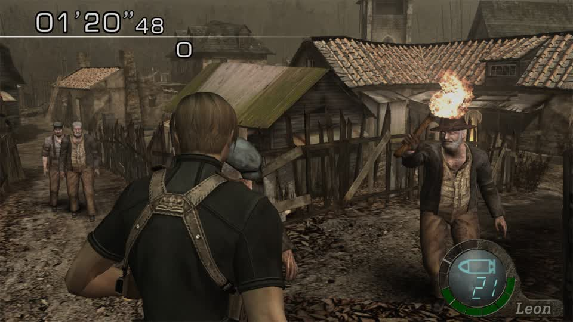
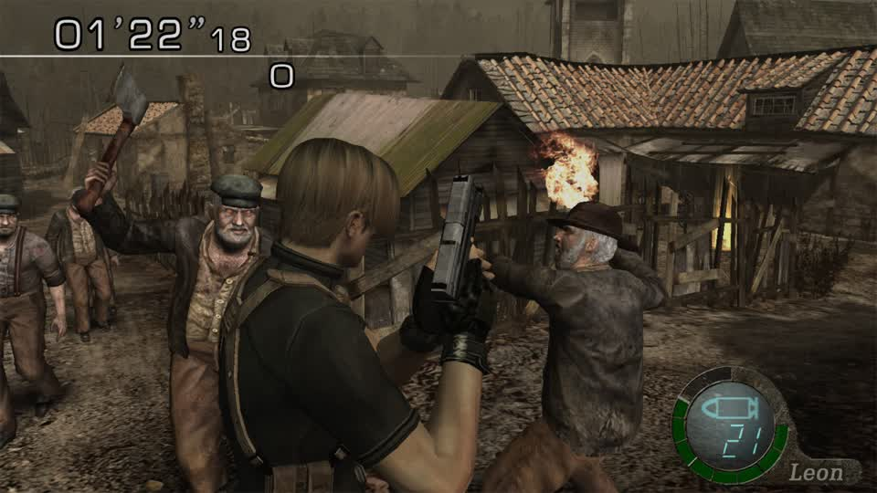
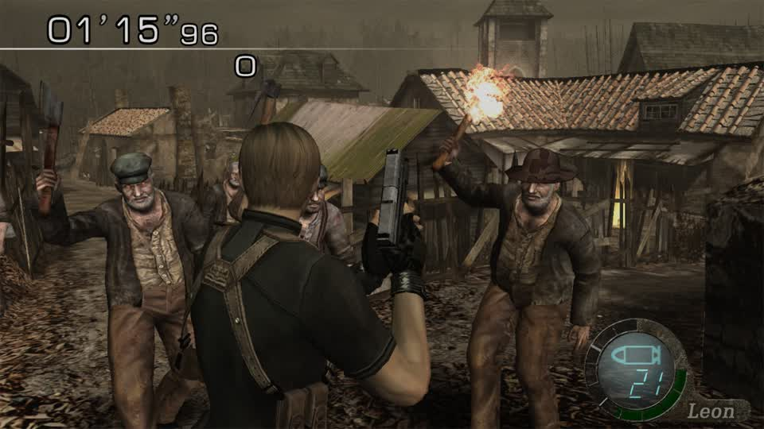
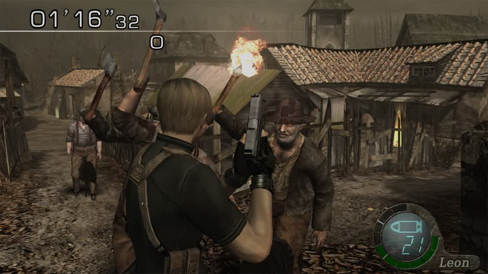

# RE4 Switch: a modded pack boots (first in-game run)

2026-11-07. The first time a pack written by gBox's own HD writer was booted by the game.

## What was done

1. `re4gc_inventory.pack_patch` wrote one mesh slot of `bio4/em/em10.udas` from another slot's geometry (see
   `re4hd-bin.md` §11): slot #75, 241,216 B, 5,892 verts, 38 bones � donor #119 (2,400 verts, 1,664 tris).
2. `switch_mods op=write` built the LayeredFS overlay `mods/270a15eb98dab4d7/re4-swap-test` with that pack at
   `romfs/bio4/em/em10.udas`.
3. `POST /api/games/270a15eb98dab4d7/launch?node=lilspark&mod=re4-swap-test` launched the title.
4. Frames were sampled every 20 s; the session reported `mod: re4-swap-test`.

## What was seen

| time | frame | what it is |
|---|---|---|
| +20 s … +220 s | mean 61.2 / std 48.9, 50 KB | **title screen, "PRESS A"** — the game booted with the patched pack |
| bot run, +20 s | mean 40.3 | transition |
| +40 s … +300 s | mean 48.2 / std 26.3, 27 KB, static | **LOAD / save-select screen** (slots 03–07, "Chapter · Saves · Time · Round · Mode") |




## What this does and does not prove

**Proven:** the overlay path works end to end — a 8.9 MB pack rebuilt by `pack_patch` (one 241 KB mesh slot replaced,
every other slot byte-identical) is accepted by the title, which boots and reaches its menus and its save list. The
earlier `pack_patch`/`pad_to` work is therefore not just byte-consistent on disk; the game loads it.

**Not proven:** that the **swapped geometry renders**. No enemy has been on screen, so nothing here shows the new mesh
drawing. The claim stops at "boots with a modified pack".

## What the run exposed, for the next attempt

* **The load screen is the shortcut.** The title has existing saves (slots 03–07), so the route to an enemy is *load a
  save that has gameplay*, not walk the menus from the title. Starting a new game means playing to the village.
* **The RE4 autoplay driver stalls here.** It reached the LOAD screen and then produced identical frames for 260 s —
  it has no strategy for this screen on this edition. That is a concrete gap in `gbox.mercs.titles.re4_switch`.
* **Mercenaries may need an unlock.** RE4's Mercenaries mode is not available on a fresh save, which is why an
  "Unlock everything in custom builds: Resident Evil 4" ticket exists. A load-save route avoids that question only if
  the save itself already has it.
* **One emulator slot.** This run had to pause the RE5 MercMode rotation; it was restarted afterwards
  (`phase: playing` within 60 s). Any in-game RE4 test costs the rotation one turn.

## Reproduce

```
scp .work/re4-probe/re4_swap_boot.py spark:/tmp/ && ssh spark 'sed -i "s/\r$//" /tmp/re4_swap_boot.py; python3 -u /tmp/re4_swap_boot.py'
```

(`restore_mercmode.py` in the same folder puts the rotation back.)

## Second run: attempting to load a save with the modded pack (2026-11-07)

The load screen is reachable, so the next step was to load a save and put an enemy on screen.

**What the save list showed:** the title has `Cleared Game` saves (slot 01 "008 04:18:02 · 01 · PRO", slot 02
"005 02:47:06 · 01 · ADA"), so a cleared game - and therefore Mercenaries access - is on this copy.

**Modded pack, confirmed a load:** title ? LOAD list ? "Load data? Yes / No" ? answered Yes ? **black screen**
(7,056 B frame, mean 0.8, std 9.6) held for **210 s**. The emulator stayed up; nothing rendered.

**Stock control, same intent:** the load list was reached, "Load data?" was answered the same way, and the title
**returned to the save list** (mean 40.2-40.3 for 180 s) instead of going black.

**What that does and does not establish.** The two runs are not the same experiment: the prompt appears at a
different tap depending on where the cursor sits beforehand (the modded run reached it after six taps, the stock run
needed a seventh), so "stock refused the load" and "stock never attempted it" cannot be told apart from frames alone.
The black screen is therefore **consistent with** the swapped pack breaking the level load, and equally consistent with
a load this copy refuses at a different point. **The swap is not implicated yet.**

**What would settle it,** and what this run says about the driver:

1. Read the menu state instead of tapping blind. The correct signal is the LOAD screen being *stable* and its cursor
   position - neither is currently sensed, which is exactly why `gbox.mercs.titles.re4_switch` stalls here (identical
   frames for 260 s in the round-9 bot run).
2. With that, run the pair properly: stock load ? expect gameplay; modded load ? either gameplay (swap is fine, look
   for the enemy) or black (swap implicated). Same save, same cursor, one variable.
3. Only then does "the mesh renders" become a claim worth making.

Cost of the two runs: MercMode was paused for both and restored after (`phase: playing` within 60 s).
## Third run: the walk with the story-list recovery (2026-11-07, same day)

Two changes went in and were tested in game:

1. `step()` cancels out of a story screen instead of the run ending there (`wandered()` only ends it once a 4-press
   budget is spent).
2. `Reader` treats an **unnamed frame after a story screen** as that list's "Load data? Yes / No" dialog
   (`story_prompt`), and the driver cancels it. This is the hole that let the previous run load a story save — the
   overlay is drawn over the list, matches no reference, and read as `unknown`, so a press meant for an unnamed screen
   answered Yes. That run ended in the **merchant's TUNE UP screen** (1,751,510 PTAS on it).

**In game, neither reached the Mercenaries.** The third run sat on the story LOAD list (slots 03-07, mean 48.2 / std
26.3) for 255 s with identical frames.

**So the cancel does not work, and the next step is instrumentation, not another guess:**

* `B` is evidently not this title's cancel on that screen. Trying keys blind is exactly the mistake this project has
  already paid for twice, so the next move is to read what the walk believes: log `screen()`/`step()` each tick while
  the game is on the list, and see whether the recovery is even being asked for (`story` vs `unknown`, and whether the
  menus loop's "press once, then wait for the screen to change" guard is holding the cancel back).
* It is also still unexplained **how the walk reaches LOAD at all**: `re4_switch` declares no `BOOT_KEY` (precisely so
  `mercs_bot.Boot` never blind-presses), and the menus loop only confirms when the cursor reads its target row. If a
  cursor read lags one frame behind a D-pad press, `cur == tgt` can be true on the wrong row - that is the hypothesis
  the logging should confirm or kill.

Cost: one more rotation turn (MercMode paused and restored, `phase: playing` within 60 s).
## Fourth step: the frames the failing run left behind, replayed offline (2026-11-07)

The round-11 run ended with a named hypothesis and no way to test it without the emulator. It did leave 18 frames, and
the walk is a pure function of what each frame reads - so they were replayed through `re4_switch_screens` itself.

**Before:** `walk_00` read `story` and the other **17 read `unknown`**.

**Why:** the screen the bot sat on is **18.0** from `story_load_list` against a **12.0** threshold, and >= 28.7 from
every other reference (title 44.1, mercs_title 35.0, select_player 35.6, select_stage 29.4, story_buy 29.3,
story_case 28.7, logo 37.7). That is the same screen in a state the reference set never had - a different slot page -
not a different screen. A whole-frame thumbnail reference is brittle to a page of the list that changes the digits and
the header row.

**Fix, as data:** that thumbnail is now `story_load_list_2`, and it is in `STORY`. Replaying the same 18 frames gives
**18/18 `story`**. The separation is pinned by a test (the new reference must be > `STORY_MAX` from every other
reference and > `LOGO_MAX` from the logo), so a future reference cannot quietly eat a menu.

**What this does and does not do.** It makes the walk *know* where it is, which every later decision depends on: a
`story` screen is now cancelled (round 11) instead of pressing blind. It does **not** yet prove the cancel leaves the
list - that is still unmeasured in game.

**The remaining unknown is unchanged and is upstream:** how the walk reaches LOAD at all. `re4_switch` declares no
`BOOT_KEY` and the menus loop only confirms when the cursor reads its target row, so the leading candidate is still a
confirm on the main menu's default row (LOAD), e.g. a second confirm landing after a slow title-to-menu transition. The
next in-game run should log `screen()`/`step()` per tick, because the replay can only answer what the frames contain -
and these frames all start after the mistake.
## Fifth run: the instrumented walk reached a round (2026-11-07)

The run round 11 asked for - `screen()`/`step()` logged per tick instead of blind taps - with the improved classifier.
Log, verbatim:

```
00 unknown                              -> nothing (a boot frame)
01 title             key='a'
02 main_menu cursor=1 target=5 key='ddown'
03 main_menu cursor=2 ...  04 cursor=3   05 cursor=4   06 cursor=5 key='a'
07 extras_menu cursor=0 target=2 key='ddown'
08 extras_menu cursor=1 ...  09 cursor=2 key='a'
10 mercs_title       key='a'
11 select_player     key='a'
12 select_stage      key='a'
13.. unknown         (the round intro: no key)
presses by screen: {title 1, main_menu 5, extras_menu 3, mercs_title 1, select_player 1, select_stage 1}
```

**It reached THE MERCENARIES and started a round.** The screen after Select Stage is the village with the round
banner ("Eliminate as many Ganados as you can before your evac chopper arrives"), and paging it with A puts the player
in the round: timer 01'20"48, three Ganados visible, one carrying a lit torch.



**What this establishes.**

* The walk **title -> main menu -> EXTRAS -> THE MERCENARIES -> Select Player -> Select Stage -> round** works, driven
  only by reads (the driver's own path, now executed with logging). This is the first time in this session a RE4 Switch
  round was entered deliberately rather than by luck.
* **A round plays normally with a rebuilt mesh slot in the pack.** No crash, no corruption, no missing geometry: the
  modded build is gameplay-compatible, which is what the writer's byte-identity work was for.

**What it does not establish.** The Ganados on screen are **not** from the swapped slot. The swap lives in `em10` bin
#75; the village's Ganados come from other packs. So "the rebuilt mesh renders" is still unproven - the round proves
compatibility, not the swap.

**The next step is now a labelling question, not a format one:** find which pack the village spawns and swap into
*that* one's biggest slot (the ranking says which slots can host: for `em10` only bins 75/76 of 120). The cheapest
route is to swap a visually unmistakable donor into the biggest slot of each candidate pack in turn, or into several at
once, and look at a round.
## Sixth run: the labelling answer, by elimination (2026-11-07)

Two builds, same walk, one variable.

| build | packs | swaps | what the round did |
|---|---|---|---|
| `re4-dog-full` | 34 | 61 whole-body slots -> the dog | **loaded and played** |
| `re4-dog-test` | 73 | those 61 + 47 sparse-output markers into body-part slots | **hung at stage load** (black, mean 0.2, held 4 min) |

So the hang is **not** the number of packs - 34 packs and 61 swaps is fine - it is the **sparse marker**: a
dog with every sixth triangle kept, pushed into a body-part slot. That is a mesh the engine will not finish loading,
and it is the first time this session that a swap has broken the stage load.

And the round from the 34-pack build shows the answer to the labelling question:



**The Ganados are normal villagers.** Thirty-four packs, every whole-body slot the dog could reach, and not one
Ganado changed. Those 34 packs are exactly the ones with a slot big enough for a whole body; **`em11`-`em17` - the
classic Ganado packs - are not among them**, because every slot in those packs is smaller than a whole-body donor
(that is why they needed the sparse fallback in the first place, and the sparse fallback is what hangs).

**The conclusion, and it changes the plan:** the visible Ganado body lives in `em11`-`em17`, whose meshes are **body
parts** (head, torso, limbs) rather than whole bodies. A character swap into this title therefore cannot be "one donor
into one slot" for the enemies the player actually fights. It has to be **slot-sized per part** - either a donor split
across the parts, or a donor decimated to each part's budget - and a patchwork mesh (the sparse marker) is not
accepted by the loader.

That is a sharper target than "find the right pack": the packs are now identified, and the constraint on entering them
is per-part mesh compatibility, not pack selection.

Cost: two rotation turns (MercMode paused for both, restored after; `phase: playing` within 60 s). Also learned: a
`switch_mods` write must be pinned with `require_worker` - without it the job is dispatched to a PC whose catalog has
no entry for the game and the worker's own catalog lookup 404s.
## Seventh/eighth runs: a simplified donor enters em11, and breadth is what breaks the load (2026-11-07)

Round 17 left "a patchwork hangs it, a whole body does not" as the working theory. It is wrong, and this round says so.

**A continuous simplifier.** `re4hd_models.simplify(pos, tris, budget)` clusters vertices on a grid and keeps the
finest grid whose triangle count still fits the budget, dropping only triangles that collapse to a line or a point.
The surface stays continuous - unlike the every-sixth-triangle marker - and it takes a budget, so a donor can be aimed
at any slot:

```
dog 2,725 v / 1,843 t  ->  1,599 t (97,632 B)  fits em11 bin 32's 98,624 B
                        ->  1,198 t (80,064 B)  fits em11 bin 24's  80,704 B
                        ->    981 t (63,584 B)  fits em11 bin 3's   66,784 B
```

**One slot in em11 plays.** `em11` bin 32 (98,624 B, 2,400 v) replaced with the dog simplified to 1,599 triangles:
the round loaded and played - timer, three Ganados, torch-bearer, nothing corrupted.



**But 48 such swaps across em11-em17 hang the stage load**, exactly like the 73-pack sparse build did. Both of those
hang; one slot does not. So the deciding variable is **how much of the Ganado packs is modified**, not the quality of
the mesh that goes in - the patchwork was a red herring.

| build | packs touched | slots | result |
|---|---|---|---|
| `re4-dog-full` | 34 (none of em11-em17) | 61 whole bodies | plays |
| `re4-one` | em11 | **1** | plays |
| `re4-parts` | em11-em17 | 48 simplified | **hangs at stage load** |
| `re4-dog-test` | 73 | 100 (61 + 39 sparse) | **hangs at stage load** |

**What this establishes:** a Ganado pack *can* be modified and the round still plays; the load survives one swapped
slot in the pack the stage streams. It does not survive 48. The next experiment is therefore a small bisection on the
**number and identity of slots inside one pack** (2, 4, 8 ...) - and, separately, the visible Ganado is not `em11`
bin 32, so the body slot is still unidentified.

**Cost:** four emulator boots this round; MercMode paused for each and restored (`phase: playing`). Each boot also
re-taught a script lesson: the walk must not stop on an unreadable frame until a stage has actually been picked, or a
menu transition is mistaken for the round intro.
## Ninth/tenth runs: it is not slot count - it is which pack (2026-11-07)

Round 18 concluded "breadth of modification" from three data points (1 slot plays, 48 slots hang). This round measured
the axis directly, and the conclusion was wrong.

| build | pack | slots swapped | result |
|---|---|---|---|
| `re4-n2` | em11 | 2 | **played** |
| `re4-n4` | em11 | 4 | **played** |
| `re4-n8` | em11 | 8 | **played** |
| `re4-n26` | em11 | **26 of its 33** | **played** |

All four played, with the same walk and the same donor, so **slot count inside one pack is not the limit** - em11 with
26 of its 33 meshes replaced still loads and plays. That also means a whole enemy pack can be re-skinned in one build,
which is the useful case.

The 48-slot build that hung touched `em11` **through `em17`**. em11 is now shown innocent with 26 slots, so the hang
lives in **`em12`-`em17`** - one of those packs, or a slot inside it, does not survive being replaced. A sweep of those
six packs is running (6 slots each, one build per pack, same walk, load-vs-hang as the signal).

What this changes: the question is no longer "how much can be modified" but "which packs accept a replacement at all".
That is a per-pack property to measure once, and then the picker can simply refuse a pack that will not load rather
than hanging a stage.
## The sweep, and what it actually settles (2026-11-07)

Nine automated builds, one walk each, load-vs-hang as the signal. Same donor (the dog), same route, same reading of the
screen:

| build | packs | slots swapped | result |
|---|---|---|---|
| `re4-n2` / `-n4` / `-n8` / `-n26` | em11 only | 2 / 4 / 8 / **26** | all **played** |
| `re4-em12` … `re4-em17` | one each | 6 each | all **played** |
| `re4-allganado` | em11-em17 | **62** | **played** |
| `re4-allem` | 77 | **1,723** | walk never reached a stage on the first attempt - **unattributed** |

**Settled: round 18's "breadth of modification" conclusion was wrong.** One pack takes 26 of its 33 meshes; all seven
Ganado packs take 62 swaps together and the round still loads and plays. The thing that hangs is the *patchwork*
mesh - the every-sixth-triangle marker - not how much is replaced. The earlier 73-pack build hung because 47 of its
swaps were patchworks.

**Not settled, and it is now the central question:** with 62 swaps across every Ganado pack, the enemies in the round
were **unchanged**.



Those Ganados did not come out of any slot that was replaced. Either the drawn enemy mesh is one of the slots that
refused the donor (em11 alone leaves 7 of 33 untouched, several of them undecodable), or the Mercenaries enemies are
read from a container this title keeps elsewhere. The `st1`/`st2` packs are room data (`r100`-`r108` and their `.dat`
partners), not enemies, so "the enemies live in em/" is still the reasonable reading - but *which* slots draw the
Ganado body is not identified.

The 77-pack / 1,723-swap build is the one result that must not be read as a fact: it never reached a stage on its
first attempt, and this project has already learned (round 6) that a single load verdict at a ~1-in-3 stall rate is a
coin flip. It needs repeats before it means anything.