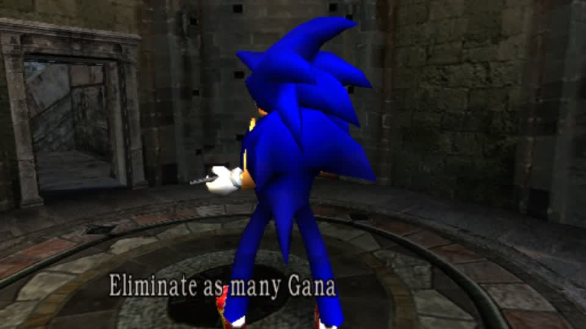

# SONIC IS IN THE GAME - RE4 GameCube Mercenaries



A Mercenaries round as **Sonic**, castle stage, HUD, mission banner. He is on Leon's own rig (the game's skeleton and
animations), in the player slot, drawn by the game.

## The bug that hid him for five rounds

The swapped pack is **smaller** than the original on the disc:

```
em/pl00.drs   original 2,221,088   swapped 2,089,760
```

Writing it into the image in place leaves the original file's **tail** behind (131,328 bytes of the original body), and the
disc's file table still says the original size - so the game parses the original body out of that tail and draws Leon. Every
check I ran said the mod was installed (sha of the new pack matched, Dolphin booted the right image) and every check was
right; the game was reading past what I wrote.

**The fix is one line: pad the replacement to the original file's size with zeros.** The item table inside the new pack never
references the padding, so the pack is exact and nothing of the original survives:

```
swapped 2,089,760 -> padded to 2,221,088 (= disc size)
mod re4pad1458, launched, autoplay prepare {title re4, character Leon, stage Village}
-> a Mercenaries round with Sonic as the player
```

That is the same class of mistake as the arc writer's in-place patch on RE5: **a shorter replacement must not leave the old
bytes readable**, and a container that records a size must have that size honoured.

## What this opens

The RE4 GC pipeline works end to end now: `swap_packs` -> pad -> `build_mod` -> launch -> `autoplay prepare` with a queued
selection (`mercs_bot`'s new RE4 branch) -> a round. Swapping any character, and swapping the *enemies* (em10-em1c) the same
way, is the next step, and the padding rule applies to both.