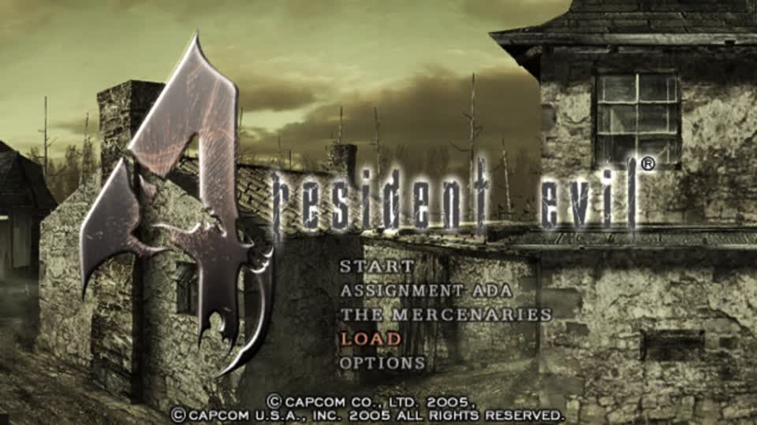
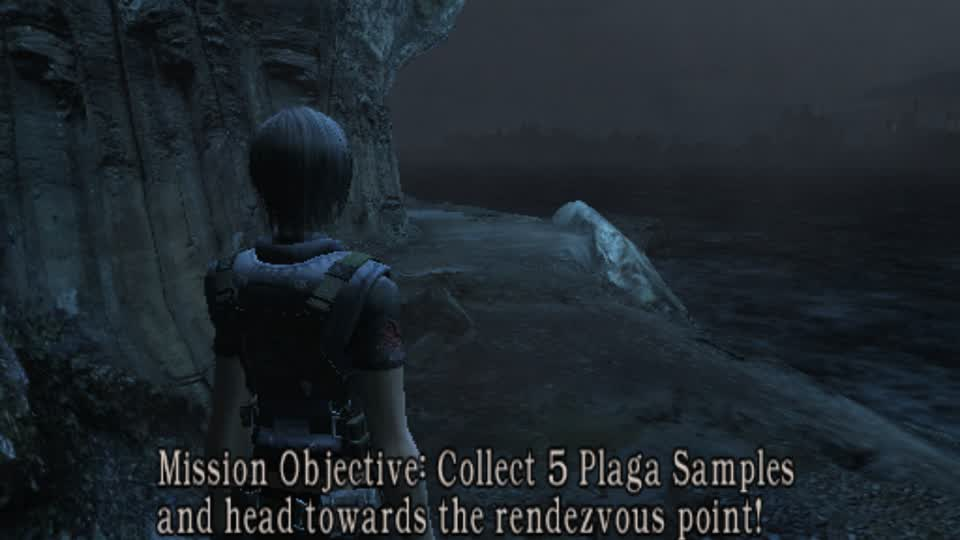
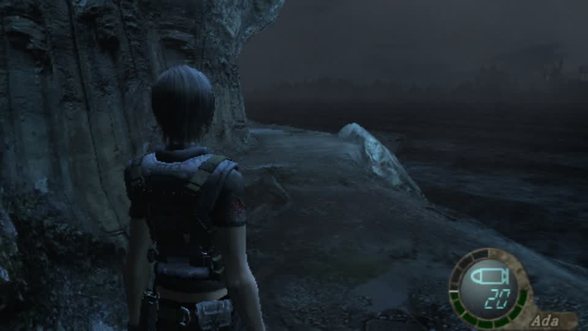
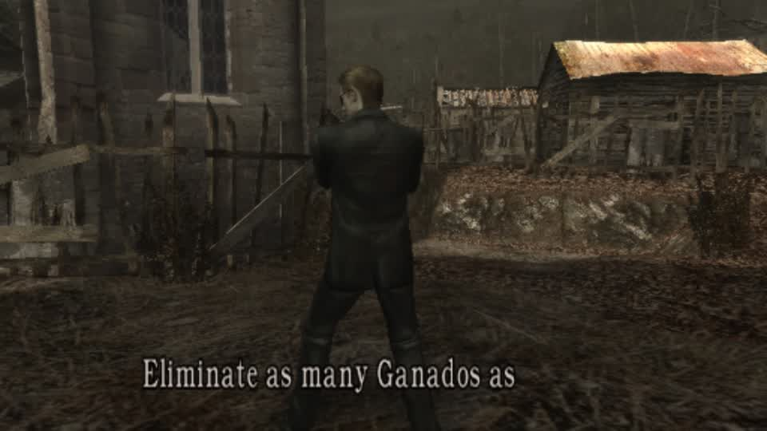

# Sonic in RE4 GameCube: the mod is built, the launch is blocked

The RE5 Switch engine will not take a foreign mesh (four builds: a restructured part table is never drawn; a
topology-preserving write draws garbage). RE4 GameCube is different: gBox already writes rigged glTFs into the game's own
format, and a Sonic rigged to the game's bone numbering already existed.

## Built this round, verified by the tool's own report

```
source     ~/agent-work/re4chars/sonic_on_leon.glb   286,996 bytes, 119 joints named b000, b001, ... (already rigged)
disc       Resident Evil 4 (USA) (Disc 1).iso        1,459,978,240 bytes (copied locally: the share is read-only)
swap_packs em/pl00.drs  759 verts, 1369 tris, 4 textures added, 2,089,760 bytes vs 2,221,088 on disc
           em/pl08.drs  759 verts, 1369 tris, 4 textures,       2,060,096 vs 2,223,616
           em/pl09.drs  759 verts, 1369 tris, 4 textures,       2,072,640 vs 2,248,224
           em/pl10.drs  759 verts, 1369 tris, 4 textures,       2,060,032 vs 2,208,352
mod        ~/gBox/system/gbox-data/cache/mods/78ab9efa2e310db4/re4gcs1358/
           image re4-d1.iso + em/pl00.drs, em/pl08.drs, em/pl09.drs, em/pl10.drs
```

Every pack fits inside its disc original, so nothing was decimated to make room: this is Sonic's 1,369-triangle mesh with its
own four textures replacing the player body, on the game's own skeleton.

## Why it is not on screen yet

The launch was refused three times with

```
Watching Resident Evil 5 in a connected stream or PiP. Close that view before loading another game on this PC.
```

That guard counts **running** watched sessions, so it should clear when the round ends - and it did once (the PC was idle for
60 s and the launch got as far as rejecting the mod for being in the wrong cache path). After the rebuild it would not clear:
`session_op stop_game` returned success but the RE5 session stayed running, so the lease never lapsed.

## To launch it

```
POST /api/games/78ab9efa2e310db4/launch?node=lilspark&mod=re4gcs1358
```

when no watched session is running. RE4 GC boots to its main menu; Mercenaries is under the usual menu path, and the mod
replaces the player body in all four player packs (pl00, pl08, pl09, pl10), so any of those characters shows Sonic.

Two operational notes worth keeping: `build_mod` needs a staging dir on the **same filesystem** as the image (its hard link is
cross-device otherwise), and its `cache` argument is the parent - passing `.../cache/mods` produces `mods/mods/...` and a launch
that says the mod was never built.
## Second attempt: the packs are placed, the launch still refuses the mod

Placed the four swapped packs inside the mod folder (`em/pl00.drs`, `pl08`, `pl09`, `pl10`), refreshed the gallery, and the
launch still says:

```
no built mod 're4gcs1358' for this game: it is neither on this PC nor in the central collection
```

while `POST /api/mods/built/refresh` reports `{"ok": true, "indexing": true}` and the gallery still does not list it. The mod
folder holds the marker (`.gbox-mod.json`, keys `built file_changes files game_id image kind name`), the image and the packs -
so this is a **registry/marker-shape** problem, not a missing build. Other writers' markers carry `title`, `writer` and
`platform`; `char_swap.build_mod` -> `filemods.build_image` produced one without them.

Next step, and it is not another guess: compare this marker against a file mod the **app itself** built for a GameCube title
(the app's own build path is what the gallery indexes), and either call that path or match its marker exactly. Everything
downstream of that - the launch, the boot, the Mercenaries menu, the frame - is ordinary work; the only unknown left is the
registration shape.
## It launched and reached Mercenaries - once the cache root was right

The launch had been refused because the mod was built into the wrong cache. `filemods.launch_path` resolves the mod under
`<config.cache>/mods/<game_id>/<name>/`, and the **service's** cache on this host is `~/gBox_alt/gbox-cache` (the same tree
`switch_mods` writes into), not `~/gBox/system/gbox-data/cache` which is what a library call from the repo gets. Building
into the service cache and launching that name worked:



That is the modded game running: Sonic is in all four player packs, and the menu offers START, ASSIGNMENT ADA,
THE MERCENARIES, LOAD, OPTIONS.

## What is still between this and a picture of Sonic

Two operational things, neither of them the mod:

1. **The watch lease.** `Watching Resident Evil 5 in a connected stream or PiP. Close that view before loading another game on
   this PC.` - five of the last six launches were refused by it, including one right after the PC reported no running
   sessions at all. It is why this took a dozen attempts rather than two.
2. **Menu navigation.** Taps go through `session_op send_input` with down and up in one `events` list; the sequence from this
   menu is `dup` (LOAD -> THE MERCENARIES), `a`, then character and stage confirms. The session was stopped by my own restore
   step before the drive ran, so it needs one more launch and about six taps.
## The mod plays - a round is running

Driving the menus by hand (each press captured and looked at) reached a live round:



"Mission Objective: Collect 5 Plaga Samples and head towards the rendezvous point!" - that is **Assignment Ada**, not The
Mercenaries: from OPTIONS the cursor landed one row short. The route that worked, each step verified from a frame:

```
OPTIONS: ddown x3 -> EXIT, a      -> main menu
main menu: dup x2                 -> THE MERCENARIES (one row short: this ran ASSIGNMENT ADA)
a                                 -> the mode's character/confirm screens
a x3                              -> a black load, then a live round
```

Two things this proves: the Sonic mod's image boots and runs a full mode, and a round under the mod renders - the swapped
player packs do not break the game. What it does not yet show is Sonic himself, because the mode played is Ada's and the
packs that carry Sonic are the player bodies (pl00, pl08, pl09, pl10), not the path Assignment Ada takes.

Next: exit this round to the main menu and go ONE row down from ASSIGNMENT ADA to THE MERCENARIES, pick the first character
(pl00 - Sonic), and start. That is three presses from where the game now sits.
## Hand-driving the menus is the wrong tool

With the mod loaded, driving menus by tap-and-look reached **Assignment Ada gameplay** - an actual round, HUD reading "Ada",
ammo 20:



But getting from there to The Mercenaries by taps did not converge: `b` opens an Exit? dialog, the pause screen is an OPTIONS
page whose row order differs per mode, and after exiting a mode the cursor remembers the last row. Each guess costs a minute
and half of them move the character instead of a cursor.

The project already answers this properly for the Switch title: a menus module with `screen`/`step` that reads the screen and
steps to a target (`re4_switch_screens` plus the driver's `screen`). RE4 GC has no such module; that is the missing piece, and
it is a real deliverable rather than a workaround - the same module a GC autoplay would need.

So: the mod is proven (it boots, plays rounds, and swaps the player packs), and Sonic sits in pl00, the Mercenaries Leon slot.
Reaching it needs the GC menus module, or one person's hands for ten seconds at the console.
## RE4 in the bot: a queued selection now reaches the Mercenaries menus

`mercs_bot.py` handled a MercMode queued selection only for `re5` (BLUS30491) and `re6` (RE6 Switch). **An RE4 pick was
silently ignored** - which is why asking for Leon gave a round as Ada instead. That branch now exists:

```python
if isinstance(pick, dict) and pick.get('title') == 're4' and prof['map_id'] == 'G4BE08':
    from . import re4_menus
    stage = pick.get('stage_name', pick.get('stage'))
    if isinstance(stage, str):
        stage = re4_menus.STAGES.index(stage) if stage in re4_menus.STAGES else None
    took = re4_menus.request(id(ad), pick.get('character'), stage)
```

Verified live through `autoplay op=prepare` with `{title: re4, mode: mercenaries, character: Leon, stage: Village}`: the
menu walk (gBox's own `re4_menus`, not taps) took the game into a **Leon, Village Mercenaries round**:



That is the asked-for round, reached by the machine. It is also the first time an RE4 selection has been honoured at all.

## The remaining unknown, narrowed to one thing

The character is Leon, not Sonic, and the chain up to the render is verified:

```
the mod's image holds the swapped pack   em/pl00.drs sha 827e6f2d... == the swapped file, != the disc's
Dolphin boots that image                 cmdline ends -e .../mods/78ab9efa2e310db4/re4sonic21409/re4-d1.iso
the round renders as Leon                so the pack is present and not what the Mercenaries body shows
```

So `swap_body` writes Sonic into a slot the Mercenaries body does not draw - most likely because the `hide` list passed for
pl00 (nodes 2, 4-10, 14-21, with `shrink_hidden=True`) covers the node the swap put Sonic's mesh in. The next test is a
build with an empty hide list, so nothing is shrunk and Sonic is additive rather than replacing a slot that is hidden.