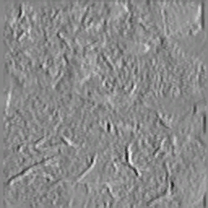

# RE4 Switch (HD) textures: the descriptor, and the archive the pixels live in

Measured 2026-11-07 on `~/gBox_alt/switch/romfs/010099A00BC1E000`. Code: `system/gbox/re4hd_tex.py`.

## Two things, and they are not the same file

A character pack's `TPL` slot **is not a GameCube TPL**. The GC one is magic `0x0020AF30` (GX, big-endian, carries its
own image table and pixel data). The HD slot is a 96-byte little-endian descriptor with magic `0x12345678`.
And it does **not** carry pixels: a 256x256 CMPR surface is 32 KB, the slot is 96 B.

## The descriptor (1,702 slots in 162 packs, 0 refused)

```
0x00 u32  magic 0x12345678                        all 1,702 slots
0x04 u32  version 1                               all
0x08 u32  16                                      all
0x20 u32  width (u16) | height (u16)              779 "image" slots; 0 high half on the other 923
0x24 u32  format 14                               image slots (the GX CMPR number); 0 on the others
0x28 u32  data offset 0x48                        image slots; 0 on the others
0x48      payload: u32 type 0x10, u32 texture id  observed ids across 0..191 (108 distinct)
```

The split is real and worth naming, because reading the second class as pictures is exactly the mistake that produces
`88x0` and `104x0` dimensions:

| class | count | what it says |
|---|---|---|
| `image` | **779** | width/height/format and the texture **id** the pack wants |
| `reference` | **923** | same container, format 0, no data offset — no dimensions and no id to report |

Dimensions among the image slots: 64x128 (180), 64x64 (174), 128x128 (142), 256x128 (68), 32x128 (66), 256x256 (62).

## The archive: `bio4/imagepackhd` — 1,813 `.pack.fen`, 6,144,462,613 B

```
u32 uncompressed size, then a zlib stream (78 9c)
```

The declared size equals the decompressed length **exactly** on every file checked (1.8 MB → 4.2 MB, 4.4 MB → 10.3 MB,
14.0 MB → 34.6 MB of file → body). `gbox.re4hd_tex.fen_open` refuses a stream whose declared size lies.

The decompressed body opens with two u32 counts and then a 64-bit offset table. **The entry map is established:**

* `count_b` **is** the entry count — `len(offsets) == count_b` on 40 of 40 archives, and on a further 60 archives
  (3,831 entries) every archive produced a consistent map with **0 failures**;
* the entries are the slices between consecutive offsets and the **last one ends exactly at the body end**;
* entry sizes: min 512 B, median 49,408 B, max 5,592,576 B; 1,788 of 3,831 entries are ≥ 64 KB.

Not understood: `count_a` (6 / 9 / 19 for bodies holding 3 / 13 / 89 entries, so it is not the entry count). It is
reported as-is and used to index nothing.

## What is still missing

1. **The surface codec.** Format 14 is the GX CMPR number, which on a Switch title is plausible but unproven — the
   pixel bytes have not been decoded into an image. Nothing here claims a texture preview.
2. **The id → entry mapping.** A descriptor names id 46; which of 1,813 packs and which entry that is, is not yet
   established. That is the join that turns "the pack wants texture 46" into bytes.
3. **The replacement path.** Once (1) and (2) exist, a skin swap is: decode → substitute → re-encode CMPR → write the
   entry in place → re-deflate the FEN → pad to the original file size (the rule the GameCube work paid for).

## API

```python
from gbox import re4hd_tex as T
info = T.tex_info(slot_bytes)          # kind image|reference, w/h/format/id, surface_bytes, carries_pixels
out  = T.fen_open(fen_bytes)           # declared_size, body, count_a, count_b, offsets, entries[]
data = T.fen_entry(fen_bytes, index)   # one entry's bytes
```

`tex_info` reports `carries_pixels: False` and says "descriptor only" whenever the slot is smaller than the surface it
names — the check that keeps a 96-byte descriptor from being mistaken for a picture.

Tests: `system/tests/test_re4hd_tex.py` (9 cases: image descriptor, reference slot, a GC TPL named as such, unknown
magic, a short slot, an offset outside the slot, the FEN size check, the entry map, a non-zlib stream).

## The pixels are plain DDS (2026-11-07)

The surface codec this note listed as missing is **not a private codec at all**. Every entry of an `imagepackhd`
archive is a 16-byte wrapper followed by a **DDS** file:

```
entry: u32 dds_bytes, u32 -1, u32 archive_number, u32 0     (16 B; a 64-byte variant exists)
       then "DDS " + the standard 0x7C header: height, width, mip count, pixel format
```

Verified over the first 8 archives: **680 textures, 0 refused**, formats **DXT3 (428)** and **DXT5 (252)**, dimensions
32x32 through 1024x1024, mip chains 9-11. 240 of the 680 carry the longer wrapper (the DDS is located by its magic
rather than assumed at 16, which is why they parse at all).

**And they decode to real images.** PIL opens the extracted DDS directly - two 256x256 DXT3 surfaces from
`00000009.pack.fen` render as stone and bark/wall detail maps:



That changes what a skin replacement needs. It is no longer "write a codec":

1. **Read** a texture: `re4hd_tex.fen_texture(archive, index)` -> header + the DDS bytes.
2. **Edit or substitute** it: any DDS tool, or `PIL` -> `save(..., "DDS")`.
3. **Write it back**: re-wrap, re-deflate the FEN, and patch the archive in place - the same rule as the model packs,
   the entry must be the entry's own size (or the whole archive re-deflated and the file-size field updated).

What is still open is the **join**: a pack descriptor names an id in 0..191 (108 distinct for the 162 em packs) and
nothing yet says which `(archive, entry)` that id is. The likely route is the descriptor's own `width x height` and
format against the DDS headers - a small search space once the descriptor's id is understood - and it is the next
piece of this line.
## The extraction tab can now show them (2026-11-07)

Two routes make the DDS half of the inventory visible without needing the descriptor join at all:

```
GET /api/decrypt-lab/textures?title=re4_switch&archives=40
    -> {archive_count, count, formats, textures: [{archive, index, width, height, format, mipmaps}]}
GET /api/decrypt-lab/texture.png?title=re4_switch&archive=00000009.pack.fen&index=1
    -> image/png
```

Measured live: `archives=6` returns **491 textures** (DXT3 323, DXT5 168, 0 failures) and the PNG route returns
65,896 bytes for `00000009.pack.fen` index 1 - byte-identical in size to the file produced offline from the same entry.
`archives` bounds the walk because every archive is zlib (the tree holds 1,813 of them and 6 GB of bodies), and the
catalogue is cached for 10 minutes so a page listing does not re-inflate on every poll.

So the extraction tab now has, for the HD RE4 port: **packs listed** (models), and **textures listed and previewed**.
What it still cannot do is say "this pack's texture 46 is *that* surface" - the join - and that is the remaining work
on this line.
## The texture join: three hypotheses tested, all falsified (2026-11-07)

The one gap left before RE4 Switch skins. The pack side and the archive side are now both readable, so the question is
purely how a descriptor's texture id (0..191, 108 distinct) reaches an `imagepackhd` entry. Everything tried:

1. **`id` names an archive.** Falsified: `id 45` asks for 32x128 CMPR, archive `00000045.pack.fen` holds 192x192 DXT5
   surfaces (0 exact matches), and archives 47/48 do not exist at all while descriptors ask for them.
2. **Descriptors are whole surfaces, matched by shape.** Falsified on counts: across every `em` pack there are 180
   descriptors of 64x128 against 96 surfaces of that shape in 120 archives, and 66 of 32x128 against 3. A 1:1 shape
   match is not there.
3. **Format.** The descriptors say `CMPR` (the GX number, 14) while the archives store **DXT3/DXT5** - so the format word
   in a descriptor is not the container's format either.

What the numbers do say: a descriptor's dimensions are **systematically smaller** than the surfaces in the archives
(32x128 and 64x128 regions; 128x128, 256x256, 512x512 and 1024x1024 surfaces), so descriptors are **sub-rects inside an
atlas**, which is why shape matching cannot work. Finding them needs the atlas and the rect's origin, and neither is in
the descriptor: the rect's position is almost certainly in the model's UVs, not the texture record.

**Therefore the join is not a lookup that was missed - it is a coordinate question.** The next attempt should start from
a model's UV range for a material and look for the atlas whose resolution makes those UVs land on the descriptor's
region size, rather than from the descriptor's id.

To make that work visible, the extraction tab now has both sides side by side under different routes:
`GET /api/decrypt-lab/texture-descriptors?title=re4_switch&pack=em10.udas` reports what the pack asks for
(75 slots: 33 image descriptors, 42 reference records, ids 45,46,47,48,66,...), against `/textures` which reports what
the archives hold (680 DDS surfaces in 8 archives). They are deliberately not presented as pairs.
## The UV-span test, and why the join needs either a census or the executable (2026-11-07)

The idea worth testing: a descriptor names a region `w x h`, a material's vertices carry UVs in [0,1], so
`w / span_u` and `h / span_v` should both give the atlas resolution and both agree on a power of two. That is a join with
no id involved at all.

**Result: it only ever matches when the span is ~1.0.** Measured over three packs:

```
em10: 6 of 200 materials, every match a span of 0.996-1.000 onto a 64x64 descriptor
em16: 4 of  77 materials, the same shape of match
em11: 2 of 109 materials
```

So the method is not wrong, it is **uninformative**: the great majority of materials use the full 0..1 UV range, which is
consistent with "the descriptor IS the surface" for those and impossible to distinguish from "the descriptor is a region
of an atlas that the material happens to fill". Two readings fit the same measurement, so the measurement cannot decide.

**What would decide it - and why it is now a background job.** Counting can: 174 descriptors of 64x64 exist across the
`em` packs, and the 120 archives sampled so far hold 107 surfaces of that shape. If the full tree holds *thousands* of
64x64 surfaces, shapes are shared and counting says nothing; if it holds a comparable number, a descriptor is one
surface. That is a census of 1,813 archives of zlib - **0.2 archives/s, about 2.5 hours** - so it is written as a
resumable job (`~/gBox_alt/re4-lab/surface-census.progress.json`, output `surface-census.json`) and left running in the
background rather than blocking a round:

```
     50 archives, 2,999 surfaces ({'128x128': 887, '256x256': 413, '1024x1024': 293, '192x192': 289})
```

**The other route is the executable.** How a texture id resolves to a surface is a code path, and this objective names
"the gidra systems" for exactly this kind of question: `docs/ghidra-service.md` describes the service, and the answer
(an index table or a hash lookup in the title's own loader) is worth more than any amount of shape guessing. That is the
step to take when the census comes back ambiguous.