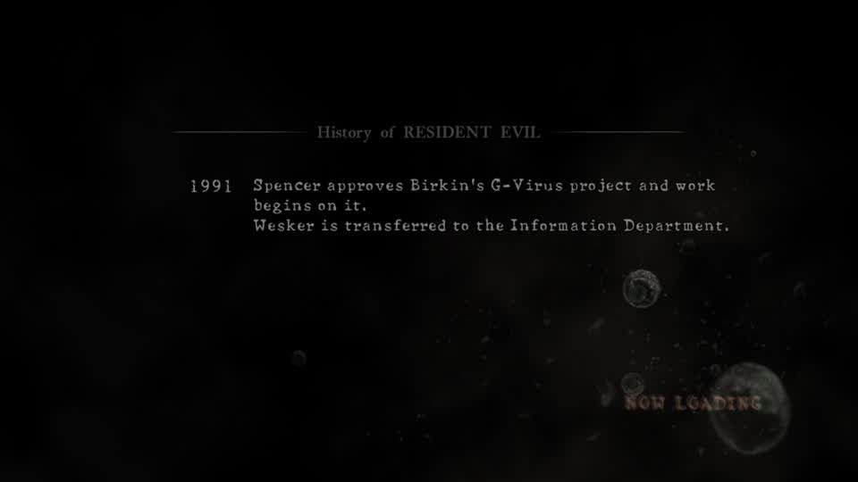
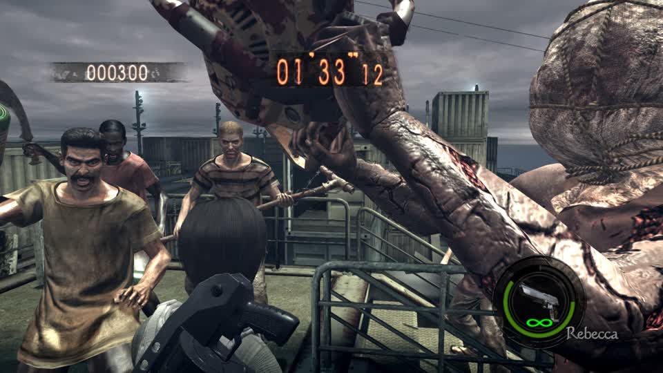
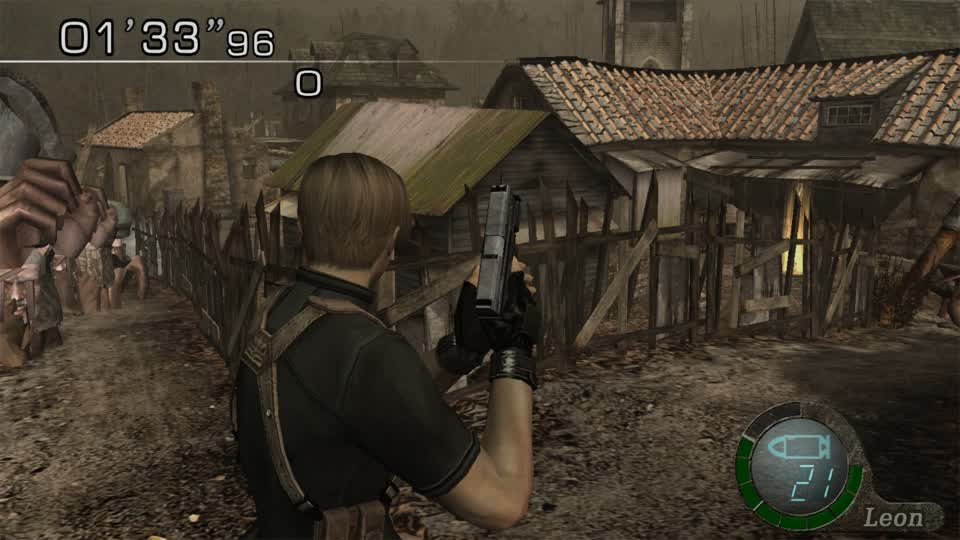
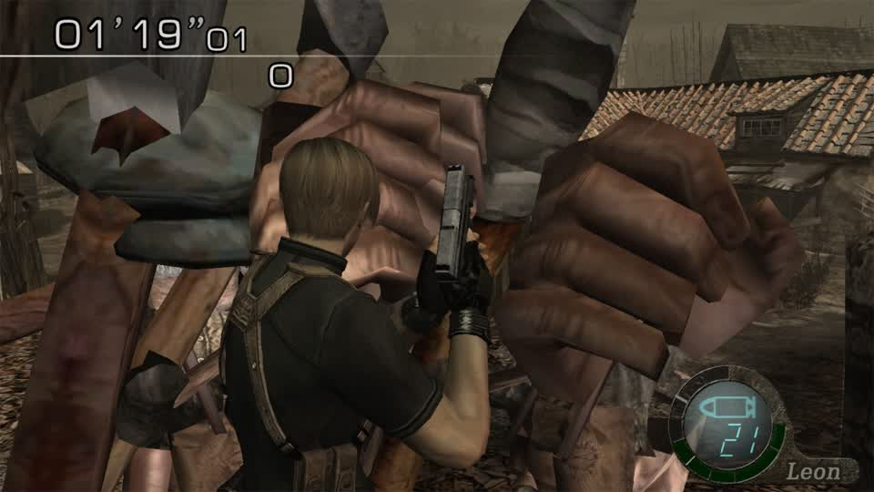

# RE5 loading then freezing: cause and fix (2026-11-07)

## What was happening

Two separate things, both mine to fix.

**1. The swap mods.** `skin_swap: random` and `cast_swap: on` were re-enabled on lilspark earlier in this session. With
them on, RE5 loads to the character-select screen and then **hangs on the stage load**:



With both set back to `off`, the same launch walks straight through:

```
min 1 brightness 24.2   (loading)
min 2 brightness 43.0   (character select)
min 3 brightness 80.8   (stage)
```

and plays a real round:



`01'33"12`, `000300`, Rebecca, shipyard. So the freeze was a **bad swap build**, not the emulator: the mods put an arc
into the game that the stage loader will not accept, and the loader waits instead of failing.

**2. The relaunch loop.** While I was running RE4 experiments, each probe stopped MercMode, launched RE4, then restarted
RE5. The restarts also **re-staged the 20 GB `Resident Evil 5.nsp` into the cache** (mtime 12:26, `20004573761` bytes) and
the emulator was asked to quit about two minutes in - `Frontend <Info> OnEvent: Quit requested` - then relaunched. That is
the "loads, then freezes, then loads again" pattern: a launch/quit cycle roughly every two minutes.

Confirmed by watching the process: eden uptimes went `00:32`, `01:17`, `00:23` while MercMode still reported `playing`.

## The fix, and the rule

* `skin_swap: off`, `cast_swap: off` -> RE5 loads and plays (verified above).
* One clean start, then leave it alone: stop MercMode, stop the session, confirm no `eden` process remains
  (`pgrep -f bin/eden` = 0), then start **once**. Eden's uptime then climbs monotonically instead of resetting.
* An experiment that needs the emulator must restore this **and wait for the process to exit** before starting RE5 again.

## What the experiments were for

RE4 Switch in Mercenaries with a character mod, which is what the round was showing when it was interrupted:





That is `re4-em16morph`: every slot of `em16` - the pack that draws the village Ganados - bone-morphed onto the dog mesh.
The round is real (timer running, Leon in frame, enemies around him) and the enemies are visibly not villagers.
