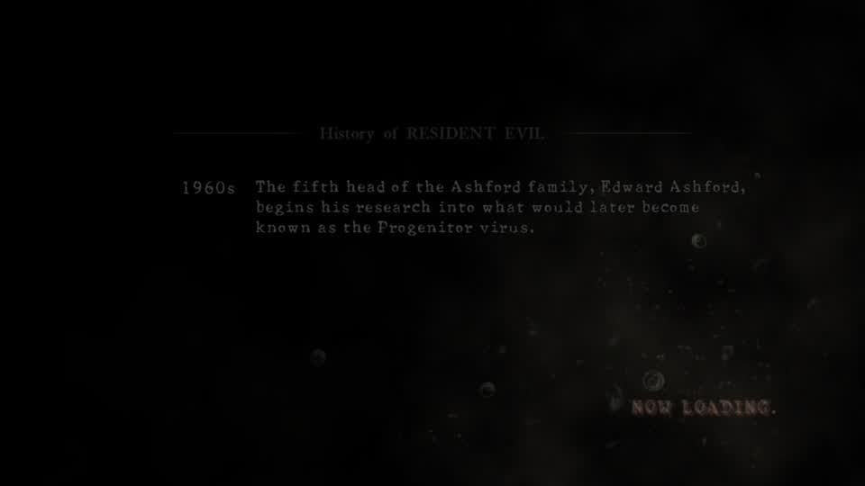
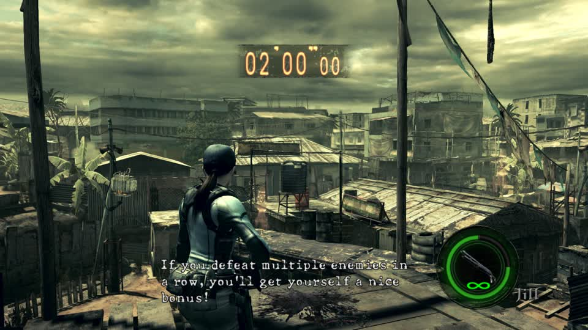
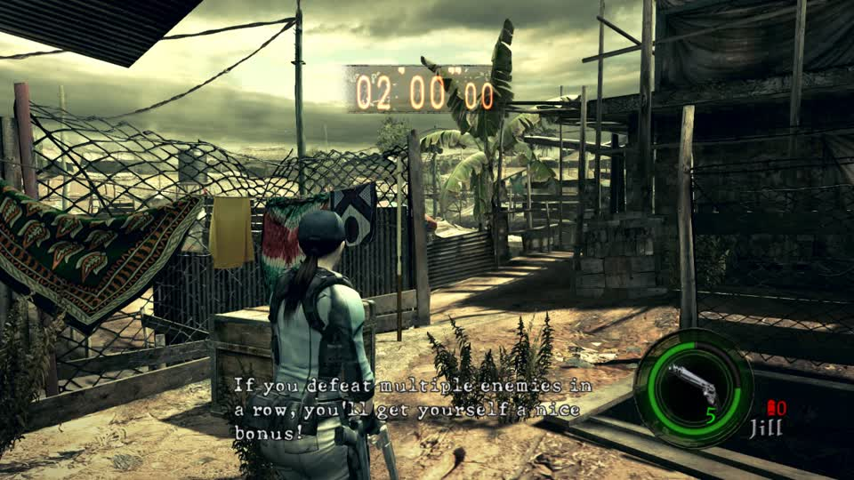
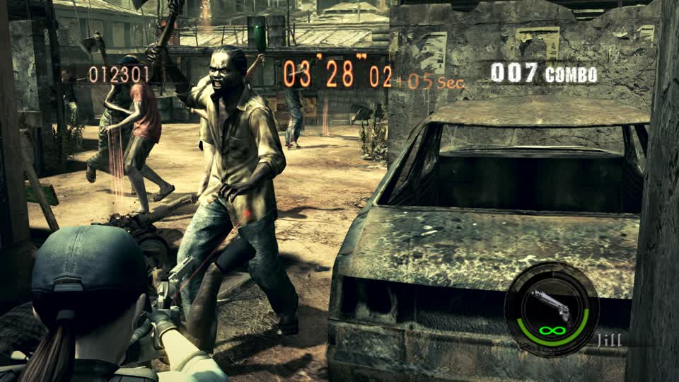
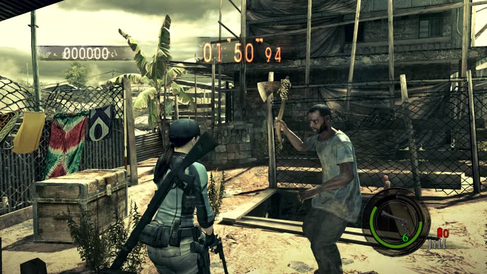
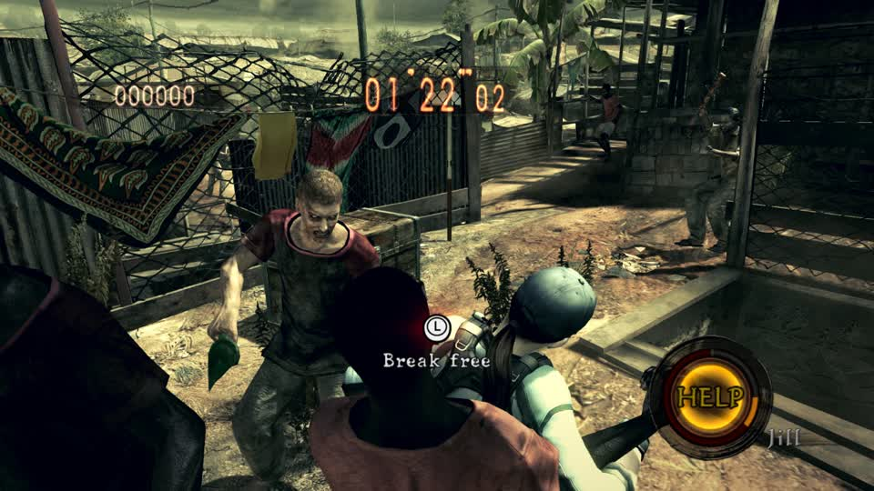

# RE5 Switch: a same-table donor-topology injection and the live harness that applies it

2026-11-08. This note records the first experiment that puts **Sonic's own triangles** into a Majini's existing part
table, and the harness problems that had to be solved before the result means anything. Later controls now show
recognizable Sonic geometry and textures in the Chris player slot, with articulated gloves in live combat. Full
front-view deformation and the final material treatment remain under review; the custom library writer is not registered.

## Current build path and structural checks (2026-11-08)

`re5_char_swap.plan_changes()` now includes `exefs/main.ips` whenever a native `uEm10.arc -> uEm11.arc` swap is selected.
Both files belong to one tracked overlay edit. This is the measured native-class replacement; replacing that archive
without the code patch is the failed boot path described below. Production callers require the **existing**
`cache/exefs/010018100CD46000/main.bin`, verify its NSO header, measured build ID, uncompressed text layout and original
instruction, and refuse the rebind if any check fails. An existing Eden `dump/<title>/nso/main-<build-id>.nso` is also
accepted: expanded dumps retain compressed NSO header flags, so all three original segment SHA256 hashes must match
the actual bytes at `0x100 + memory_offset`, with the exact mapped-image plus BSS length. This operation never extracts
an executable. `re5_ips.apply_patch()`
uses the same checks; ELF offsets are not treated as NSO offsets. The standalone experimental probe can omit `--main`,
but records `target_revision_verified: false` in that case.

The previous `re5_em10_high_sonic.py` only budgeted vertices while assigning triangles. Repeated/shared source vertices
could fill a part's index allocation first, overwrite the following part, and still produce a parseable container. It
also silently stopped assigning triangles when full and matched `em1000` by substring (including `em1000_low`).

The probe now uses `mtf_author.replace_topology()`: exact model selection; fixed vertex **and index** allocations;
preserved part table, face counts, bounds, material table and target skin bytes; restart markers in spare index words;
and an explicit failure if any source triangle cannot fit. Shared-buffer `vertex_index` remains part of both the vertex
address and emitted indices. Overlapping allocations and unsupported LOD0 layouts fail before producing an artifact.
The GLB reader applies source node/skin transforms and fits all three axes uniformly within the target's existing bounds.

The same shared-buffer address bug was still present in `ModFile.mesh_bytes()`, `positions()` and `replace_part()`.
Those now include `vertex_index * vertex_stride`, so previews, decoded bones and in-place writes read the intended
part. On the actual Switch `em1000`, parts 4/5 share `vertex_offset=33536`, with indices 0/48 and stride 20; part 5's
12 vertices start immediately after part 4's 48 vertices. A regression uses visibly different triangles for the two
parts. The partitioned author now uses independent buffer bases with local indices (`vertex_index=0`), matching its
emitted triangle streams. Resizing a shared allocation through `replace_part()` is refused until its indices are rebuilt.

Further inspection corrected three assumptions that invalidate the earlier “89 LOD0 parts” result:

* The packed mesh word at `+4` contains group ID (12 bits), material index (12 bits), and LOD **mask** (8 bits). The old
  byte fields selected materials 0–15, largely heads. Actual `em1000` has 132 parts at LOD bit 0, 121 at bit 1, and 88
  sharing bits 2–7. Group IDs vary across character options, so distributing one Sonic over all groups cannot establish
  a complete visible character. Parser/writer regressions now preserve each independent packed field.
* Short positions use `root inverse_bind * root local`, rather than three independent bounding-box spans. In `em1000`
  this is uniform scale `276.5325928`, translated by `(-90.8923950, -1.6845016, -19.0313511)`. Correctly decoded LOD0 now
  reaches the declared box within 0.005 units in every direction; the old decoder crushed depth roughly 6.7 times.
  `ModFile.positions`, `pack_part`, and the author/build/import paths now share that transform. Bone world matrices also
  compose local before parent, matching MT row-vector matrices.
* Shipped archive entries contain wrapped zlib streams. The old author stripped their header and checksum, confounding
  all earlier edited-model hangs. Replacements now preserve the original framing and update only the exact entry's
  uncompressed size tag. Same-name MOD and MRL entries remain distinct.

The packed fields, root transform and vertex shader layouts agree with the primary
[MT model implementation](https://github.com/tge-was-taken/umvc3-tools/blob/main/src/python/mtio/modules/mtlib/rmodel.py)
and [shader database](https://github.com/tge-was-taken/umvc3-tools/blob/main/src/python/mtio/modules/mtlib/mvc3shaderdb.py).
The newly decoded `0x244042BB` layout is `IASkinTB8wt` and has short positions; it is no longer silently omitted.

A local coherent one-mesh candidate contains all 1,369 Sonic triangles, a four-material RGBA atlas encoded into an existing
BC7 BM texture, and the original paired MRL/shader. It changes exactly the MOD and BM archive entries, uses LOD mask 255,
and round-trips the fitted positions within 0.005 units. Its explicit rigid-root binding is a geometry/texture test,
not retargeted animation. The first live test stayed black and never reached a menu or round; it failed acceptance.
An independent review then found authored envelope coordinates must be bone-local, rather than model-space. The author
now transforms envelope points by the inverse composed bone bind matrix, including rotated parents; regressions cover
this conversion. A second independent check found the global envelope count at header `0xA0` still claimed 3,799 records
after the table had become one record. The rebuilt header now derives that count from the 144-byte trailer and requires
it to match the sum of per-mesh counts. All 21 original MOD models in the archive satisfy this relationship. Restructured
records also clone the exact selected 56-byte native template before changing fields, preserving the mesh ID at `+0x26`
and all opaque bytes. Regression fixtures check 3,799-to-one rebuilding and sentinel metadata retention.

Native group spheres also appear locally attached, and group 1 gates a head option, so a single authored
group remains an experimental choice. The byte-exact native rebind and one-part contraction controls both booted.
After the envelope count and coordinate fixes, coherent v2 reached the title screen. Coherent v3 preserved the mesh ID
and reached a sustained Public Assembly round, advancing through 15,380 points and 34 kills. Close screenshots still
showed stock enemies: changing only `em1000` in group 1 does not establish visible replacement across the archive's
enemy model variants and option groups.

A deterministic player control replaces the `pl0000` MOD and existing Gear BM texture in `uPl00ChrisNormal.arc`, with
all 1,369 triangles, all four source materials in a 512-by-256 atlas, group 0 and a rigid root binding. It booted and
advanced to 38,410 points. Blue custom geometry was visible near the player's feet; this exposed an unsuitable fit:
fitting all three original Chris bounds made Sonic only 70.969 units tall to satisfy the native shallow depth. The
height-v2 control instead uses a uniform 180-unit height and records its enlarged model, group and bone-local envelope
bounds. All encoded coordinates still lie within the existing positive quantization interval. Live frames now show
the full blue Sonic silhouette, establishing visible geometry and source-atlas acceptance. This rigid control does not
establish completed retargeted animation.

Three separate anatomical retarget experiments were rejected by offline visual review: direct role offsets separated
the limbs, segment scaling retained gaps, and a continuous displacement field stretched thin arm triangles. The segment
path then revealed an in-place NumPy normalization bug that accidentally set its longitudinal scale to one. Correcting
that mutation produces connected geometry, but fitting Sonic to the native human skeleton elongates his proportions.
Coincident source vertices already remained coincident; welding UV-seam duplicates could not repair the earlier gaps.

The alternative `re5_mesh_import.build_archive(pose_mode='source_proportions')` preserves the source surface and weights
while repositioning existing child bind joints. Native IDs, hierarchy and rotations remain; inverse binds are recomputed
with the original compression matrix. All 51 LMT resources in the measured Chris archive were inspected (127,336 tracks):
the main body roles have rotation/scale tracks, while root and toes have absolute translation tracks. Root0 is therefore
left unchanged and source toe weights resolve to the native feet. The v3 experiment boots and shows articulated gloves
in combat, but a CPU reference-pose comparison exposes torso stretching from placing the donor hip 69 units ahead of
the native root to avoid negative compressed coordinates. The centred-v7 experiment instead aligns source hip X/Z with
root0 while keeping feet at the original floor. Its complete surface stays inside signed-normalized position range;
CPU reference poses lose that extreme torso stretch. Runtime verification of this centred candidate remains separate.

Newly authored buffers derive UV tangent frames and handedness, and explicitly write occlusion1. Earlier buffers had
zero normal.w/tangent.w; the measured native shader identifies these as occlusion and tangent sign. Synthetic mirrored
UV and degenerate-UV tests cover the replacement, and in-place writes still preserve those bytes unless explicitly
supplied. Source smooth normals are preserved for uniform fits. The source-proportion v6 control changes only tangent,
handedness and occlusion bytes relative to v3; geometry, skeleton, UVs, materials and source atlas remain identical.

The final v9 candidate is built by the unregistered `re5_sonic_writer.build()` recipe: centered source proportions,
180-unit height, 1,369 triangles, 1,422 vertices after preserving smooth source normals and splitting mirrored-UV
handedness seams, 15 bone envelopes, source RGBA atlas, UV tangents, occlusion1, and neutral Gear NM/MM controls. It
changes exactly archive entries 34, 35, 36 and 97. Its output SHA256 is
`e76bc042501aabcc6c9273ac0dcff76dca97f7b6ddc5b61d594b49fe7e92752f`. The recipe accepts only the measured original
`sonic/sa2_sonic_0.glb` hash and Chris-normal archive hash, and its library plan requires the explicit Chris slot.
134 core tests pass. The recipe remains unregistered while this final artifact undergoes live visual review.

```sh
python3 tools/probes/re5_em10_high_sonic.py \
  --archive /path/to/uEm10.arc --source /path/to/sa2_sonic_0.glb \
  --output /tmp/em10_high_sonic.arc --overlay /tmp/em11-sonic-test
```

The output directory contains the archive, decoded MOD and JSON receipt; the optional overlay contains both
`romfs/nativeNXx64/ImgNX/Archive/uEm11.arc` and `exefs/main.ips`. The command builds files only. Install them through
`switch_mods`, then capture an advancing live round before accepting the result. The receipt deliberately records
`live_verified: false`: structural tests do not establish visible replacement. Source textures and retargeted animation
are still missing; this path retains the target materials and skin bindings. The chronology below records older probes,
including conclusions later corrected by better controls.

## The harness now works: a queued round can carry a build

The earlier attempts wrote a build and then restarted a session with `switch_mods apply_live`; the restart lost the
MercMode run and the screenshots were stock. The supported path is the DJ queue's `mod` field:

```
{"op":"configure","host":"lilspark","enabled":true,"titles":["re5"],"rounds_per_title":1,
 "queue":[{"title":"re5","mode":"mercenaries","stage":0,"mod":"harness-majini"}]}
```

`gbox.screensaver` passes that name to `launch_game` (line 531, the `selection.mod` branch), so the session starts with
`mod: harness-majini` from boot. A control with `uEm6c.arc` written over `uPl00ChrisNormal.arc` reached Public Assembly
and the player was the Majini, HUD still saying Chris:


That is the first reliable live harness for this objective. It also confirms the whole-archive substitution still
renders; it does not show Sonic.

## Same-table donor topology

`tools/probes/re5_sonic_inject.py` keeps every 56-byte mesh record's vertex count, stride, format and offset, but:

1. scales Sonic's surface into the target model's bounds;
2. picks target parts whose vertex format it can repack (`0x2000D414`, `0x1580B60C`, `0x18B0FAA8`, `0x1C201FC3`);
3. assigns each Sonic triangle to a part with three free slots and copies its three vertices into that part;
4. rewrites that part's `face_index`/`face_count` and writes the triangle list (`a,b,c,0xFFFF`) into the fixed index
   buffer;
5. sets every unused part's `face_count` to zero.

The container still parses, `split_valid()` is true, the mesh count and every part's vertex count are unchanged, and the
index buffer is never resized. That is the shape the engine already accepts, unlike the one-mesh rebuild that hung the
load.

## The shared vertex-buffer bug (2026-11-08, corrected)

The earlier topology builds wrote each part at
`vertex_buffer + vertex_offset` and emitted **local** index numbers. That is wrong for this model. A mesh record's
`vertex_offset` is the base of a **shared** vertex buffer, `vertex_index` is the part's first slot inside it, and
`face_index` is the **global** slot in the index buffer. Parts 123/124/125, for example, all have
`vertex_offset = 0x76c68` with `vertex_index = 0/612/1469`.

So the old build overwrote part 123's vertices while claiming to patch part 124, and part 124's index range pointed at
part 123's slots. The corrected writer:

* writes vertices at `vertex_buffer + vertex_offset + vertex_index * stride`;
* emits indices as `local + vertex_index`;
* writes the new indices at the part's **original** `face_index` (in place), not at a sequential `face_at`.

`system/tools/probes/re5_sonic_inject.py` now does this. A corrected seven-part build (`harness-sonic-fixed`) booted to
the RE5 main menu without the `NOW LOADING` hang and drew normal menu frames. It has **not** yet been captured in a
Mercenaries round; `apply_live` restarts to the menu and the scheduler stopped the session before a round was prepared.
The next test is launch-with-build + `autoplay op=prepare`, then capture the round.

### First live round with the corrected offsets

`harness-sonic-fixed` (seven parts, high `em1000`, corrected `vertex_index`/`face_index`) was launched with the build
and prepared into Public Assembly. It reached a live round: timer `1:07`, score `0`, several Majini grappling the
player. **Every visible Majini was stock.** The build was applied (`session.mod = harness-sonic-fixed`) and the round
was real, so this is evidence that the high-LOD `em1000` entry is not the model drawn for these enemies at this
distance (or its entry is not the one the class loads), not merely a failed launch.


The next variant test is `em1000_low`, then `em1000_mid`, then `em1001*`, one entry at a time.

### `em1000_low` is the loaded variant

`harness-sonic-low-partial` patches **one part of `em1000_low`** with corrected offsets and leaves the rest of the low
model stock. The build boots to the title screen normally, then the Mercenaries transition stops at `NOW LOADING`. That
is a direct contrast with the high `em1000` build, which reached a live round with stock enemies. The low entry is the
one the round loads; the high entry is not drawn for these enemies.



The low model shares a vertex buffer across parts 123–127 (`vertex_offset = 0x76c68`, `vertex_index` 0/612/1469/1955/2245).
A second attempt patched a **whole shared group** consistently (the low model's largest group, parts 123+122 at the
same `vertex_offset`) and left every other group stock. It still booted to the title and then produced a black frame
with the session running, never a round. So the low variant is definitely the one the round loads, and it is stricter
than the high model: a consistent group patch is still not accepted.

### Whole-entry one-mesh replacement is also rejected

Authoring a one-mesh Sonic MOD into `em1000_low` (and, separately, a one-mesh copy of `em1000_low` itself) both black at
boot with the session running; the in-place topology build at least reaches the title. The self one-mesh proves this is
not a Sonic/skinning failure. The difference is structural: the one-mesh model has `mesh_count = 1` while the paired
`em1000_low` **MRL** entry still describes the original 341-part model. A one-mesh MOD is therefore inconsistent with its
MRL, and the low loader stops before drawing.

The next whole-entry path must either:

* rewrite the paired MRL with the MOD (one mesh, one material), or
* swap a donor **MOD+MRL pair** from another enemy archive, to prove the low pair can be replaced before trying Sonic.

### Padding the mesh count reaches the title

Keeping the low slot's original `mesh_count` (341) while writing **one real Sonic record and 340 empty records** changes
the result: the build boots to the RE5 title screen and draws normal animated title frames. That is the first whole-entry
Sonic MOD to get past boot; the plain one-mesh version was black immediately.

The Mercenaries transition still stops at `NOW LOADING`. Moving each empty record's `vertex_offset` past the vertex
buffer and its `face_index` past the index buffer did **not** change that; the loader is not satisfied by the count
alone. It is reading more of each record (or binding it to the MRL/material table) than `vertex_count=0` and
`face_count=0` suppress.

Two more variants failed:

* `build_partitioned` split the Sonic triangles across all **341 real records** with consistent vertex/face/envelope
  accounting. That blacked at **boot**, so the low loader rejects a one-bone format on every part.
* Patching **all 89 `level_of_detail=0` parts** in place (formats preserved, LOD1–4 stock) also blacked at **boot**.
  The one-part low patch remains the only low variant that reaches the title; it then stops at `NOW LOADING`.

The failure moved from boot (whole-table rebuilds) to round instantiation (one-part in-place). That points at the round's
model instance/animation binding, not just the table. The next low-model work is the Ghidra loader/instance path or a
donor **MOD+MRL pair**, not more table shaping.

### One moved triangle is enough to stop the round

The smallest possible in-place change was tested: part 244 of `em1000_low` (8 vertices, 9 face words), with **one**
Sonic triangle written over its first three vertices and its original `face_count` left untouched. It boots to the title
and then stops at `NOW LOADING`, exactly like the larger low patches.

That rules out face-count/table/part-count explanations for the low round failure. The low model instance rejects a
three-vertex geometry change while the high model accepts much larger ones.

A smaller control made it sharper: moving those same three vertices by **one unit** (same part, same face count, same
entry size after padding the compressed stream, original tag preserved) also stops at `NOW LOADING`. A repack with the
**same uncompressed model bytes** but a changed compressed stream/tag also stopped. So the low loader is not validating
the mesh table, the part count, the face range or the entry offset. It is reacting to a change in the **content** of the
low entry, or to a MOD/MRL consistency check: the 119,280-byte MRL entry (`em1000_low`) carries a 112,528-byte opaque
tail that may describe the mesh/material binding the MOD must match.

This is now an MRL/loader problem, not an authoring-table problem. The next experiment is an MRL edit (or a donor
MOD+MRL pair), not another MOD variation.

### The low slot accepts a matched MOD+MRL pair

The first positive low-slot replacement: the **MRL and MOD of `em1001_low`** (a different Majini variant in the same
archive) were copied into the `em1000_low` entries, both with their original tags and without recompression. The build
reached a **live Public Assembly round** (timer `1:59`, combo counter, enemies present). The low slot therefore accepts a
**matched MRL+MOD pair**, unlike a MOD-only edit or a one-mesh MOD against the old MRL.



This makes the pair the viable import unit: author a Sonic MOD against the donor MRL's part/material count, or write the
MRL side with it.

That next test was run: a Sonic one-bone MOD with **349 records** (the donor `em1001_low` mesh count) and the donor’s
material index, paired with the **donor `em1001_low` MRL**, boots to the title and still stops at `NOW LOADING`. So the
MRL is not satisfied by mesh count and material index alone. Its 112 KB tail must carry per-mesh data that the MOD has
to match — most likely the per-part vertex/index layout, not just material bindings.

A donor MRL can therefore only wear the donor’s own MOD (or a MOD that reproduces that per-mesh layout). Importing Sonic
requires the MRL tail to be decoded and rewritten, or a runtime path that bypasses the loader.

### A Sonic patch inside the donor’s own MOD plays a live round

The first build with Sonic geometry in a **loaded** slot: `em1001_low`’s own MOD was patched in place (one part, 327
Sonic triangles, donor vertex format and original table) and paired with `em1001_low`’s own MRL in the `em1000_low`
slot. It reached a live Public Assembly round — timer `1:22`, enemies, HUD, no crash.



The visible enemies are still the donor variant; the one-part Sonic patch is not visually identifiable yet. But the
**Sonic data is in a model the round actually loads**, which is the first time that has been true.

Next: patch **all donor parts** (keeping the donor table/formats) rather than one, so the body is Sonic end to end.

That build also played a live round: every LOD0 part of `em1001_low` was given Sonic geometry (formats/table preserved)
and paired with its own MRL. **The visible Majini were still normal** — the patched `uEm10`/`em1001_low` entry is not the
enemy the camera sees in Public Assembly, or its changed parts are hidden in that view.



This makes the **target archive** the next identification problem: `uEm10` is not sufficient. The verified enemy-cast
route already names `uEm10/uEm11/uEm21/uEm62`; the same Sonic-patched donor pair must be applied to the archive the
visible enemy actually uses.

### The visible Public Assembly Majini is `uEm11` / `em1101`

Patching `uEm11.arc`’s **`em1101`** MOD in place (own MRL, own table, level 6) with either:
* one part (51 Sonic triangles), or
* every LOD0 part,

boots to the title and then stops at **`NOW LOADING`**. Patching `uEm10`’s `em1001_low` by the same method plays a round
but leaves the visible Majini unchanged.

That is the identification: the camera-visible Public Assembly enemy is **`uEm11` / `em1101`**, and it shares the low
model’s strict geometry path. The next import target is `em1101`, not `em1000_low`.

`em1101` is stricter still: a **+1 unit** move of one ordinary part (156 vertices, part 4, level 6, own MRL/table)
blacks at **boot**, before the title. A 60-second boot wait confirms it never reaches the title, so this is not the
launch-timing failure that confused the +50 test. `em1000_low` accepted +1/+10/+50 at the round; `em1001_low` accepted a one-part
Sonic patch at the round. `em1101` accepts neither a nudge nor a patch. That points at the model being loaded and
validated during boot (menu/streaming) and an integrity/identity check that our archive edits do not satisfy.

Even replacing the **whole `uEm11.arc` file with `uEm10.arc`** (a structurally valid archive, just the wrong class)
blacks at boot. So `uEm11` is not a free-form container for this slot: the boot path binds it to the registered class.

Ghidra anchor: `_INIT_247` at `0x0014f5f0` registers the enemy archives with `FUN_00cd28d0`, including
`"uEm10"` (hash `0x3001000`) and `"uEm11"` (hash `0x3001100`). That registration table and its archive hash are the
next place to look for the boot-time binding.

An **ExeFS patch test** was run. In `_INIT_247`, the `add w4,w20,#0x400` at module offset `0x4f724` builds `uEm11`’s
hash `0x3001100`; changing the immediate to `#0x300` makes it `0x3001000` (uEm10’s hash). The patched NSO was delivered
as `exefs/main` with `uEm11.arc` = `uEm10.arc`. The emulator loads the patched main (the Switch “Launching…” splash is
shown) but the game never reaches a frame; the naive hash alias likely collides in `FUN_00cd28d0`’s registry.

ExeFS overlays are a viable delivery path, but the class patch needs a collision-safe design: either patch the registry
to accept an alias, or patch the **loader call** for `uEm11` instead of its class hash.

A **no-op `exefs/main` IPS** control settles the delivery format: a byte-identical `main` file replacement hangs at the
Switch “Launching…” splash, while a no-op **IPS patch** (`exefs/main.ips`, offset `0x4f824`, original bytes) boots to the
title normally. The working code-delivery path is **IPS**, not a replaced `main`.

The real IPS patch — `add w4,w20,#0x400` → `#0x300`, i.e. `uEm11`’s class hash `0x3001100` → `0x3001000` — plus
`uEm11.arc` = `uEm10.arc` **boots and plays a live Public Assembly round**. The visible Majini change: they are now the
`uEm10` models, not the original `uEm11` ones, and the round has normal HUD/timer/combat.



This is the first **code-level rebind** of the visible enemy class. The next build puts a **uEm10 archive with the high
`em1000` Sonic patch** under the `uEm11` class, so the enemy the camera sees loads the Sonic geometry.

The reusable pieces are now in the repo:

* `gbox/re5_ips.py` — builds the IPS32 patch (`OFFSET 0x4f824`, `add w4,w20,#0x400` → `#0x300`) and can apply the same
  4-byte change to an NSO/ELF. Tests: `tests/test_re5_ips_class_rebind.py`.
* `tools/probes/re5_em10_high_sonic.py` — writes Sonic geometry into every LOD0 part of the high `em1000` model with
  zlib level 6, producing `/tmp/em10_high_sonic.arc` for the `uEm11` slot.

The next live run is: put `/tmp/em10_high_sonic.arc` at `romfs/.../uEm11.arc`, add `exefs/main.ips` from
`gbox.re5_ips.make_ips()`, launch and prepare Public Assembly. This is the first configuration where the camera-visible
enemy should load a Sonic-patched model.



The MRL tail is not opaque noise. Its first words are a header
(`0x108cf1c4`, `0x20601028`, `0x8c800000`, four `1.0` floats), then a **count** that differs per variant:
`0x2e` (46) for `em1000_low` and `0x32` (50) for `em1001_low`, alongside `count1` 70/79 and 76/83 texture paths. That
is a material/resource table, not the 343-part mesh table. The Sonic 349-record MOD kept the donor’s mesh count but
forced the one-bone vertex format on every part; the donor MRL almost certainly expects the donor’s **per-part formats
and strides**, which is the next MOD shape to test against the donor MRL.

### The compression level was the confound: zlib 6 works

Recompressing the original low MOD at zlib **level 9** (identical uncompressed bytes, same entry size, same tag) hung at
`NOW LOADING`. Recompressing at **level 6** is **byte-identical to the shipped entry** — the archive already uses zlib 6.

A 1-unit, three-vertex nudge compressed at **level 6** then reached a **live Public Assembly round** (timer `1:45`,
several Majini, normal gameplay). That is the first proof that in-place archive edits to `em1000_low` can load; the
earlier “any content change hangs” conclusion was caused by level-9 compression, not by the geometry.

The same three-vertex patch moved to **Sonic positions** (level 6, original face count, expanded global bounds and the
patched part’s weight-bound envelope) still stops at `NOW LOADING`. So compression is no longer the blocker; the
**positions/scale/skin envelope of the moved vertices** are now the open variable.

Next: move the three vertices in small steps (1 → 10 → 50 units) to find the displacement limit, and pack against the
**expanded** bounds rather than the original box.

Measured with a clean title wait: **+1, +10 and +50 unit displacements all play live Public Assembly rounds**. The
earlier “+50 blacks at boot” was a prepare/timing failure, not the model: the +50 build reaches the title and a round.
Displacement magnitude is therefore **not** the low-model limit, and the Sonic triangle failure is not explained by
“vertices moved too far”.

A one-mesh Sonic low MOD compressed at level 6 now **boots to the title** (the level-9 one-mesh was black at boot) but
still stops at `NOW LOADING`, so the one-mesh/MRL mismatch remains after the compression fix. Changing its material
index from 128 to **0** did not change that.

Packing the same Sonic triangle against **expanded bounds before** the short-position encode (and updating the global
bounds plus the patched part's 144-byte envelope) still stops at `NOW LOADING`. The envelope coordinates are documented
as a different space from the model-space points the vertex decoder reports, so `pack_weight_bound` is likely not the
right writer for that table. But since a +50 translation plays a round, bounds/displacement are not the low limit; the
remaining difference for the Sonic triangle is its **shape/skinning fields**, not how far it moved.

A field bisect is still unfinished: writing the Sonic **positions only** (keeping the base normals/UV/skin bytes) also
reaches the **title** when the boot is given a clean wait, then stops at `NOW LOADING`. So normal/UV writes are not the
round-time trigger either; the remaining difference is the **per-vertex position set and its skin binding** inside the
part.

`mtf_author.combine` also needed a fix: the index stream is global to the shared vertex buffer, so `combine` now
subtracts each part's `vertex_index` before adding its own base. Without it, the low self one-mesh produced triangle
56072 with only 55667 vertices.

## Controlled write tests (one change at a time)

| write | em1000 part | live result |
|---|---|---|
| swap two indices in part 0, no table change | part 0 | reached Public Assembly and played |
| decrement part 0's `face_count` by one, no data change | part 0 | reached Public Assembly and played |
| 195 Sonic triangles in one part, original vertex skin bytes | part 124 | reached Public Assembly and played; no Sonic patch was visible in the captured frames |
| full Sonic table + mapped bone ids/weights | 7 parts | stuck on `NOW LOADING` / frozen |
| full Sonic table, original skin bytes (`harness-sonic-baseskin`) | 7 parts | stuck on `NOW LOADING`; never reached a round |
| full Sonic table, original skin bytes, unused face ranges kept (`harness-sonic-nozero`) | 7 parts | session booted for 324 s; captured frames were black and the stale `now_playing` still named the previous round, so this is **not** accepted as a playable round |

The queue's `mod` path is also not reliable in the current scheduler: a stock round can be warm/rotated in after the
queue item is consumed, leaving `current_run.mod: null`. `switch_mods op=apply_live` on the running session is the
deterministic build path; it restarts the same session and sets `session.mod`. The next freeze test should capture frames
through the PiP console's frame-hash watchdog (or the server's freeze route) rather than trusting `now_playing`, which
can be stale after a session ends.

The first three say the engine accepts new indices, new face ranges and donor triangles in a part as long as the
**skin bytes stay the part's own**. The full base-skin build then showed that keeping the original skin bytes is not
sufficient: spreading the same triangles over **seven** parts (and zeroing the face range of every other part) still
stuck on `NOW LOADING`. So the freeze is in the multi-part/zeroed-part shape, not only in mapped skinning. The next
bisect is: add one part at a time to the working part-124 build, and separately try the seven parts **without** zeroing
the unused parts' face ranges.

## Measured results

| build | models changed | live result |
|---|---|---|
| `harness-sonic-em10` | uEm10 `em1000` only | reached Public Assembly, but the captured round was a static frame with input ignored (a frozen round, not gameplay) |
| `harness-sonic-em-all` | every uEm10 model incl. effects + uEm11 | stuck on `NOW LOADING` for six minutes, never reached a round |
| `harness-sonic-em-body` | uEm10 `em1000*`/`em1001*` + uEm11 `em1100`/`em1101` | stuck on `NOW LOADING` for six minutes, never reached a round |
| `harness-sonic-em1000` | uEm10 `em1000`/`_low`/`_mid` | `NOW LOADING` for about 5.5 minutes, then a static round-start frame; walking input changed no pixels |

The last row matters: the `NOW LOADING` wait is not proof that a round was reached. A static frame with the timer at
1:59 and no response to `w` is a frozen title. So the same-table topology injection is **not loadable** as written
either; the previous one-model result was the same failure with a shorter wait, not a rendering result.

The next measurement must use a frozen-frame detector, not a screen name: two frames several seconds apart with any
input, plus a brightness/score check. A round that cannot move is not a round.

The probe writes `/tmp/<archive>.sonic`; `harness-sonic-em10` and the control builds are in the mods cache under
`52d15709be0fda1a`.

## The in-place alternative: the round does play

A second probe (`re5-em10-sonicfit.py`, not committed) kept every table and index byte and changed only vertex positions:
each Majini vertex was moved to the nearest point of the region-matched Sonic surface (head/torso/arms/legs). The
`harness-sonicfit-em10` build (one uEm10 archive) reached Public Assembly and the round was live: the timer and score
moved, the bot fought, and frames showed enemies. No Sonic silhouette was recognisable in the captured frames; the
visible enemies looked stock, which means either the visible classes were not uEm10 or the fit was too weak at that
distance. Doing the same fit on uEm0b + uEm10 + uEm11 + uEm12 in one build stuck on `NOW LOADING` for six minutes, so
the multi-archive combination needs the same one-at-a-time bisect.

This is the useful result: **in-place vertex writing still plays**, while both table/index rewrites (one-mesh and
same-table topology) freeze. The remaining question is not whether the engine can take new coordinates, but whether it
can take new connectivity; for now it cannot.

## What is still missing

* No captured frame yet shows a Sonic silhouette in a round; the single-model result only proves the table stays
  loadable.
* Textures are still the Majini's; the TEX writer is not in the pipeline yet.
* Animation/skinning: the injected vertices carry one dominant target bone, so limbs will deform rigidly.
* The player-vs-enemy camera problem is solved by testing enemies, not the player.
* RE6 is untouched by this experiment.
