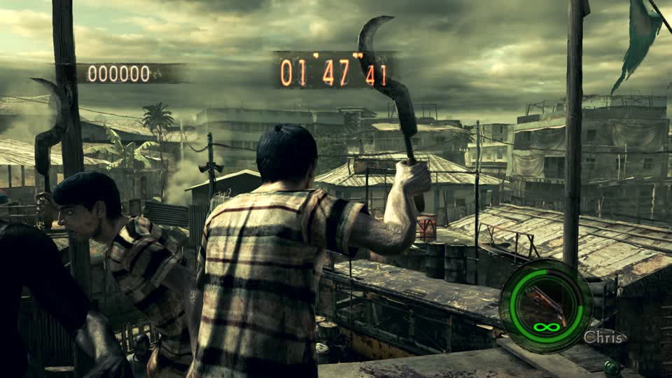
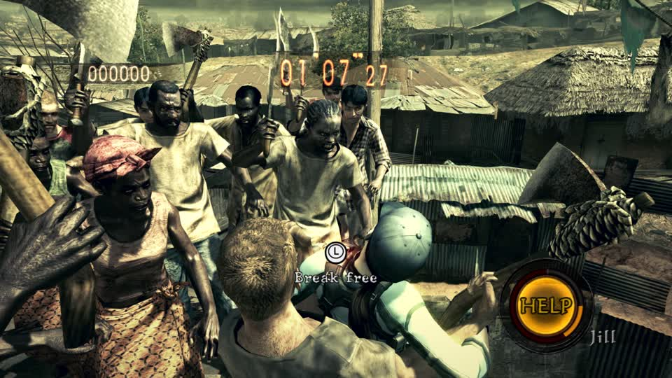

# RE5 Switch: a same-table donor-topology injection and the live harness that applies it

2026-11-08. This note records the first experiment that puts **Sonic's own triangles** into a Majini's existing part
table, and the harness problems that had to be solved before the result means anything. It is not an acceptance: no
Sonic mesh is visible in a captured round yet.

## The harness now works: a queued round can carry a build

The earlier attempts wrote a build and then restarted a session with `switch_mods apply_live`; the restart lost the
MercMode run and the screenshots were stock. The supported path is the DJ queue's `mod` field:

```
{"op":"configure","host":"lilspark","enabled":true,"titles":["re5"],"rounds_per_title":1,
 "queue":[{"title":"re5","mode":"mercenaries","stage":0,"mod":"harness-majini"}]}
```

`gbox.screensaver` passes that name to `launch_game` (line 531, the `selection.mod` branch), so the session starts with
`mod: harness-majini` from boot. A control with `uEm6c.arc` written over `uPl00ChrisNormal.arc` reached Public Assembly
and the player was the Majini, HUD still saying Chris:



That is the first reliable live harness for this objective. It also confirms the whole-archive substitution still
renders; it does not show Sonic.

## Same-table donor topology

`tools/probes/re5_sonic_inject.py` keeps every 56-byte mesh record's vertex count, stride, format and offset, but:

1. scales Sonic's surface into the target model's bounds;
2. picks target parts whose vertex format it can repack (`0x2000D414`, `0x1580B60C`, `0x18B0FAA8`, `0x1C201FC3`);
3. assigns each Sonic triangle to a part with three free slots and copies its three vertices into that part;
4. rewrites that part's `face_index`/`face_count` and writes the triangle list (`a,b,c,0xFFFF`) into the fixed index
   buffer;
5. sets every unused part's `face_count` to zero.

The container still parses, `split_valid()` is true, the mesh count and every part's vertex count are unchanged, and the
index buffer is never resized. That is the shape the engine already accepts, unlike the one-mesh rebuild that hung the
load.

## The shared vertex-buffer bug (2026-11-08, corrected)

The earlier topology builds wrote each part at
`vertex_buffer + vertex_offset` and emitted **local** index numbers. That is wrong for this model. A mesh record's
`vertex_offset` is the base of a **shared** vertex buffer, `vertex_index` is the part's first slot inside it, and
`face_index` is the **global** slot in the index buffer. Parts 123/124/125, for example, all have
`vertex_offset = 0x76c68` with `vertex_index = 0/612/1469`.

So the old build overwrote part 123's vertices while claiming to patch part 124, and part 124's index range pointed at
part 123's slots. The corrected writer:

* writes vertices at `vertex_buffer + vertex_offset + vertex_index * stride`;
* emits indices as `local + vertex_index`;
* writes the new indices at the part's **original** `face_index` (in place), not at a sequential `face_at`.

`system/tools/probes/re5_sonic_inject.py` now does this. A corrected seven-part build (`harness-sonic-fixed`) booted to
the RE5 main menu without the `NOW LOADING` hang and drew normal menu frames. It has **not** yet been captured in a
Mercenaries round; `apply_live` restarts to the menu and the scheduler stopped the session before a round was prepared.
The next test is launch-with-build + `autoplay op=prepare`, then capture the round.

### First live round with the corrected offsets

`harness-sonic-fixed` (seven parts, high `em1000`, corrected `vertex_index`/`face_index`) was launched with the build
and prepared into Public Assembly. It reached a live round: timer `1:07`, score `0`, several Majini grappling the
player. **Every visible Majini was stock.** The build was applied (`session.mod = harness-sonic-fixed`) and the round
was real, so this is evidence that the high-LOD `em1000` entry is not the model drawn for these enemies at this
distance (or its entry is not the one the class loads), not merely a failed launch.



The next variant test is `em1000_low`, then `em1000_mid`, then `em1001*`, one entry at a time.

## Controlled write tests (one change at a time)

| write | em1000 part | live result |
|---|---|---|
| swap two indices in part 0, no table change | part 0 | reached Public Assembly and played |
| decrement part 0's `face_count` by one, no data change | part 0 | reached Public Assembly and played |
| 195 Sonic triangles in one part, original vertex skin bytes | part 124 | reached Public Assembly and played; no Sonic patch was visible in the captured frames |
| full Sonic table + mapped bone ids/weights | 7 parts | stuck on `NOW LOADING` / frozen |
| full Sonic table, original skin bytes (`harness-sonic-baseskin`) | 7 parts | stuck on `NOW LOADING`; never reached a round |
| full Sonic table, original skin bytes, unused face ranges kept (`harness-sonic-nozero`) | 7 parts | session booted for 324 s; captured frames were black and the stale `now_playing` still named the previous round, so this is **not** accepted as a playable round |

The queue's `mod` path is also not reliable in the current scheduler: a stock round can be warm/rotated in after the
queue item is consumed, leaving `current_run.mod: null`. `switch_mods op=apply_live` on the running session is the
deterministic build path; it restarts the same session and sets `session.mod`. The next freeze test should capture frames
through the PiP console's frame-hash watchdog (or the server's freeze route) rather than trusting `now_playing`, which
can be stale after a session ends.

The first three say the engine accepts new indices, new face ranges and donor triangles in a part as long as the
**skin bytes stay the part's own**. The full base-skin build then showed that keeping the original skin bytes is not
sufficient: spreading the same triangles over **seven** parts (and zeroing the face range of every other part) still
stuck on `NOW LOADING`. So the freeze is in the multi-part/zeroed-part shape, not only in mapped skinning. The next
bisect is: add one part at a time to the working part-124 build, and separately try the seven parts **without** zeroing
the unused parts' face ranges.

## Measured results

| build | models changed | live result |
|---|---|---|
| `harness-sonic-em10` | uEm10 `em1000` only | reached Public Assembly, but the captured round was a static frame with input ignored (a frozen round, not gameplay) |
| `harness-sonic-em-all` | every uEm10 model incl. effects + uEm11 | stuck on `NOW LOADING` for six minutes, never reached a round |
| `harness-sonic-em-body` | uEm10 `em1000*`/`em1001*` + uEm11 `em1100`/`em1101` | stuck on `NOW LOADING` for six minutes, never reached a round |
| `harness-sonic-em1000` | uEm10 `em1000`/`_low`/`_mid` | `NOW LOADING` for about 5.5 minutes, then a static round-start frame; walking input changed no pixels |

The last row matters: the `NOW LOADING` wait is not proof that a round was reached. A static frame with the timer at
1:59 and no response to `w` is a frozen title. So the same-table topology injection is **not loadable** as written
either; the previous one-model result was the same failure with a shorter wait, not a rendering result.

The next measurement must use a frozen-frame detector, not a screen name: two frames several seconds apart with any
input, plus a brightness/score check. A round that cannot move is not a round.

The probe writes `/tmp/<archive>.sonic`; `harness-sonic-em10` and the control builds are in the mods cache under
`52d15709be0fda1a`.

## The in-place alternative: the round does play

A second probe (`re5-em10-sonicfit.py`, not committed) kept every table and index byte and changed only vertex positions:
each Majini vertex was moved to the nearest point of the region-matched Sonic surface (head/torso/arms/legs). The
`harness-sonicfit-em10` build (one uEm10 archive) reached Public Assembly and the round was live: the timer and score
moved, the bot fought, and frames showed enemies. No Sonic silhouette was recognisable in the captured frames; the
visible enemies looked stock, which means either the visible classes were not uEm10 or the fit was too weak at that
distance. Doing the same fit on uEm0b + uEm10 + uEm11 + uEm12 in one build stuck on `NOW LOADING` for six minutes, so
the multi-archive combination needs the same one-at-a-time bisect.

This is the useful result: **in-place vertex writing still plays**, while both table/index rewrites (one-mesh and
same-table topology) freeze. The remaining question is not whether the engine can take new coordinates, but whether it
can take new connectivity; for now it cannot.

## What is still missing

* No captured frame yet shows a Sonic silhouette in a round; the single-model result only proves the table stays
  loadable.
* Textures are still the Majini's; the TEX writer is not in the pipeline yet.
* Animation/skinning: the injected vertices carry one dominant target bone, so limbs will deform rigidly.
* The player-vs-enemy camera problem is solved by testing enemies, not the player.
* RE6 is untouched by this experiment.
