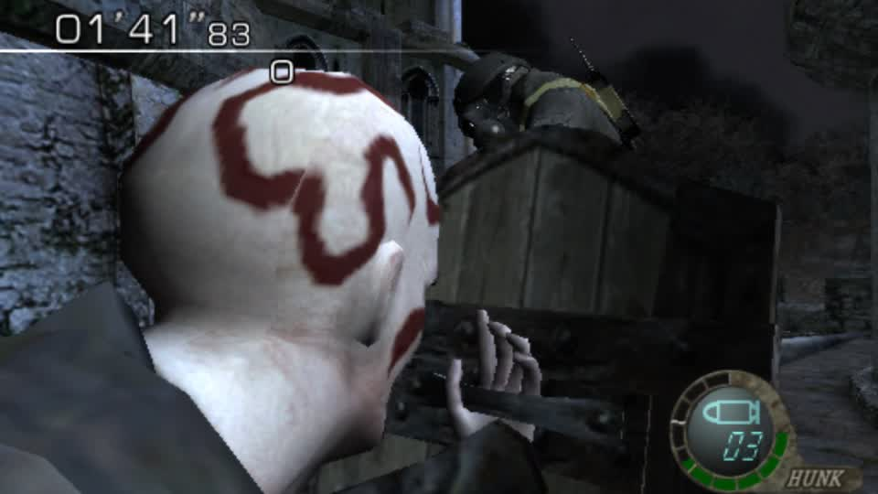
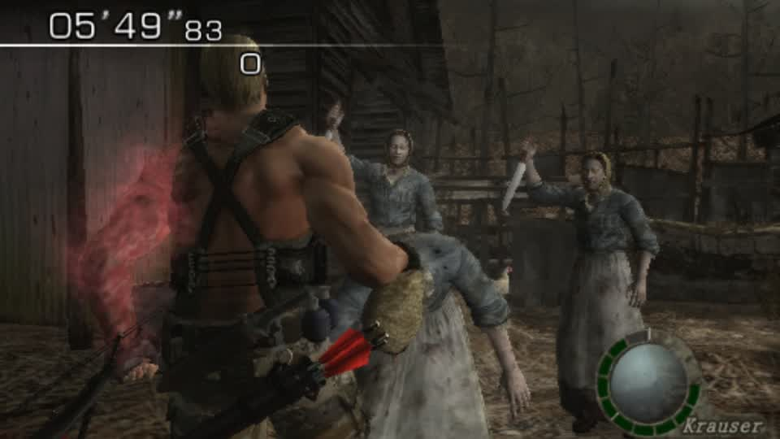

rig_roles: joint roles from geometry, with the structural case that still needs handling

The ganado swap needs a roles map (hip, chest, neck, head, each upper arm / forearm / hand, each thigh / shin / foot) and Sonic's
glTF has no anatomical names, so the roles have to come from the rest pose. New module `gbox/rig_roles.py`, four tests passing:

* head = highest joint, its parent chain gives neck and chest
* hip = the ROOT of that chain, not the joint above it (rigs differ in spine count; the test skeleton has an extra one)
* limb roots = the pair of children that are not on the spine chain - arms by widest X span, legs by deepest drop
* `named()` maps indices to joint names for `characters.rig_from_gltf`

Measured on Sonic's own rig (66 nodes, all unnamed): it derives head/neck/chest/hip correctly and then **stops**, because his
shoulders do not hang off the head-to-root chain:

```
node000 (0.00, 0.00, 0.00)  root / hips
node001 (0.00, 5.00, 0.00)  spine        <- parent chain of the highest joint
node002 (0.00, 5.24, 0.00)  highest joint (read as head)
node003 (0.00, 5.09, 0.00)  the chain then DESCENDS ...
node005 (0.00, 4.62, 0.00)  ... to here, where the arms split
node006 (-0.28, 4.69)  node016 (0.32, 4.68)   the two shoulders
```

So the lateral pair is a child of a joint off the spine chain. The fix is a fallback: when the spine chain has no branching
joint, scan every joint for the best lateral pair (children of opposite X, arms) and the best downward pair (legs) and use
those as the limb roots. That is a small, testable addition to the same module, and it makes the derivation work on rigs whose
spine runs head-first, which this one does.
## Rewritten derivation: limb pairs first, then the spine

The first version started from the highest joint and walked down the spine. Sonic's rig defeats that: the highest joints are
his **ears** (two joints at y 8.20), the chain descends through the head to a chest at 6.63, and the arms hang from the chest
while the legs hang from the hip at 4.62 - so a "highest joint" rule calls an ear the head and the origin the hip.

Now the **mirrored sibling pairs are found first** (the least ambiguous thing a humanoid rig has), then the spine is inferred:

```
chest = parent of the arm pair        hip = parent of the leg pair
head  = one highest joint, or the deepest common ancestor of several (ears, horns, antennae)
neck  = parent of the head
```

Five tests pass, including a synthetic rig shaped exactly like Sonic's (ears at the top, chest below the head, arms off the
chest, legs off the hip) which asserts all sixteen roles.

Measured on Sonic: **all sixteen roles derive**, e.g. `l_upper node037`, `l_thigh node016`, `r_thigh node006`.

## Where the enemy swap now stands

```
rig_roles.named(Sonic)               16 roles                    ok
characters.rig_from_gltf(Sonic)      62 joints, 4 prims, 16 roles ok
re4gc_enemies.retarget(rig, ganado)  fits onto the ganado skeleton ok   <- the hard part
write_rigged_gltf(...)               writes a JSON .gltf           ok
swap_body -> gltf_to_bin             FAILS: gltf_to_bin reads binary GLB, the writer emits JSON
```

`swap_body` needs a `.glb`; `re4gc_enemies.write_rigged_gltf` deliberately writes a self-contained `.gltf`. The repo has many
`to_glb` helpers (per title); the missing piece is a JSON-glTF -> GLB step, either reused from one of them or written once as
a shared utility. That is the whole remaining gap for zombies-as-Sonic - the retarget, the roles and the pack surgery all work.
## A real bug: a mod built from enemy packs contained no files

`char_swap.build_mod` globbed only `pl*.drs`, so an enemy swap produced a mod whose `files` list was **empty** - it launched,
said `mod: re4gsonic1512`, and changed nothing. Fixed to carry `em*.drs` as well:

```python
packed = sorted(list(Path(drs_dir).glob("pl*.drs")) + list(Path(drs_dir).glob("em*.drs")))
```

Verified: the rebuilt mod reports `files: ["em/em10.drs"]`.

## The ganado pack fits only with its spare bodies collapsed

Sonic retargeted onto the ganado skeleton is bigger than the slot it replaces:

```
em/em10.drs   swapped 10,654,208  vs 10,628,000 on disc   grows at every texture size (max_tex 8 still grows)
              with the pack's other 13 body slots collapsed: 10,340,608   FITS
em/em11.drs   6,271,136 vs 6,260,192 even collapsed        still grows by 10,944
```

So em10 (the base ganado) can carry Sonic today; em11 needs decimation or a smaller texture set. The texture size is not what
grows the pack - geometry is - which is worth knowing for every enemy swap after this.

## Open

`autoplay op=prepare` returned **500 Internal Server Error** on this mod (it succeeded on the player mod earlier), so the menus
were never walked and the capture only reached RE4's main menu. That is the next thing to look at, and it may be the new RE4
selection branch - it is my code, and it is the one path that differs between the run that worked and this one.
## The 500s were the store, not the mod: `database is locked`

`autoplay op=prepare` returned 500 and then even `GET /api/sessions` did - and the rotation could not be restored until the
service was restarted. The journal names the cause:

```
File ".../gbox/store.py", line 457, in put
    self.db.execute("INSERT OR REPLACE INTO docs VALUES(?,?,?)", ...)
sqlite3.OperationalError: database is locked
```

Several services share one store file (control plane, session observers, live controls, media gateway) and each keeps its own
writer connection. SQLite's default busy timeout is 5 s, which a checkpoint or another service's burst can exceed, and the
write then fails and surfaces as a 500 on whatever request did it.

Fixed in `store.py`: `PRAGMA busy_timeout=30000` on the writer and a 30 s timeout on the read connections (they were 5 s).
Every writer here is short, so waiting is always better than failing. Verified: the same `prepare` that had returned 500
returned **200** on the next run, and the walk reached a Mercenaries round.

## The enemy mod now loads and the menus walk with it

```
mod re4gz1532   files: ["em/em10.drs"]      (before the build_mod fix: files: [])
launch          succeeded, session mod re4gz1532
prepare         200, walked to a Mercenaries round (castle stage)
```

The round that came up was Ada's rather than Leon's - the queued selection is not honoured every time - but for the enemy
test it does not matter: a round is a round, and ganados are what it needs.

## What still blocks the screenshot

After `prepare` the game sits **paused at the round start** and takes no input from `session_op send_input` (ten bursts of
walking changed no pixel). `prepare` is designed to stop the walk there for a seamless swap, so the next step is
`autoplay op=start` (the bot plays the round) rather than taps - that is also what would put a ganado in frame.
## The bot plays an RE4 round - and the enemy in frame is still a normal ganado

`autoplay op=start` (not `play`: the tool rejects that - `ValueError: unknown op play`) drove the modded game into a live
Mercenaries round and played it:



Timer running, HUD reading HUNK, ammo 3, and a **vanilla ganado** in the foreground - pale skin, red markings, exactly the
stock enemy. The session's mod was `re4gp1541` whose files include `em/em10.drs`, so em10 is not the pack this stage spawns.
The castle stage's enemies come from other packs in `GANADO_FILES` (em12/em13/em21...).

So "zombies as Sonic" needs **all** the ganado packs swapped, not just em10 - and each has to fit its disc size, which
currently only em10 does (em11 grows by 10,944 bytes even with its spare bodies collapsed; the rest are untested).

## Two smaller findings

* the autoplay op is `start`, not `play` - the latter fails `ValueError: unknown op play` and looks exactly like "the bot
  never took over" (the screen stayed on the main menu for a minute).
* the queued character is still not honoured reliably: asked for Leon, the round came up as HUNK. The RE4 branch sets
  `re4_menus.request`, but the bot's RandomSelections can still land elsewhere, so that needs the same treatment re5/re6 got.
## Twelve ganado packs swapped and fitted - and the Village still shows stock villagers

All twelve core ganado packs now carry Sonic and each fits where its original sat:

```
em10 collapse 10,340,608 <= 10,628,000      em16 collapse 5,900,384 <= 5,928,256
em11 keep 1 prim, tex 64  6,248,608 <= 6,260,192   em17 collapse 5,494,528 <= 5,524,896
em12 collapse 5,639,488 <= 5,671,328       em19 keep 1 prim, tex 64 6,353,984 <= 6,365,568
em13 collapse 5,990,176 <= 6,033,280       em1a keep 1 prim, tex 64 6,370,496 <= 6,382,080
em14 collapse+tex16 6,601,088 <= 6,606,464  em1b collapse 6,749,056 <= 6,770,624
em15 collapse 5,948,032 <= 5,977,376       em1c collapse 6,977,312 <= 7,060,640
```

Mod `re4za1605` carries all twelve (`files:` lists them), launches, and the bot played a full round under it:



The enemies in frame are **stock female villagers** (aprons, headscarves) - so the Village stage draws from another pack
again, one of the nineteen left in `GANADO_FILES` (em1d..em70). The per-pack fit search is now a script, so covering them is
repetition: for each pack try `collapse`, then `keep only the biggest primitive`, then smaller textures.

## Also confirmed

The queued character is still not honoured: asked for Leon, the round came up as Krauser (earlier HUNK, then Ada). The RE4
branch sets `re4_menus.request(...)`, but the bot's RandomSelections can still land on another portrait - it needs the
"already played / took the request" accounting that re5 and re6 use.