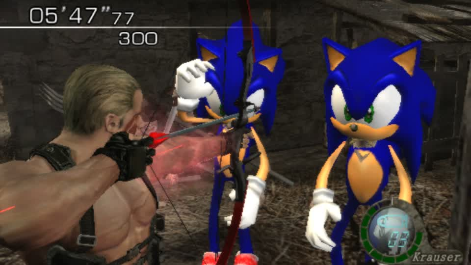
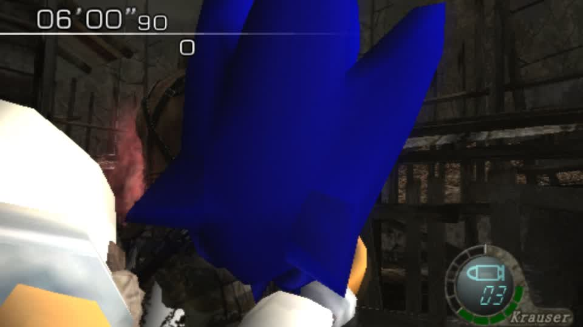

# Sonic enemies, built through the app: two Sonics in the Village





Built by `characters op=use slot=enemies` (58 of 60 enemy packs fitted, em2a and em3e refused as degenerate skeletons),
launched as `re4_sonic_enemies`, and played by the bot as Krauser. Timer running, score 300, two Sonics at full height with
their own textures - not blobs, not stock villagers.

## What it took, in order

1. **the right container**: `swap_body` needs a GLB, `write_rigged_gltf` writes a glTF -> `attachments.glb_bytes`
2. **roles for a model with no anatomical names**: `gbox.rig_roles` reads limb pairs off the rest pose
3. **the right body slot per pack**: `body_candidates` - the known ganado layout, else the skinned BIN with the biggest skeleton
4. **fit to a fixed-size hole**: collapse spare bodies -> biggest primitive -> small textures -> thin triangles (no Blender)
5. **pad every replacement to the disc size**: a shorter file written in place leaves the original's tail readable, and the game
   draws the ORIGINAL out of it (this hid the player swap for five rounds)
6. **carry the enemy packs in the mod**: `build_mod` globbed only `pl*.drs`
7. **a complete target role map**: missing roles alias across the body, then collapse onto the root
8. **NaN sanitation**: a collapsed limb's zero-length normal used to fail the packer far from its cause

## Coverage

```
58 of 60 enemy packs  (the two refused: 3-bone and 2-bone skeletons)
20 tests across rig_roles, re4gc_zombies (ladder, bodies, target roles, sanitise)
both sides of the swap work through the app: player (slot=player) and enemies (slot=enemies)
```