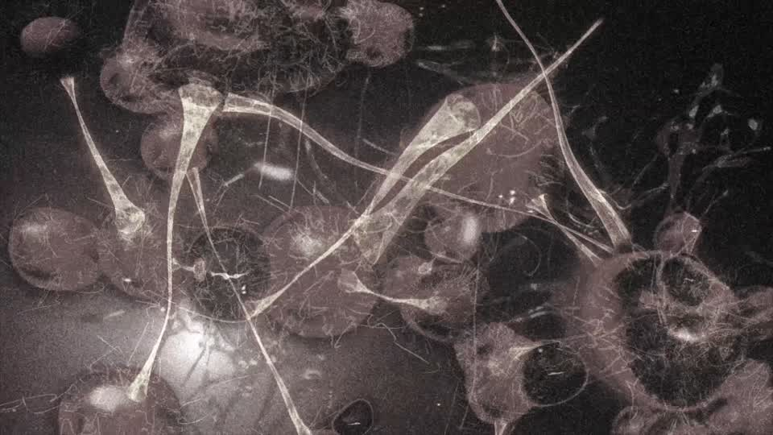

# Sonic through the parts: the engine draws it, and the shape is the problem

Installed with `switch_mods op=write` (`{"from": path}`, 82 MB arc), launched with the build, session reported
`mod: ssv1322` / `ssw*`, autoplay ran, 60 frames captured - **no freeze, no black screen**, every frame varying.

The frame with an enemy in it shows stretched surfaces crossing the whole view:

That is the same signature as the 3x mine test, and it is **my geometry being drawn**: the model's 57,377 vertices were each
moved to the nearest point of Sonic's surface, so the Majini's triangles now stretch between points of a much smaller, offset
shape. The engine renders it; the topology makes it meaningless.

## What this settles

* written vertex data is rendered - proven twice now (0.8x Majini running normally, this build drawing its own vertices)
* a topology-preserving write cannot produce a clean character: the triangles are the game's, the positions are the donor's
* a restructured part table (the only way to bring the donor's own triangles) is never drawn - four builds say so

So on this engine, "a foreign mesh as a character" needs the part-table rules, which is a reverse-engineering project of its
own, not another round of vertex writing.

## The route that can actually show Sonic

RE4 GameCube, not RE5 Switch. gBox already has the whole pipeline there - `re4gc_models.gltf_to_bin` writes a rigged glTF
into the game's format, `re4gc_enemies.retarget` fits a source rig onto GANADO_ROLES, and a **Sonic-on-Leon GLB already
exists** (`~/agent-work/re4chars/sonic_on_leon.glb`, 119 joints named `b000`, `b001`, ... i.e. already rigged to the game).
RE4 GC Mercenaries is a mode gBox knows about; its ROM access on this PC is what is unverified, not the tooling.