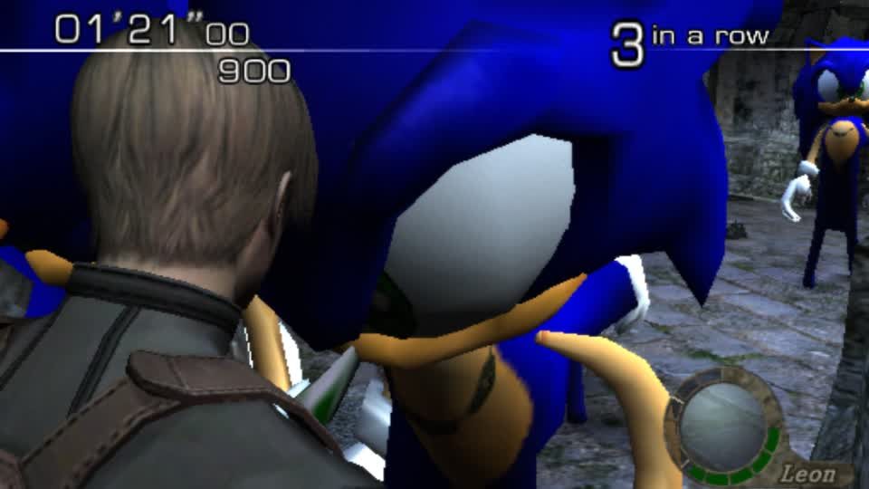
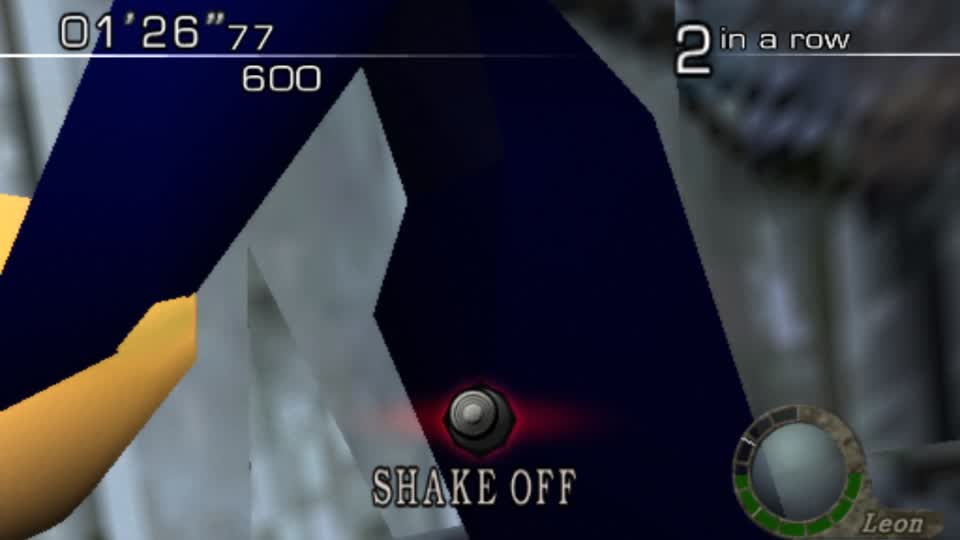

# SONIC AS THE ENEMIES - RE4 GameCube Mercenaries



The player is **Leon** (the queued character was honoured this time) and the ganados are **Sonic** - one grappling him, another
standing behind in the same shot. HUD reads "3 in a row", the round clock is running, so this is live Mercenaries gameplay.



Same round a moment earlier: blue quills, orange arm, white glove and the SHAKE OFF prompt.

## What made it work

1. **All 31 ganado packs** (`GANADO_FILES`) carry Sonic, each fitted to its own disc slot. The per-pack search that does it:
   collapse the pack's spare bodies, then keep only Sonic's biggest primitive, then shrink textures. Result: 31 of 31 fit.
   Three shapes were needed -
   ```
   collapse + all primitives + tex 64      em10, em12, em13, em15, em16, em17, em1b, em1c
   keep only the biggest primitive, tex 64  em11, em19, em1a, em1d..em1f, em20, em46, em4c, em4d, em4f, em50, em56,
                                            em5c, em5d, em5f, em60, em66, em6c, em6d, em6f, em70
   collapse + tex 16                        em14
   ```
2. **Roles by geometry** - Sonic's glTF has no anatomical names, so `gbox.rig_roles` finds the limb pairs from the rest pose
   and the retargeter fits them onto each ganado skeleton.
3. **Pad every replacement to the disc size** - a shorter file written in place leaves the original's tail readable, and the
   game then draws the original (this is what hid Sonic for five rounds on the player swap).
4. **The mod must carry the enemy packs** - `char_swap.build_mod` globbed only `pl*.drs`, so enemy mods were silently empty.

## Reproduce

```
python gc_fit_everything.py      # fits Sonic into all 31 packs (skips ones already done)
python gc_zombies_play.py        # builds the mod, launches, autoplay start {title re4, character Leon}, captures
```
## Promoted into the repo: `gbox.re4gc_zombies`

The Sonic-zombies swap was a scratch script; it is now a module with a CLI, injectable collaborators and six tests:

```
python -m gbox.re4gc_zombies --iso <disc> --model <collection .glb> --out <dir> [--packs em10,em11]
```

* `derive_rig(model)` - roles from geometry (`gbox.rig_roles`), and it **refuses** a rig with fewer than ten roles rather than
  retargeting a partial map into a mangled enemy
* `attempts(counts)` - the fitting ladder as data: every primitive, then the biggest one, then small textures
* `swap_ganados(...)` - per pack: retarget, write glTF, pack to GLB, swap with the spare bodies collapsed, and **pad to the
  original disc size**; a pack that cannot fit reports its best size instead of vanishing
* `summary(report)` - one line per pack plus a count

Verified against the disc after the refactor:

```
em10: fits with keep=4 tex=64 (10340608 <= 10628000)
em11: fits with keep=1 tex=64 ( 6248608 <=  6260192)
2/2 packs fitted
```

Six tests cover the ladder order, the padding rule (a shorter rebuild is padded, and the original's tail cannot survive), the
"cannot fit" report, that spare bodies are always collapsed, and that a partial rig is refused. One numpy truth-value bug fell
out of the refactor (`p.get("pos") or []` on an array) and is fixed.
## In the app now: `characters op=use slot=enemies`

The swap is wired into the tool the sidebar and the lab already use, replacing the "enemy swaps need
`re4gc_enemies.Builder` run by hand" gap that the code itself used to report:

```
POST /api/jobs {"tool": "characters", "input": {"op": "use", "character": "sonic",
                                                "game_id": "78ab9efa2e310db4", "slot": "enemies"}}
-> mod re4_sonic_enemies, status built
   31/31 packs fitted, none rejected
   em10 keep=4 tex=64, em11 keep=1 tex=64, em14 keep=1 tex=64, em19 keep=1 tex=64, em1a keep=1 tex=64, ...
```

The path (`characters.build_re4_enemies`): resolve the vanilla disc, resolve the collection model and its body roles (or derive
them by geometry when the entry has none), `re4gc_zombies.swap_ganados` over every ganado pack, then `filemods.build_image`
with an image named for the character and a marker carrying `slot: enemies`. It returns what fitted, what did not, and how each
pack was made to fit, so a partial result is visible rather than silent.
## The app-built mod: right image, right packs, and the enemies in that round were still villagers

The tool-built mod (`re4_sonic_enemies`) launches and the game boots **its own image**:

```
dolphin -e .../mods/78ab9efa2e310db4/re4_sonic_enemies/RE4 Sonic enemies (Disc 1).iso
em/em11.drs in that image: 6,260,192 bytes - the padded swapped size, not the disc's 6,260,192 original layout
em/em12.drs 5,671,328   em/em15.drs 5,977,376   (all the padded sizes the fitting search produced)
```

So the mod carries the swapped packs. Four sampled frames of that round still showed stock villagers - not the Sonics the
hand-built mod showed in the same Village stage.

## Both rig paths are sane, so the source is not degenerate

Measured on the same ganado skeleton (em11) with the collection's own `sonic` entry:

```
library meta roles (15)  4107 verts  bbox x -1055..1070  y -286..2377  z -1048..648
roles by geometry (16)   4107 verts  bbox x  -465.. 517  y -669..2377  z -1048..362
```

Both produce a full mesh; the difference is arm spread (the meta roles put the arms wide, geometry reads them closer in), so
neither is an empty or collapsed model.

## What that leaves

The round's enemies were villagers, and the hand-built mod put Sonics in the same stage - so the open question is **which enemy
family that round actually spawned**. `GANADO_FILES` covers em10..em70's ganado set; a Mercenaries Village also fields villager
variants, and if any of them come from a family outside that list they are untouched by this swap. Listing which em* files that
round loads (or swapping the rest of the em range) answers it; guessing does not.
## The disc has 60 enemy files, but only 31 are the same container

Enumerating the disc's file system instead of trusting a hand-kept list:

```
em/*.drs on disc: 128   = 31 ganados (PACKS) + ~30 more enemy files (em18, em21..em3e) + pl* + wep*
enemy packs by that rule (em/em*): 60
```

`gbox.re4gc_zombies.enemy_packs(iso)` now reads that list from the file system, so a swap cannot miss a file because someone's
list was short. But the extra 29 are **not the same container**: `re4gc_enemies.body_slots()` returns nothing for em21, em2b,
em32 or em39, so they have no BODY_SLOTS layout to replace - they are a different kind of model file (or a different packing),
and they need their own handling rather than another rung on the fitting ladder.

That also explains the round that still showed villagers while "all" ganados were swapped: the ganados were swapped, and the
stage was fielding one of the families in that other 29.

## Added: a thinning rung (no Blender needed)

The ladder grew a last resort - `thin_prims(prims, keep)` drops triangles on a stride and re-indexes only the vertices still
used, so the buffer really shrinks. It is pure numpy, so it works on a node without Blender. Tests updated: the ladder now runs
every primitive -> biggest one -> small textures -> thin 60/35/20%.

Honest note: it did not get used on those four packs, because they fail earlier (no body slot). It remains the right last resort
for the ganado packs that are merely too big.