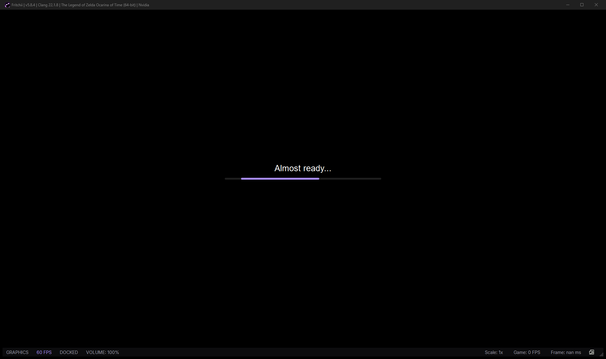

# Switch 2 in gBox

The operator's Switch 2 library (`\\10.89.1.125\QuickSwap2\Emulation\switch2`) holds NUP archives, a Mario Kart World
NSP and an extracted Donkey Kong Bananza dump. gBox lists them like any other Switch game and plays them with the
engine the title needs, using the prod.keys and builds that already live on that share.

## What is listed

`gbox.catalog.scan` recognises three shapes (all on platform `switch`, with `launch.switch_generation = 2`):

| shape | example | catalog `format` |
|---|---|---|
| NUP container | `StarFox [0400E88025B1A000].nup`, `The Legend of Zelda Ocarina of TIme […].nup` | `nup` |
| NSP container | `Mario Kart World [0400C3F00006E000].nsp` | `nsp` |
| extracted dump | `DonkeyKongBananza/base/exefs` + `base/romfs` (and `updates/<v>/`) | `switch_dump` |
| materialised NUP | the folder the NUP Extract action writes | `nup_folder` |

A `.nup`/`.nsp` takes its title id from the container itself (NUP package record, NSP ticket); an extracted dump takes it
from `exefs/main.npdm` (ACI0 + 0x10) — Donkey Kong Bananza is `040074A01BF12000`. An extracted game is one catalog row,
not one row per RomFS file; its `updates/<version>` subtree belongs to the same game. The NUP's own metadata supplies
title, publisher, display version and build id without keys.

Measured listing (2026-11-11, Windows node, no hashing): DK Bananza, its update, Mario Kart World, StarFox and Zelda
Ocarina of Time, with the tools on the share excluded by the library's `exclude_files`.

## Engines

| engine | what | host | launch |
|---|---|---|---|
| `fritchii` | [Frizti/Fritchii](https://github.com/Frizti/Fritchii/releases) v5.8.4, a Lichii fork tuned for OoT (pinned, SHA-256 verified) | Windows x64 | `lichii.exe -g <nup/nsp/exefs-main>` |
| `lichii` | [zortos293/Lichii](https://github.com/zortos293/Lichii), the operator's own install, e.g. the share's `Custom Version of Lichi for OoT.zip` | Windows x64 | `lichii.exe -g <game>` |
| `hookshot` | [NotRexed/Hookshot](https://github.com/NotRexed/Hookshot/releases) v2.1.0, a native recompilation of the OoT Switch 2 remake | Windows x64, Linux x86_64 | `HookshotBuilder.exe --play <home>/Games/Hookshot` |

`switch2_engine = "auto"` (default): Ocarina goes to Hookshot **once its build exists**, otherwise to the Eden forks
(Fritchii when installed, else Lichii). Explicit `fritchii`, `lichii` or `hookshot` wins. The adapter is selected before
the Switch 1 one, so ordinary NSPs keep running in Yuzu/Eden/Citron.

Both Eden forks take a NUP directly — no extraction step is needed to play. `switch2_materialize_nup = true` switches to
a loose `exefs/main` from `<switch2_root>/games/<title>` for a build that cannot read the container.

### Keys and firmware

The operator's keys are used, never bundled:

* `switch2_keys`, else a `prod.keys` at a Switch library root (`…/Emulation/_switch/prod.keys` or the switch2 share's
  own `prod.keys`). `title.keys` beside it is copied too.
* `install_keys` copies them into the portable engine's `user/keys/` (missing or changed only). Fritchii's first run
  creates `user/` beside `lichii.exe`.
* `switch2_firmware` optionally names a firmware ZIP; it is restored into `user/nand/system/Contents/registered` with
  the NCA count taken from the ZIP (the share has 23.0.0/23.0.1, not the pinned Switch 1 17.0.0). The measured OoT boot
  needs no registered firmware.

```powershell
# once per node: install the pinned Fritchii (72 MB) and copy the share's keys
POST /api/jobs {"tool": "switch2", "input": {"op": "install", "engine": "fritchii"}}
# or from the CLI
python -c "from gbox import config, switch2; print(switch2.provision(config.load('system/gbox.toml'), 'fritchii'))"
```

### Hookshot (native OoT)

Hookshot's builder takes the **NUP itself** (`recomplauncher.json`: `--cli --prepare --game <nup>`), builds for 10–45
minutes into `<home>/Games/Hookshot`, then `--play` starts it. The pinned release gBox downloads is the small
setup/launcher; run it once interactively with `--portable` (it installs the Builder, its tools and Python beside the
setup), point `switch2_hookshot` at the installed `HookshotBuilder.exe`, then run the build as a job once:

```
POST /api/jobs {"tool": "switch2", "input": {"op": "prepare",
                "game": "\\\\10.89.1.125\\QuickSwap2\\Emulation\\switch2\\The Legend of Zelda Ocarina of TIme [04004860224DEC000].nup"}}
```

Hookshot exposes a **local control bridge** that is the hook surface for live work: a named pipe on Windows or a Unix
socket on Linux, newline-delimited JSON, with frame-timed input, status/subscriptions, screenshots, saves and — with
`HOS_CONTROL_MEM=rw` — guest-memory reads and writes. gBox starts it with `HOS_CONTROL=\\.\pipe\gbox-hookshot-<id>` and
`HOS_CONTROL_MEM=rw` (configurable) and records the address in the launch detail, so a later `switch2_control.py` client
can read/write the running game like the RE RAM bots do. Guest memory is per-process and host-native in a
recompilation, which is what makes a live model swap tractable.

## Play

`tools._launch_game` routes a Switch 2 row to `adapters.Switch2Adapter`. For an Eden fork it copies the keys, runs
`lichii.exe -g <game>` from the engine folder, and waits for the game window; for Hookshot it runs `--play` with the
control bridge environment. A NUP is never staged to the cache (25–30 GB would delay every launch); the emulator reads
it from the share.

Measured 2026-11-11 on the Windows node with Fritchii v5.8.4 and the share's keys: the Zelda OoT NUP started from the
share with `lichii.exe -g "<nup>"`; the window title became
`Fritchii | v5.8.4 | Clang 22.1.8 | The Legend of Zelda Ocarina of Time (64-bit) | Nvidia`, RAM 2.6 GB, and the game
showed its loading screen. That is the container accepted and the game booting; first-run shader preparation takes
~15 minutes before gameplay.



The extracted Donkey Kong Bananza dump passed the same adapter path: the catalog row routed to `Switch2Adapter`, the
game argument resolved to `DonkeyKongBananza/base/exefs/main`, and Fritchii opened a game window (stopped after the
check). Mario Kart World and StarFox use the same routing with their NSP/NUP paths.

## Host limits

Fritchii and Lichii are Windows x64 only. Hookshot ships Windows x64 and Linux **x86_64**; the DGX Spark is aarch64 and
cannot run any of the three releases. A Switch 2 session therefore runs on a Windows worker (the i9-NUC) and is played
there or streamed; the Spark keeps the library, control plane, NUP extraction and model pipeline.

## Config (per node)

```toml
switch2_engine = "auto"                    # auto | fritchii | lichii | hookshot
switch2_root = "D:/gBox/runtime/switch2"   # local SSD; engines, keys, Hookshot home
switch2_fritchii = "D:/gBox/runtime/switch2/fritchii"   # optional; default <root>/fritchii
switch2_lichii = ""                        # optional; the operator's own Lichii folder/exe
switch2_hookshot = "D:/gBox/runtime/switch2/hookshot/HookshotBuilder.exe"
switch2_keys = "//10.89.1.125/QuickSwap2/Emulation/switch2/prod.keys"
switch2_firmware = ""                      # optional 23.0.x ZIP
switch2_materialize_nup = false
switch2_hookshot_mem = "rw"                # HOS_CONTROL_MEM for live memory work
```

`switch2` job ops: `status` (engines, keys, Hookshot readiness), `install` (pinned release + keys), `prepare` (Hookshot
build). Code: `system/gbox/switch2.py`, `Switch2Adapter` in `system/gbox/adapters.py`; tests
`system/tests/test_switch2.py`.


## Import from the Switch (SD card or USB folder)

The Switch itself has no USB mass-storage mode; use the microSD card in a reader, or a homebrew FTP/MTP server that
exposes the card as a folder. NUPs are ordinary files, so either route works.

```powershell
# 1. See what is on the card (no writes; partial downloads and <4 MB files are skipped)
python -m gbox.switch_import scan --from E:\

# 2. Copy .nup/.nsp/.xci into the switch2 library; extract each NUP into the Switch 2 games folder as well
python -m gbox.switch_import import --from E:\ `
  --to "\\10.89.1.125\QuickSwap2\Emulation\switch2" `
  --extract --games "D:/gBox/runtime/switch2/games"

# 3. Rescan the library (job) so the new titles appear, then Play from gBox
POST /api/jobs {"tool": "scan_library", "input": {"libraries": ["quickswap-switch2"]}}
```

The same pipeline is a job: `{"tool": "switch_import", "input": {"op": "scan|import|extract", "source": "E:\\",
"dest": "...", "extract": true, "games": "D:/gBox/runtime/switch2/games"}}`. Import streams a SHA-256 while copying,
skips a file whose size changes during the read (still downloading), skips `.part/.tmp/.crdownload`, and does not copy
a title already present with the same name and size.

* **Play**: the copied `.nup` is what Fritchii/Lichii launch; extraction is for the model pipeline and for an emulator
  that wants a loose `exefs/` + `romfs/` folder. `--extract` writes `<games>/<title> [<title id>]`.
* **Rotation**: every imported title is a normal switch2 library row, so the library's Play/queue rotation sees it.
  MercMode's own title rotation only has drivers for the RE4/5/6 Switch titles; a new title needs its driver before it
  can join that rotation (the NUP import does not create one).
* A download that has not finished is refused rather than half-copied; rerun `import` when it completes.

### Plug the card in later (watcher)

If the card is not connected yet, let a job wait for it and import the moment it appears:

```powershell
python -m gbox.switch_import watch --all-drives `
  --to "\\10.89.1.125\QuickSwap2\Emulation\switch2" `
  --extract --games "D:/gBox/runtime/switch2/games" --timeout 3600
```

```json
{"tool": "switch_import", "input": {"op": "watch", "all_drives": true,
 "dest": "\\\\10.89.1.125\\QuickSwap2\\Emulation\\switch2", "extract": true,
 "games": "D:/gBox/runtime/switch2/games", "timeout_s": 3600}}
```

The watcher polls mounted removable drives, imports the first card holding a title, then queues the library scan
(`scan_job` in the result). `op=import` does the same without waiting when the card is already mounted.

> **Copy first, extract later.** A 23 GB NUP with 186k RomFS files takes hours to unpack one file at a time, while
> Fritchii/Lichii read the NUP directly. Use `import` without `--extract` to play immediately; run `op=extract` only
> when the loose `exefs/` + `romfs/` tree is needed (models, a loose-title emulator), ideally on a local SSD.
